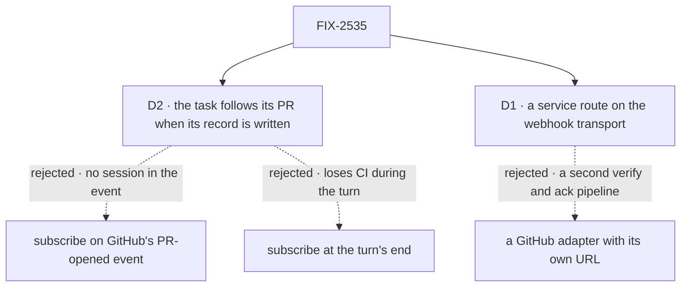

# FIX-2535 · Decisions

[Spec](SPEC.md) · **Decisions**

Two decisions are the sign-off surface; inputs, not reopened: the epic's decisions and ER-1 to
ER-8 (ER-7 as amended); FIX-2534's D1 and D2.

## The tree

Dashed edges lost, for the reason on the label.

## D2 · A coding task follows its PR from the moment its record of opening it is written

| | |
|---|---|
| **Instead of** | Subscribing on GitHub's PR-opened event · at the turn's end · by the agent calling `saveRoutine` |
| **Because** | Only the session knows it opened the PR. The event names a branch and a login, so the service would guess a session and write a user's row (ER-5, FIX-2534 D2), and a model's memory is no guarantee (D5). The record's one write path, `writePullRequests` (`core/src/types/pull-requests.ts:412`), has two writers: the tool recorder, mid-turn (`pull-request-recorder.ts:118`), and harness-manager's turn-end `branch-pull-requests` step (`session-flow.ts:868`, after `pullRequestWritesSettled`, `branch-pull-requests.ts:196`). A new row calls back into harness-manager's session flow, which owns the record, to `subscribe` as the session's user. Turn end would lose CI landing mid-turn; GitHub does not redeliver (owner second look, 2026-11-05) |
| **Locks in** | Every coding session that opens a GitHub PR hears its reviews, comments and CI from the moment it is recorded until it closes. Workforce workers have no PR record; they use `saveRoutine` with an event trigger |

**What would change my mind:** coding tasks that should not hear their PR's reviews; then opt-in.

It comes down to who knows the session: the event names a branch, never the session that opened it.

## D1 · A GitHub delivery takes a service route on the webhook transport

| | |
|---|---|
| **Instead of** | A binding whose `sessionId` names a session per PR (retired by epic Q5) · a GitHub adapter with its own URL |
| **Because** | The transport already verifies, parses, reads the delivery id and answers. A `service` entry takes those steps, then normalizes and calls `routeServiceEvent` where a binding would dispatch. `normalize` is pure, so the flow stays isomorphic |
| **Locks in** | `webhooks.<provider>.service`, public. `on` is required on `WebhookSubscriptionConfig` today (`core/src/types/webhooks.ts:90`), so the type takes `on` or `service`, never both. A later provider's flow declares the same |

It comes down to one pipeline: an own adapter keeps a second verify-and-ack copy in step.

## Decided, not asked

- **Where.** GitHub's flow in `workforce`; `service`, `addressed` and the record callback in
  `core`; the route in `engine`.
- **When GitHub gets its answer.** As a binding's: after durable recording (`routes.ts` ~233),
  with `routeServiceEvent` awaiting each owner run's `accepted`.
- **Fan-out is capped and safe to restart (owner second look, 2026-11-05).** Each run sends
  under `<object>@<version>:<session>` and the cursor drops a seen version, so a delivery cut
  partway by a timeout lands only the rest when redelivered or polled. Owner runs per delivery
  are capped; past the cap, refused with a reason.
- **Object and version, the one contract FIX-2536 consumes (owner second look, 2026-11-05).**
  The object is what GitHub keeps under its own id (a review, a comment, a check run),
  versioned by its own last-changed time. A PR or issue, whose `updated_at` moves with any
  activity, is never the object: its events are occurrences,
  `pull_request:<thread>:<action>:<subject>` (the pinned, lower-cased thread key below, then the assignee or reviewer named), versioned by the
  occurrence's time. Never the delivery's. Normalize reads the API object a payload embeds, so
  a poll gets the same pair. A check on two PRs is one event per PR.
- **`sessionId` (Q5)** leaves GitHub's docs; the binding field stays.
- **Thread keys (pinned).** `github:<owner>/<repo>`, then `#<n>`, lower-cased as `pullRequestKey` does.
- **Kinds (pinned).** `review`, `comment`, `check` (a completed run), `pull_request` and `issue`
  (opened, closed, reopened, assigned, review requested); anything else normalizes to nothing.
  The PR-open subscription hears the first three.
- **Asking the agent (owner, 2026-11-05).** An app-named handle in `agentHandles`, defaulting
  to the App's bot login when the provider is a GitHub App. A person's mention is never an ask.
- **`addressed` (EM call, 2026-11-05).** An optional `true` on the `.strict()` event when it
  mentions, assigns or requests review from an agent handle. New, rather than `self` with the
  `own` screen (`screens.ts:72`) or `addressedBy` (`log-row.ts:54`), because it is the
  provider's judgment from the raw payload, not a config screen. FIX-2538 reads it: an
  unmatched forward with `addressed: true` is an ask, delivered in every mode; any other is
  inferred. Never model input (BP-031).
- **Sender (Q1).** `OWNER`/`MEMBER` → `member`, `COLLABORATOR` → `collaborator`, a `Bot` →
  `bot`, others → `outsider`, none → `unknown`. Ids are lower-cased logins, a bot's without
  `[bot]`.
- **`closes`** on a PR or issue `closed`; a reopen does not resubscribe. **`audience`** follows
  the repository. **The provider (ER-4)** reads with a per-user token the app supplies.

## Considered and dropped

| Alternative | Why not |
|---|---|
| Version from the delivery | A redelivery and a poll would read as new |
| Answer GitHub at once, then route | GitHub does not redeliver; a crash loses the event |

## Notes from review

The owner's second look ([comment](https://github.com/fixpoint-labs/flow-state-dev/pull/4810#issuecomment-6668663442)), for the implementer:

- The `@login` parse is lossy (quoted replies, fenced code, emails): strip quotes and code
  before computing `addressed`, and test a quoted mention.
- `service` could carry only `normalize`, the entry resolved by `githubServiceFlow`, so the core
  type says nothing about subscriptions.
- Pin one `normalize` signature; FIX-2536's poller calls the same function with API objects.

**Open: none.**
