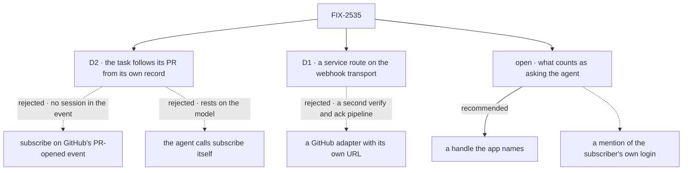

# FIX-2535 · Decisions

[Spec](SPEC.md) · **Decisions**

Two decisions and one open fork are the sign-off surface. Inputs, not reopened: the epic's D1,
D4, D5, D9, D11, Q1, Q5 and ER-1 to ER-8 (ER-7 as amended by #4675); FIX-2534's D1 and D2.

## The tree

Solid edges are proposed; dashed edges lost or are the other option, for the reason on the label.

## D2 · A coding task follows its PR from its own record of opening it

| | |
|---|---|
| **Instead of** | Subscribing on GitHub's `pull_request` `opened` event · leaving it to the agent to call `subscribe` |
| **Because** | Only the session knows it opened the PR: core's recorder writes it to the session's PR record (`writePullRequests`). The event names a branch and a login, so the service would guess a session and write a user's row, which ER-5 and FIX-2534 D2 refuse. A model's memory is no guarantee (epic D5). So at the end of a worker's request, each GitHub PR it recorded is subscribed through the one `subscribe`, as its user |
| **Locks in** | Every worker session that opens a GitHub PR hears its reviews, comments and CI until it closes. A PR opened outside the record is followed only by the tool |

**What would change my mind:** a coding task that should not hear its PR's reviews; then opt-in.

It comes down to who knows the session: the event names a branch, never the session that opened it.

## D1 · A GitHub delivery takes a service route on the webhook transport

| | |
|---|---|
| **Instead of** | A binding whose `sessionId` names a session per PR (retired by epic Q5) · a GitHub adapter with its own URL |
| **Because** | The transport already verifies, parses, reads the delivery id and answers. A provider entry that declares `service: { entry, normalize }` takes those steps, then normalizes and calls `routeServiceEvent` as the flow's resolved principal where a binding would dispatch. `normalize` is pure, so the flow stays isomorphic. No session is made from the event |
| **Locks in** | `webhooks.<provider>.service`, public on `WebhookSubscriptionConfig`. A provider entry is bindings or a service route, never both. A later provider's flow declares the same |

It comes down to one pipeline: an own adapter keeps a second verify-and-ack copy in step.

## Open

### What counts as asking the app's agent?

- **In plain terms:** epic D11 says an ask (it addresses the agent and passes the sender rule)
  runs in every mode, even with inferred work `off`. GitHub's event now says whom it addresses:
  the people @-mentioned, assigned or asked to review. Something must say which of those is "the
  agent".
- **The trade-off:** a handle the app names for its agent (`@acme-agent`) never mistakes a
  person's mention for an ask, but two users' coordinators on one repository both act on one
  mention. The subscriber's own login (`self`, already on every row for the `own` screen) needs
  nothing new and reaches one coordinator, but a teammate asking the person a question starts the
  agent's work, even with inferred work off.
- **My recommendation: the app's handle.** It keeps `off` meaning off for a person's mentions,
  and a person's GitHub notifications stay theirs.
- **What would change my mind:** teams that run several coordinators on one repository; then
  `self`, one per user, is the safer reading.
- **If wrong:** a team that mentions its agent gets the work twice, once per coordinator.

It comes down to a mention meant for the person: under `self`, it starts the agent's work.

## Decided, not asked

- **Where.** GitHub's flow in `workforce`; `service` and `addressed` in `core`; the route in `engine`.
- **When GitHub gets its answer.** After `routeServiceEvent` returns: routing finished and each
  owner run durably accepted or refused. 5xx when routing failed or a run failed to start.
  GitHub does not redeliver on its own, so an early 202 would lose the event; a redelivery lands
  nothing twice. A busy repository can show a timeout and still land once.
- **`sessionId`'s retirement (Q5).** The docs stop routing GitHub by it. The binding field
  stays, unrefused by provider name, since keys are opaque. The epic's "`webhook-transport.md`
  drops `sessionId`" is read under Q5: out of the routing story, still a binding field.
- **Thread keys (pinned).** `github:<owner>/<repo>`, then `#<n>` for a PR or issue, widest first,
  lower-cased as `pullRequestKey` does.
- **Kinds (pinned).** `review`, `comment` (PR, issue or code), `check` (a completed check run),
  `pull_request` and `issue` (opened, closed, reopened, assigned, review requested). Anything
  else normalizes to nothing. The PR-open subscription hears `review`, `comment`, `check`.
- **Object and version (ER-8; FIX-2536's seam).** The object is what changed (`comment:<id>`); the
  version is its own last-changed time (`updated_at`, `submitted_at`, `completed_at`), never the
  delivery's. Normalize reads the API object a payload embeds, so a poll gets the same pair. A
  check on two PRs is one event per PR.
- **`addressed` (EM call, 2026-11-05; moved here from FIX-2538).** One optional list on FIX-2534's
  event (ER-6 stays one event): the `@login` mentions in the event's own text, the object's
  assignees and requested reviewers, in `sender.id`'s form. An event with none omits it.
- **An ask, both ways of the FIX-2538 seam.** An event is an ask when `addressed` holds one of the
  flow's agent handles (per the [open fork](#open)) and the `sender` screen passed; the mark is
  computed at delivery, never from model input (BP-031). An ask reaches a coordinator only
  through an ordinary subscription and is delivered as an ordinary message, so it runs in every
  mode. FIX-2538's forwards (events no ordinary subscription passed) are all inferred work and
  never read `addressed`.
- **Sender (Q1).** `OWNER`/`MEMBER` → `member`, `COLLABORATOR` → `collaborator`, a `Bot` →
  `bot`, others → `outsider`, none → `unknown`. Ids are logins, lower-cased, a bot's without
  `[bot]`. A check's sender is its app, so CI passes when the app lists it; the guide lists
  `github-actions`.
- **`closes`** on a PR or issue `closed`, merged or not; a reopen does not resubscribe.
  **`audience`** is `private` when the repository is.
- **The provider (ER-4).** `canRead` and `self` use a per-user token the app supplies; the
  framework stores none.
- **PR-open subscribe (ER-5).** It only calls `subscribe`, idempotent per session and thread.
  Where it runs is the implementer's: a worker request's end, after `pullRequestWritesSettled`,
  over the rows that request recorded.
- **The routing principal** is the flow's `defaultUserId` (`service:github`), resolved as a binding's.

## Considered and dropped

| Alternative | Why not |
|---|---|
| Version from the delivery | A redelivery and a poll would read as new |
| Answer GitHub at once, then route | GitHub does not redeliver; a crash loses the event |

## Settled

None. No POC or checker: the premises are read in code or GitHub's documented payloads.

## Analysis

2026-11-05 · watermark 2026-11-04 (#4687) · **Right approach, nothing folded.** Run by the
authoring worker, with no sub-agent tool. Reuse: every Adds row composes FIX-2534 or the
transport. Prior art: GitHub Apps route by repository, then PR number. Other shapes: [D1](#d1),
[D2](#d2). Necessity: the first provider. Concerns: fork PRs' check runs; answer time on busy
repositories.

## How it got here

- **Draft:** GitHub as FIX-2534's first provider: a service route on the webhook transport,
  normalize from API objects so push and poll agree, and a task that subscribes from its own PR
  record. The answer's timing went to the engineering calls, to keep the ask at three.
- **EM call (2026-11-05):** the "ask the agent" leg moved here from FIX-2538: the `addressed`
  field, filling it, and the open fork on what counts as an ask.
