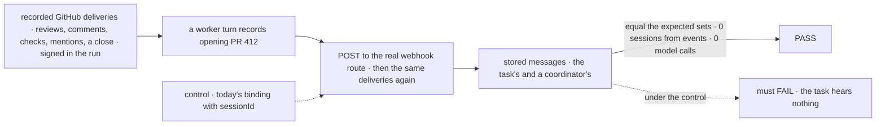
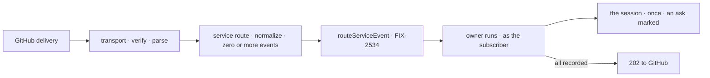

# FIX-2535 · GitHub flow, retire `sessionId`

**Spec** · [Decisions](DECISIONS.md)

## Five people, before and after

| Someone who… | Today | After |
|---|---|---|
| **has a coding task that opened a PR** | Hears a review only if a binding's `sessionId` names its session | Follows the PR from the turn that opened it; each review, comment and CI result arrives once, from `service:github` |
| **mentions the app's agent on an issue** | Nothing reaches the agent | A coordinator that follows the repository gets it as a message, whatever its work mode ([open](DECISIONS.md#open)) |
| **is an outsider commenting on a PR** | Lands wherever the binding routes | Refused unless the subscription opted in ([epic Q1](../../epics/FIX-2471/DECISIONS.md#q1)) |
| **merges or closes the PR** | n/a | Ends the subscriptions to it (ER-7 as amended); the repository's stay |
| **follows the GitHub webhook guide** | Derives `sessionId` from the PR number | Mounts the GitHub service flow; no `sessionId` on GitHub's path |

The epic's ([FIX-2471](../../epics/FIX-2471/SPEC.md)) first provider, on
[FIX-2534](../FIX-2534/SPEC.md)'s event, subscriptions and delivery, which it does not re-decide.

## The goal, and how we'll know it's met

**A coding task that opens a GitHub PR hears each review, comment and CI result on it once,
through a signed webhook, with no `sessionId` on the path; an ask to the app's agent reaches a
coordinator that follows the repository; and each object is named so a poll (FIX-2536) names it
the same way.**

| Is it the right goal? | |
|---|---|
| **The real need** | The epic's first row, *"the task follows its PR; a screened review lands in its session"*; its *Not done if*, *"GitHub routes by `sessionId`"*; D11's *explicit work runs in every mode* |
| **Smaller, and rejected** | "Normalize GitHub payloads": the task still subscribes by hand, and no real delivery reaches it |
| **Bigger, and not this issue's** | Polling, screens, unmatched kinds, the closure (FIX-2536 to FIX-2539); Stripe and Slack (Q4, Q5) |
| **Not done if** | The task must call `subscribe` itself · a review lands in a session made from the event · a redelivery lands twice · a closed PR still delivers · an outsider passes by default · a person's mention counts as an ask · a webhook object and its API form get different versions |



Under `sessionId` the reviews land in a session nobody follows, so the check fails.

| How we verify | |
|---|---|
| **Goal check** | `goals/webhook-routing/a-pr-task-hears-its-pr-from-github/` · no model · verdict on the implementation PR |
| **Signal** | (a) The task's rows from `service:github` equal the expected set. (b) `subscribe` wrote its subscription in the turn that recorded the PR. (c) 0 sessions made from an event. (d) A redelivery adds nothing; a bad signature answers 401. (e) Nothing after the close. (f) A payload object and its API form get one id and version. (g) A coordinator on the repository, inferred work `off`, gets the ask to the agent's handle as a message and no person's mention as one. (h) 0 model calls |
| **Input** | Real GitHub payloads (`@octokit/webhooks-examples`, or a test repository's Recent Deliveries) rewritten to one repository: members, a listed bot, an outsider, the subscriber's own comment, mentions of the agent and of a person; the API forms for (f) beside them |
| **Anti-game** | Assert on stored rows and session records, not `routeServiceEvent` calls; deliveries go through the real HTTP route and signature check |
| **Control that must fail** | `GOAL_CONTROL=session-id` routes GitHub through today's binding with `sessionId: pr-<n>`: (a) FAILS. `version-from-delivery`: (d) and (f) FAIL. `ask-any-mention`: (g) FAILS |

## What changes


Before, an event made its own session; after, it reaches the session that asked for it.

```diff
 // the app's GitHub flow (FIX-2534's service flow, built for GitHub)
-webhooks: { github: { on: { pull_request_review: defineWebhookBinding({ block, input,
-  sessionId: (e) => `${e.payload.repository.full_name}#${e.payload.number}` }) } } }
+const github = githubSubscriptionProvider({ token: (ctx) => userGitHubToken(ctx) });
+githubServiceFlow({ provider: github, installation,
+  trustedBots: ["github-actions", "codex"], agentHandles: ["acme-agent"] })
+//   declares  webhooks: { github: { service: { entry, normalize } } }

 // the app's workers: the same provider, so a session that opens a PR follows it
+installation with subscriptions: { providers: [github] }
```

The names are illustrations except `service`, which [D1](DECISIONS.md#d1) locks, and
`addressed`, the event's new optional field.

**Docs:** rewrite `apps/docs/guides/webhooks-github.md` (mount the flow; a task follows its PR;
asking the agent) · update `apps/docs/docs/server/webhooks.md` (the service route; no GitHub
`sessionId` example) and `docs/architecture/webhook-transport.md` (the route in the pipeline;
`sessionId` only for bindings) · the workforce, core and engine READMEs ·
`mechanisms.yaml`'s `webhook` and `subscriptions` rows. The Stripe and Slack guides and
`keeping-a-flow-running.md` stay (Q5).

## How a review reaches the task



**Stays:** the signature check; bindings, with `sessionId`, for Stripe, Slack and custom
providers; FIX-2534's screens and dedupe; the PR recorder. FIX-2538's forwards stay inferred.

## What's already here, and the debt

| Already here | What this does with it |
|---|---|
| **The job, "bring an outside event to a session".** `mechanisms.yaml`: `webhook`, `subscriptions` | **Not a new way:** GitHub moves to the second |
| FIX-2534's service flow, `routeServiceEvent`, `subscribe` ([D2](../FIX-2534/DECISIONS.md#d2)) | **Builds on**, unchanged |
| The webhook transport ([`webhook-transport.md`](../../../docs/architecture/webhook-transport.md), FIX-439) | **Amends** in part: a provider entry can be a service route |
| FIX-2534's event (`core/src/types/subscription-event.ts`, ER-6) | **Extends** by one optional field, `addressed` |
| The PR record, `writePullRequests` (`core/src/types/pull-requests.ts`) | **Builds on:** where a session's opened PRs land |
| `githubWebhookVerifier`, `eventType` from `X-GitHub-Event` | **Reuses** |

| Adds | Existing piece considered | How composed |
|---|---|---|
| The service route | A binding's `block` dispatch | **Extends** the transport: after verify and parse, normalize and call `routeServiceEvent` ([D1](DECISIONS.md#d1)) |
| GitHub normalize | FIX-2534's event | **Maps into** it, from API objects, so push and poll share it |
| `addressed` and the ask mark | `self` on the row; the `sender` screen | **Composes** them at delivery, per the [open fork](DECISIONS.md#open) |
| The GitHub provider | FIX-2534's `SubscriptionProvider` | **Implements** it on the user's token |
| PR-open subscribe | `subscribe`; the PR record | **Composes** them ([D2](DECISIONS.md#d2)) |

| The debt | |
|---|---|
| **Removes** | GitHub's `sessionId` routing, from the guide and the reference page |
| **Adds** | `service` beside `on` on `WebhookSubscriptionConfig`: permanent by design (Q5, two ways to route, split by provider). One optional event field |
| **Leaves** | `sessionId` for Stripe, Slack and custom bindings (Q5). A fork PR's check run names no PR, so only repository subscribers hear it; not filed |

**Net: up, by one public form and one field.** GitHub's routing leaves the docs; no code used it.

## Sign off

**[The goal](#the-goal-and-how-well-know-its-met):** the task hears its PR from a real delivery,
named so a poll agrees. If wrong: FIX-2536 builds a second naming, and leg c double-delivers.

**[The debt](#whats-already-here-and-the-debt): up, one public form and one field.** If wrong:
`service` becomes a second binding kind that Stripe code starts copying.

**Open · [what counts as asking the app's agent](DECISIONS.md#open).** Recommended: a handle the
app names. If wrong: a team that mentions its agent gets the work twice.

1. **[D2](DECISIONS.md#d2) · A coding task follows its PR from its own record of opening it.**
   The one to weigh. If wrong: tasks follow PRs nobody wants, or miss ones opened another way.
2. **[D1](DECISIONS.md#d1) · A GitHub delivery takes a service route on the webhook transport.**
   If wrong: a core type grows a form only one provider uses.

Feature · workforce, core, engine, docs · medium: one transport form, one event field, one provider, one subscribe hook · epic FIX-2471
