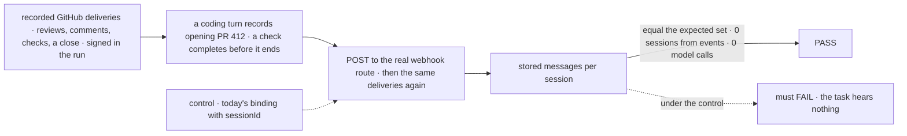
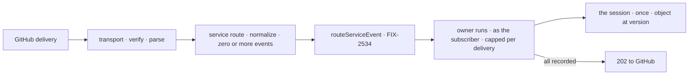

# FIX-2535 · GitHub flow, retire `sessionId`

**Spec** · [Decisions](DECISIONS.md)

## Three people, before and after

| Someone who… | Today | After |
|---|---|---|
| **has a coding task that opened a PR** | Hears a review only if a binding's `sessionId` names its session | Follows the PR from the moment its record of opening it is written; each review, comment and CI result arrives once, from `service:github` |
| **is an outsider commenting on a PR** | Lands wherever the binding routes | Refused unless the subscription opted in ([epic Q1](../../epics/FIX-2471/DECISIONS.md#q1)) |
| **merges or closes the PR** | n/a | Ends the subscriptions to it (ER-7 as amended); the repository's stay |

The epic's ([FIX-2471](../../epics/FIX-2471/SPEC.md)) first provider, on
[FIX-2534](../FIX-2534/SPEC.md)'s event, subscriptions and delivery, unchanged.
It also marks an event that asks the app's agent, for FIX-2538.

## The goal, and how we'll know it's met

**A coding task that opens a GitHub PR hears each review, comment and CI result on it once,
through a signed webhook, with no `sessionId` on the path, and each event is named so a poll
(FIX-2536) names it the same way.**

| Is it the right goal? | |
|---|---|
| **The real need** | The epic's first row, *"the task follows its PR; a screened review lands in its session"*; its *Not done if*, *"GitHub routes by `sessionId`"* |
| **Smaller, and rejected** | "Normalize GitHub payloads": the task still subscribes by hand |
| **Bigger, and not this issue's** | Polling, screens, unmatched forwards, the closure (FIX-2536 to FIX-2539); Stripe and Slack (Q4, Q5) |
| **Not done if** | The task must call `subscribe` itself · CI during the opening turn is lost · a review lands in a session made from the event · a redelivery, or a restarted fan-out, lands twice · a closed PR still delivers · an outsider passes by default · a webhook event and its API form differ in id or version |



Under `sessionId` the reviews land in a session nobody follows, so the check fails.

| How we verify | |
|---|---|
| **Goal check** | `goals/webhook-routing/a-pr-task-hears-its-pr-from-github/` · no model · verdict on the implementation PR |
| **Signal** | (a) The task's rows from `service:github` equal the expected set. (b) A check completed before the opening turn ends is heard. (c) 0 sessions made from an event. (d) A redelivery adds nothing; a bad signature answers 401. (e) A fan-out stopped partway, then redelivered, leaves each session one message. (f) Nothing after the close. (g) A PR's review request, by webhook and by a later API read, gets one id and version; two in one second both land. (h) 0 model calls |
| **Input** | Real GitHub payloads (`@octokit/webhooks-examples`) rewritten to one repository: members, a listed bot, an outsider, the subscriber's own comment; the API forms for (g) beside them |
| **Anti-game** | Assert on stored rows and session records, not `routeServiceEvent` calls; deliveries go through the real HTTP route and signature check |
| **Control that must fail** | `GOAL_CONTROL=session-id` routes GitHub through today's binding with `sessionId: pr-<n>`: (a) FAILS. `version-from-delivery`: (d) and (g) FAIL. `subscribe-at-turn-end`: (b) FAILS |

## What changes


Before, an event made its own session; after, it reaches the session that asked for it.

```diff
 // the app's GitHub flow (FIX-2534's service flow, built for GitHub)
-webhooks: { github: { on: { pull_request_review: defineWebhookBinding({ block, input,
-  sessionId: (e) => `${e.payload.repository.full_name}#${e.payload.number}` }) } } }
+const github = githubSubscriptionProvider({ token: (ctx) => userGitHubToken(ctx) });
+githubServiceFlow({ provider: github, installation,
+  trustedBots: ["github-actions", "codex"], agentHandles: ["acme-agent"] })
+//   declares  webhooks: { github: { service: { normalize } } }

 // the coding sessions: the same provider, so a session follows the PR it records
+harnessManager({ ..., onPullRequestRecorded: followPullRequest({ providers: [github] }) })
```

The names are illustrations except `service`, which [D1](DECISIONS.md#d1) locks, and
`addressed`, the event's new optional field.

## How a review reaches the task



## Reuse verdicts

- **The service route extends the webhook transport:** normalize and route where a binding
  would dispatch ([D1](DECISIONS.md#d1)).
- **Answering after recording reuses the route's durable ack.**
- **PR-open subscribe extends `writePullRequests`**, the PR record's one write path
  ([D2](DECISIONS.md#d2)).
- **GitHub's normalize and provider are new:** the first implementations of FIX-2534's seam.

## What's already here, and the debt

| Already here | What this does with it |
|---|---|
| **The job, "bring an outside event to a session":** `webhook`, `subscriptions` | **Not a new way:** GitHub moves to the second |
| FIX-2534's service flow, `routeServiceEvent`, `subscribe`, screens ([D2](../FIX-2534/DECISIONS.md#d2)) | **Builds on**, unchanged |
| The webhook transport (FIX-439) and `githubWebhookVerifier` | **Extends:** a provider entry can be a service route. **Reuses** the verifier |
| FIX-2534's event (`subscription-event.ts`, ER-6) | **Extends** by one optional field, `addressed` |
| The PR record and its writer, `writePullRequests` (`core/src/types/pull-requests.ts`) | **Extends** with a new-row callback |
| Bindings with `sessionId`, for Stripe, Slack and custom providers | **Leaves alone** (Q5) |

| The debt | |
|---|---|
| **Removes** | GitHub's `sessionId` routing, from `apps/docs/guides/webhooks-github.md` (rewritten: mount the flow, a task follows its PR) and `apps/docs/docs/server/webhooks.md` |
| **Adds** | `service` beside `on` on `WebhookSubscriptionConfig`: `on` is required today, so the type takes `on` or `service`. Permanent by design (Q5, two ways to route, split by provider). One optional event field. Docs updated with it: `docs/architecture/webhook-transport.md`, the workforce, core, engine and harness-manager READMEs, `mechanisms.yaml`'s `webhook` and `subscriptions` rows |
| **Leaves** | `sessionId` for Stripe, Slack and custom bindings, and their guides (Q5). A fork PR's check run names no PR, so only repository subscribers hear it; not filed |

**Net: up, by one public form and one field.** No code used GitHub's `sessionId` routing.

## Sign off

**[The goal](#the-goal-and-how-well-know-its-met):** the task hears its PR from a real delivery,
named so a poll agrees. If wrong: FIX-2536 builds a second naming, and leg c double-delivers.

**[The debt](#whats-already-here-and-the-debt): up, one public form and one field.** If wrong:
`service` becomes a second binding kind that Stripe code starts copying.

1. **[D2](DECISIONS.md#d2) · A coding task follows its PR from the moment its record of opening
   it is written.** The one to weigh. If wrong: tasks follow PRs nobody wants, or miss ones
   opened another way.
2. **[D1](DECISIONS.md#d1) · A GitHub delivery takes a service route on the webhook transport.**
   If wrong: a core type grows a form only one provider uses.

**Open: none.** The owner decided what counts as asking the agent: a handle the app names.

Feature · workforce, core, engine, harness-manager, docs · medium: one transport form, one event field, one provider, one record callback · epic FIX-2471
