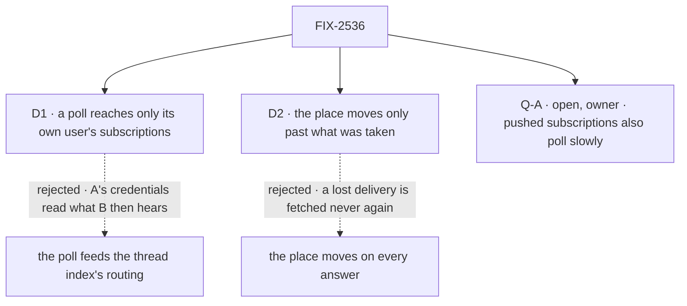

# FIX-2536 · Decisions

[Spec](SPEC.md) · **Decisions**

Two decisions and one owner fork are the sign-off surface. Epic D4, D5, D10 and ER-4, ER-5,
ER-8, and FIX-2534's D2 and cursor, are inputs and are not reopened here.

## The tree

Solid edges are what you sign; dashed edges lost, for the reason on the label.

## D1 · A poll reaches only its own user's subscriptions, read from that user's own rows

| | |
|---|---|
| **Instead of** | The poll's events going through the service's routing and the thread index, which nominate every user's subscription on the thread |
| **Because** | A poll runs as the row's user, on that user's credentials (epic D5, D10). What it reads is that user's view of the thread; sending it to B makes A's access B's (ER-4). It is also the only way a fire can reach delivery: the schedule fire is a request, and a request starts no other user's run (FIX-2534 D2). So the fire reads the user's own row, builds the screens' entry from it, and calls the same screens and `deliverToRow` |
| **Locks in** | Each user who follows a thread polls it on their own credentials. Two users on one PR make two polls, and each pays its own rate limit. A second door into delivery beside the thread index, which must keep the index's rules (provider, thread, kinds) |

It comes down to a private repo: one user's token is not another user's access.

**What would change my mind:** an app-level credential that every subscriber holds the same
access through, such as a GitHub App installation scoped per user. Then one poll per thread
could serve everyone, and the routing path is cheaper.

## D2 · A poll's place moves only once every event it fetched was taken, seen, held or finally refused

| | |
|---|---|
| **Instead of** | Moving the place (the provider's ETag and `since` mark) on every answer, the usual way to poll |
| **Because** | FIX-2534 leaves an event unseen when the host lost its dispatch, so its next copy sends it (`service-flow.ts` ~30–33). On push, that copy is a redelivery. On a laptop, the only next copy is the next poll, and a moved place answers it `304`. So a send that came back `unsent`, or met another delivery's in-flight mark, keeps the place: the next poll asks without it, and the cursor drops what was already seen |
| **Locks in** | The place is a promise: everything before it reached its sessions. A loss costs one unconditional request and a re-read the cursor dedupes, never a missed event |

It comes down to a lost delivery: with the place moved, the next poll answers `304` and the event is gone.

**What would change my mind:** delivery gaining its own resend for what it gave back. Then the
place could move freely, and this rule is extra.

<b>Decided, not asked</b> — engineering calls

## Decided, not asked

- **Where.** The fire and the place in `workforce/src/subscriptions/`; the tick beside Vercel's
  claim-and-dispatch, its home (`scheduled` or a shared helper) the implementer's call; GitHub's
  poll beside FIX-2535's GitHub flow.
- **The row (epic D10, as signed).** One per polled subscription, in a `defineScheduleCollection`
  at `workforce/subscription-polls/*`, keyed by the subscription id: `kind`, `input:
  { subscription }`, `onOverlap: "skip"`. The subscription row's schema is fixed by FIX-2534 and
  the schedule row's by `scheduled`, so the schedule fields live on a sibling keyed by the same
  id. **Pinned:** persisted.
- **ER-5's convergence point.** Only `subscribe` writes the row and only `unsubscribe` turns it
  off. Every ending goes through `unsubscribe` already: the tool, a task's failure or cancel
  (`endTaskSubscriptions`), a thread's closing. A poll that sees the thread close emits
  `closes: true` and ends it the same way.
- **Seen versions skip the screens: a seam with FIX-2537 (#4809).** Before any screen
  runs, the fire drops every object and version the subscription's cursor has already seen (or
  a live in-flight mark holds). Routing remembers nothing it judged, so without this a push and
  then a poll of one version would be judged twice, and FIX-2537's Jev would make two calls for
  one event (epic ER-1, D7). The check reads the cursor and writes nothing; `deliverToRow`'s own
  cursor check still decides the send. Tested: a unit test (a pushed version, then polled: zero
  screen calls) and the goal's signal (g) with the `no-seen-skip` control.
- **The floor (epic D10).** The app sets the cadence: 5, 10, 15, 20, 30 or 60 minutes. Under 5,
  or off that list, the service flow's definition throws. `subscribe` builds the cron itself
  and checks it again before it writes; no tool input carries a cadence or a cron.
- **Staggered.** The row's minute offset comes from the subscription id, so every row of one
  cadence does not fire in the same minute.
- **The due index.** A poll needs one (SQLite, Postgres, BullMQ's). Without one, the definition
  throws: a laptop on the filesystem store is told to use SQLite, the `fsdev dev` default.
- **The tick.** A long-lived host (`fsdev dev`, `@flow-state-dev/node`) that serves a flow with a
  schedule index claims due rows once a minute and dispatches them, as Vercel's tick does. At
  most once, as the index promises; a dropped fire is the next period's.
- **Kinds.** A poll hears the kinds push hears on that thread. A kind the provider can't list is
  named in the README, not silently missing. GitHub: check runs on their terminal state only;
  a comment edited several times between polls arrives once, at its latest version.
- **Versions agree.** The poll uses FIX-2535's normalizer and version rule unchanged, so one
  object at one state has one version by push and by poll (epic D4, ER-8). GitHub's poll is
  unit-tested on a recorded push payload and the recorded REST read of the same comment.
- **Conditional requests.** The place holds one ETag per read the provider makes. GitHub
  answers a conditional request `304` and does not count it against the primary rate limit.
- **Per-repo batching: not built.** D10's note asks for it; each subscription is its own row,
  and rows fire on their own minutes. A quiet thread costs a few `304`s per period. Batch when a
  measured user meets GitHub's secondary limit.
- **Tenants.** The resolver's principal carries no tenant, so a subscription made under one is
  not polled in v1. `subscribe` says so in its result; with push off, it refuses.
- **Turning polling on later.** A subscription made before the app polled has no row until it
  subscribes again. The README says so.
- **A failed poll** (a revoked token, a `404`) keeps the place and records the error on it; the
  subscription stays until one of ER-7's endings.

## Considered and dropped

| Alternative | Why not |
|---|---|
| One schedule row per user and repo, for batching | Re-decides epic D10's "each subscription is a row" for a saving of a few free `304`s |
| A cadence on the `subscribe` tool | A model would set it; the floor then rests on a model's choice |
| The subscriptions collection as the schedule collection | Its schema is FIX-2534's; the schedule schema would strip its fields |
| A tick in every host, Vercel included | Vercel already has one; BullMQ fires natively |

## Open

### Q-A · Should subscriptions that push also poll, slowly, to catch what push lost?

- **In plain terms:** FIX-2534 found that an event lost during delivery is never resent unless
  the provider sends it again. With this issue, a poll fetches it again (D2). Today that helps
  only apps that poll. The question is whether an app with a webhook also polls, about once an
  hour, so a lost review still reaches its task.
- **The trade-off:** yes means every subscription also has an hourly row, a few conditional
  requests per hour on its user's token (mostly free `304`s), and a pushed app must run a tick
  (Vercel's, or a long-lived host). A lost event arrives up to an hour late, not never. No
  means pushed apps keep the gap FIX-2534 recorded.
- **My recommendation: yes, as a small follow-up issue in this epic**, on by default at 60
  minutes for apps that already have a schedule index, off for apps without one. It is the same
  row with a slower cron, so it adds about a day, and it closes the epic's *"misses one on its
  PR"* for pushed apps too. This spec is complete without it.
- **What would change my mind:** evidence that GitHub's own redelivery covers the losses we see
  (a webhook that fails is redelivered by hand only), or a rate limit a measured user meets.
- **If wrong:** with no catch-up, a coding task misses a review and its PR stalls with no sign;
  with an unneeded one, each user spends a few requests an hour on threads that are quiet.

It comes down to a lost review: push alone never sends it again.

## Settled

None. The facts D1 and D2 rest on were read in the code: the resolver's principal
(`createResourceCollectionScheduleResolver.ts` ~172–176), `routeServiceEvent` taking the host
(`engine/src/durability/owner-runs.ts` ~146), FIX-2534's unsent path (`service-flow.ts`
~320–345), and no tick in `cli/src` or `node/src`. No counted factual base: no checker.

## Analysis

2026-11-05 · watermark 2026-11-04 (FIX-2534's merge, #4687) · **Right approach, one fork
raised.** Run by the authoring worker, which has no sub-agent tool; say so at the gate.

1. **Reuse:** every Adds row composes. The fire reuses the screens and `deliverToRow`; the row
   reuses `defineScheduleCollection`; the tick reuses Vercel's claim-and-dispatch. Verdict per
   item in [SPEC](SPEC.md#whats-already-here-and-the-debt).
2. **Prior art:** GitHub's own guidance, poll with conditional requests and honour
   `X-Poll-Interval`; Zapier and IFTTT poll per user connection, on intervals their plans set.
3. **Other shapes:** one row per user and repo (dropped above); the poll feeding the routing
   (D1).
4. **New factors:** FIX-2534's unsent path, which made D2 necessary, and no tick in a
   long-lived host, which made the tick part of this issue.
5. **Necessity:** the epic's second team has no other way to hear anything.
6. **Ergonomics:** one option on the service flow; the worker's call doesn't change.
7. **Concerns:** catch-up for pushed apps, raised as Q-A. GitHub's poll waits on FIX-2535's
   normalizer: the implementer can build the rest first.

## How it got here

- **Draft:** epic D10's rows and cadence on FIX-2534's cursor; D2 from FIX-2534's unsent path;
  the tick from finding none in a long-lived host.
- **Seam (coordinator, 2026-11-05):** seen versions skip the screens, so FIX-2537's Jev
  stays one call per event across push and poll.
