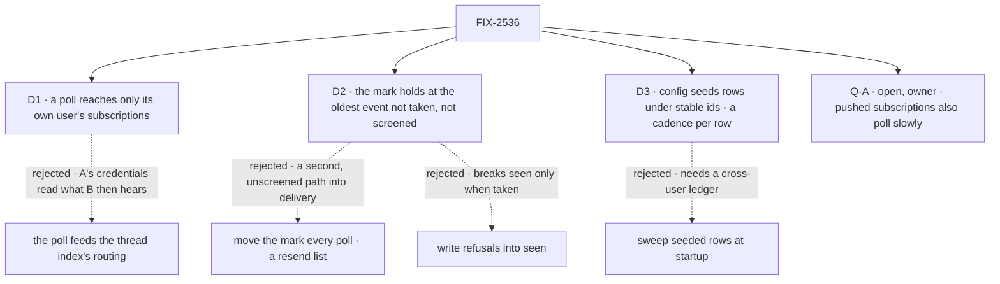

# FIX-2536 · Decisions

[Spec](SPEC.md) · **Decisions**

Three decisions and one owner fork are the sign-off; the epic and FIX-2534 are inputs.

## The tree

Solid edges are what you sign; dashed edges lost, for the reason on the label.

## D1 · A poll reaches only its own user's subscriptions

| | |
|---|---|
| **Instead of** | Routing through the thread index, which nominates every user's subscription |
| **Because** | A poll reads on its user's credentials (epic D5, D10); sending it to B makes A's access B's (ER-4). So the fire reads its own row and calls the same screens and `deliverToRow` |
| **Locks in** | Two users on one PR, two polls. A second door into delivery, on the index's rules |

It comes down to a private repo: one user's token is not another's access.

**What would change my mind:** one credential every subscriber reads through.

## D2 · The mark holds at the oldest event neither taken nor screened out (EM call, 2026-11-05)

| | |
|---|---|
| **Instead of** | Moving `polledThrough` every poll, with a 20-event resend list · writing refusals into `seen` |
| **Because** | A lost delivery is `unsent`, or accepted and never taken (`service-flow.ts` ~336–343). With the mark held, the next poll fetches it again; `seen` and `screened` drop the rest. One delivery path |
| **Locks in** | A refused or held version goes to `screened`, never judged again. Cost: re-fetching a few objects while the mark waits. **Bounded:** one not taken after 3 polls is screened as given up, with a line in the session; `screened` caps at 500 |

It comes down to a lost delivery: the resend list was a second path into delivery.

An unjudged screen (a Jev outage) writes nothing, so the next poll judges it. `screened` is a
cursor field, **not** FIX-2537 Q-A's verdict memo (epic D4).

**What would change my mind:** delivery resending what it gave back on its own.

## D3 · Config seeds subscriptions, each with its cadence (owner call, 2026-11-08)

| | |
|---|---|
| **Instead of** | Only a model's `subscribe` call, at one cadence (FIX-2614's `saveRoutine` forwards to it) |
| **Because** | At startup each entry calls `subscribe`'s write, keyed `cfg_<hash of flow kind and entry id>`, only when missing or changed: a restart adds no row. A `cfg_` row whose entry left config ends, unpolled, at its next fire (`unsubscribe`'s write, `config_removed`). `sub_` rows are untouched |
| **The owner (EM call)** | Each entry names `owner: { userId, orgId }` and a `worker`, as server config (BP-031). The row lands in that user's shared cell (`resolveSharedUserCellKey`), checked by `fireOwnerRunThrough`, polling on their credentials (D1). `canRead` is `subscribe`'s, as the owner |
| **Cadence** | `everyMinutes` on `subscribe` or an entry: 5/10/15/20/30/60, else throws; default `poll.everyMinutes` |
| **Locks in** | A `cfg_` row its thread or session ended stays ended while its entry is unchanged. ER-5 holds. Per FIX-2614, the seed targets `{sessionId, worker, taskId?}` (`deriveWorkerSessionId`), reads the row, merges only config-owned fields, never re-enabling a paused routine |

**Seam:** `routines.declared` is FIX-2614's; the polled seed and cadence, ours.

It comes down to a redeploy: a seed keyed by config id writes nothing new.

**What would change my mind:** a tenant owning config (tenants aren't polled in v1).

<b>Decided, not asked</b> — engineering calls

## Decided, not asked

- **The cursor (EM call, 2026-11-05).** `polledThrough`, `screened`, ETags: optional fields
  (BP-030). `screened` prunes once the mark passes an entry. Kind and read refusals write
  `screened`. No ETag while the mark is held, so a `304` can't hide a retry.
- **The seam with FIX-2537 (#4809) (EM call).** Judge-once holds via
  `screened`. **Left:** with push and poll on, a push refusal is judged once more; leg 3 counts it.
- **The tick (EM call).** Vercel's claim-and-dispatch becomes one `scheduled` helper that
  `serve()` (and so `fsdev dev`) runs each minute.
- **Per-repo batching: not built (EM call).** Departs from epic D10's note: with D1 it saves a
  few free `304`s. Batch when a user meets GitHub's secondary limit.
- **The row (epic D10).** `defineScheduleCollection` at `workforce/subscription-polls/*`, by
  subscription id, `onOverlap: "skip"`, at its `everyMinutes` (D3), offset by its id.
- **Also:** a due index is required; versions come from FIX-2535 (ER-8); tenants aren't polled.

## Considered and dropped

| Alternative | Why not |
|---|---|
| One row per user and repo | Re-decides D10 for a few free `304`s |
| Separate ticks in `fsdev` and `node` | `fsdev` already serves through `serve()` |
| A startup sweep of seeded rows (D3) | Needs a cross-user ledger; each row's next fire checks it |

## Open

### Q-A · Should subscriptions that push also poll, slowly, to catch what push lost?

- **In plain terms:** a pushed event lost in delivery never comes back.
- **The trade-off:** an hourly row and a tick to run, against a lost review never arriving.
- **My recommendation: yes, a small follow-up in this epic**, hourly where a due index exists.
- **What would change my mind:** GitHub redelivering failed webhooks itself.
- **If wrong:** a PR stalls silently.

It comes down to a lost review: push never sends it again.

## Settled

None. Read: `service-flow.ts`, `subscribe.ts`, `owner-runs.ts`, `scope-keys.ts`.

## Analysis

2026-11-05 · **Right approach.** It composes; the open concern is Q-A.

## How it got here

- **Draft:** the mark moved every poll, with a resend list.
- **Fold (EM calls, 2026-11-05):** after review on #4811, the held mark, `screened`, one tick.
- **Amend (owner, 2026-11-08):** D3. It reverses the dropped "cadence on `subscribe`": the
  allowed list, not the model, holds the floor.
