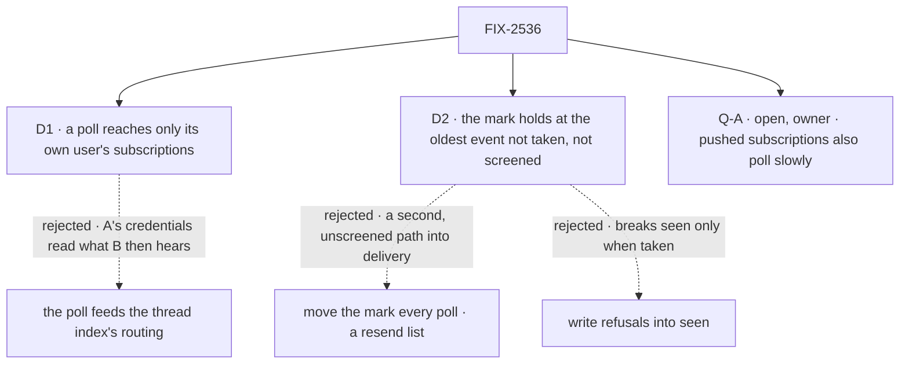

# FIX-2536 · Decisions

[Spec](SPEC.md) · **Decisions**

Two decisions and one owner fork are the sign-off; the epic and FIX-2534 are inputs.

## The tree

Solid edges are what you sign; dashed edges lost, for the reason on the label.

## D1 · A poll reaches only its own user's subscriptions

| | |
|---|---|
| **Instead of** | Routing the poll's events through the thread index, which nominates every user's subscription |
| **Because** | A poll reads on its user's credentials (epic D5, D10); sending that to B makes A's access B's (ER-4). And a request starts no other user's run (FIX-2534 D2). So the fire reads its user's own row and calls the same screens and `deliverToRow` |
| **Locks in** | Two users on one PR make two polls. A second door into delivery, keeping the index's rules |

It comes down to a private repo: one user's token is not another user's access.

**What would change my mind:** one credential every subscriber reads through with the same access.

## D2 · The mark holds at the oldest event neither taken nor screened out (EM call, 2026-11-05)

| | |
|---|---|
| **Instead of** | Moving `polledThrough` every poll, with a 20-event resend list sent straight to delivery · writing refusals into `seen` |
| **Because** | A lost delivery is `unsent`, or accepted and never taken (`deliverToRow` returns `sent`, unseen: `service-flow.ts` ~336–343). With the mark held there, the next poll fetches it again; `seenBefore` and `screened` drop the rest before any screen. One delivery path; it lands once |
| **Locks in** | A screen that judged (refused, or held as in observe mode) writes `[id, version, at]` to `screened`, so neither the screens nor Jev see it again. Cost: while the mark waits, each poll re-fetches the few objects changed since. **Bounded (EM call, 2026-11-05):** a version still not taken after 3 polls is written to `screened` as given up, with a visible line in the session, so the mark moves on. `screened` is capped like `seen` (500), and the hold cannot outlast that window |

It comes down to a lost delivery: the resend list was a second, capped path into delivery.

A screen that failed or didn't judge (FIX-2537's `interest: unjudged` in a Jev outage) writes
nothing: the mark holds and the next poll judges it. That is how a polled subscription recovers
from an outage, and judge-once holds, since it was never judged. A webhook-only event still fails
closed with no retry (epic Q1). A passed version that was lost is screened again on retry, like a push redelivery.

`screened` is a field on the subscription's own cursor row, **not** FIX-2537 Q-A's rejected
per-thread verdict memo (a third dedupe store, ruled out by epic D4). `seen` stays FIX-2534's:
written only by delivery, *seen only when taken*.

**What would change my mind:** delivery resending what it gave back on its own.

<b>Decided, not asked</b> — engineering calls

## Decided, not asked

- **The cursor (EM call, 2026-11-05).** `polledThrough`, `screened` and per-read ETags: one
  optional extension of `subscriptionCursorSchema` (BP-030). `screened` prunes once the mark
  passes an entry's `at`; `seen` keeps its 500-object bound. Delivery's kind and read refusals
  are final, so they write `screened` too; otherwise they would hold the mark. While the mark
  is held, the poll sends no ETag, so a quiet provider's `304` cannot hide a pending retry;
  ETags resume once nothing is pending.
- **The seam with FIX-2537 (#4809) (EM call, 2026-11-05).** Judge-once
  holds via `screened`; the mark holds at the oldest not-taken, not-screened event. This
  replaces "the mark moves every poll". **Left:** with push and poll both on, a version push
  refused is judged once more by the first poll; leg 3 counts it.
- **The tick (EM call, 2026-11-05).** Vercel's claim-and-dispatch becomes one `scheduled`
  helper; `serve()` starts it each minute, as `stale-request-sweeper.ts` runs, covering `fsdev dev`.
- **Per-repo batching: not built (EM call, 2026-11-05).** A departure from epic D10's
  implementer note: D1 already gives one poll per user, so batching saves only a few free
  `304`s. Batch when a measured user meets GitHub's secondary limit.
- **The row (epic D10).** `defineScheduleCollection` at `workforce/subscription-polls/*`, keyed
  by subscription id, `onOverlap: "skip"`. Only `subscribe` writes it, only `unsubscribe` ends it (ER-5).
- **Cadence, stagger, ETags (epic D10).** 5, 10, 15, 20, 30 or 60 minutes, else the definition
  throws; a minute offset from the subscription id; GitHub's `304`s are free.
- **Also:** a due index is required; versions come from FIX-2535's normalizer (ER-8); tenants
  aren't polled in v1.

## Considered and dropped

| Alternative | Why not |
|---|---|
| One row per user and repo | Re-decides D10 for a few free `304`s |
| A cadence on `subscribe` | The floor would rest on a model |
| Separate ticks in `fsdev` and `node` | `fsdev` already serves through `serve()` |

## Open

### Q-A · Should subscriptions that push also poll, slowly, to catch what push lost?

- **In plain terms:** a pushed event lost in delivery never comes back unless the provider resends it.
- **The trade-off:** an hourly row per subscription and a tick to run, against a lost review never arriving.
- **My recommendation: yes, a small follow-up issue in this epic**, at 60 minutes where a
  schedule index exists. Same row, slower cron.
- **What would change my mind:** GitHub redelivering failed webhooks itself.
- **If wrong:** a PR stalls silently.

It comes down to a lost review: push alone never sends it again.

## Settled

None. Read in the code: `service-flow.ts` ~328–356, `cli/src/commands/dev.ts`.

## Analysis

2026-11-05 · **Right approach.** It composes (SPEC's reuse verdicts); the open concern is Q-A.

## How it got here

- **Draft:** the mark moved every poll, with a resend list.
- **Fold (EM calls, 2026-11-05):** after Codex's finding and the architect's note on #4811, the
  held mark, `screened`, one tick.
