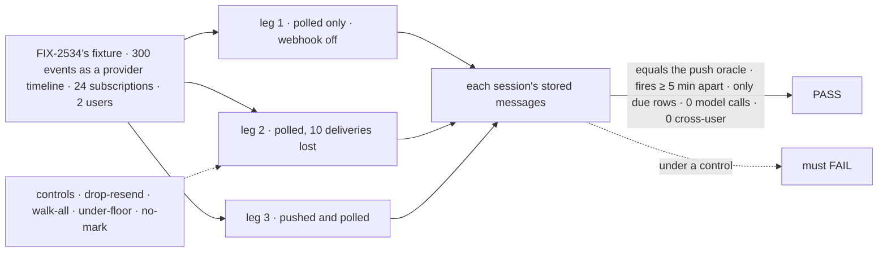
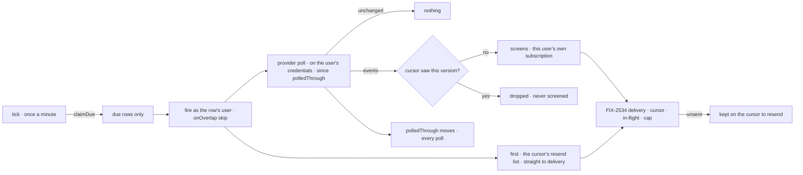

# FIX-2536 · Polling

**Spec** · [Decisions](DECISIONS.md)

## Five people, before and after

| Someone who… | Today | After |
|---|---|---|
| **runs Shift Manager on a laptop** | No public URL, so no webhook; a subscribed task hears nothing | Each subscription polls on its own schedule row, at most every 5 minutes, into the same event and the same delivery |
| **follows a thread that is both pushed and polled** | n/a | Each event once per session; a version push already delivered is dropped before any screen judges it |
| **follows a PR whose delivery the host lost while polling** | n/a | It waits on the cursor; the next poll sends it, and it lands once ([D2](DECISIONS.md#d2)) |
| **follows a private repo that another user also follows** | n/a | A poll made on your credentials reaches only your sessions ([D1](DECISIONS.md#d1)) |
| **pays for the GitHub calls** | n/a | A quiet thread costs conditional requests that GitHub answers `304`; the due index fires only due rows |

The epic ([FIX-2471](../../epics/FIX-2471/SPEC.md)) gives this issue D10's rows and cadence, ER-4,
and the subscription-row seam. FIX-2534 ([spec](../FIX-2534/SPEC.md), #4687) gives it the row,
the cursor, the screens and delivery.

## The goal, and how we'll know it's met

**With no webhook at all, a session that subscribed to a thread hears each event on it once,
within one poll period, through the same screens and delivery as a pushed event; no
subscription is polled more often than every 5 minutes, and no user's poll reaches another
user.**

| Is it the right goal? | |
|---|---|
| **The real need** | The epic's second team: *"runs Shift Manager on a laptop … the same flow polls, at most every 5 minutes"*, and its *"misses one on its PR"* |
| **Smaller, and rejected** | "A poll handler fetches and routes": a lost delivery stays lost, nothing proves the floor, and a laptop host has no tick to fire it |
| **Bigger, and not this issue's** | Catch-up polling for pushed apps ([Q-A](DECISIONS.md#qa), owner) · GitHub's push normalization (FIX-2535) · end to end (FIX-2539) |
| **Not done if** | A session's set by poll differs from its set by push · a row fires under 5 minutes · a beat fires a row that isn't due · a lost delivery never arrives, or arrives twice · a version the subscription's cursor already saw is screened again · B's poll reads A's cell, or A's poll reaches B · an ended subscription still polls · a model is called |



The oracle is FIX-2534's push oracle, unchanged: polling must reach the same set.

| How we verify | |
|---|---|
| **Goal check** | `goals/webhook-routing/polls-each-event-once-without-a-webhook/` · no model · verdict on the implementation PR |
| **Signal** | (a) Each session's rows equal the push oracle's set, in every leg. (b) Each row's fires are at least 5 minutes apart. (c) Fires equal due rows claimed, at most one per subscription per 5 minutes plus one, never subscriptions × beats. (d) Unchanged polls deliver nothing and send their ETags. (e) Each lost delivery lands exactly once, later. (f) 0 cross-user reads; 0 model calls. (g) Across polls, each version reaches a subscription's screens at most once: one refused on a poll is not fetched on the next. Leg 3 reports the versions push refused that the first poll judged again |
| **Input** | FIX-2534's `fixtures/`, read as a timeline by `at`, served by a fake provider with ETags; the long-lived host's tick, driven by a fake clock over a SQLite due index |
| **Anti-game** | Assert on stored rows and the index's claims, not on poll calls. Leg 2's losses are drawn from a fixed seed before the run |
| **Control that must fail** | `drop-resend` (a lost delivery is not kept to resend): (e) FAILS. `walk-all` (each beat fires every subscription): (c) FAILS. `under-floor` (a 1-minute row): (b) FAILS. `no-mark` (`polledThrough` moves only when something was delivered): (g) FAILS. Today's `main`: (a) FAILS, nothing arrives |

## What changes


Everything right of the fire is FIX-2534's, reused; the new parts are the row, the tick, the poll and its cursor fields.

```diff
 // the app
 defineSubscriptionServiceFlow({
   kind: "github-service", provider: github, installation,
+  poll: { everyMinutes: 5, index: createSQLiteScheduleIndex(db) },  // under 5 throws
 })

 // the provider (FIX-2535 builds GitHub's normalize; this issue its poll)
 const github: SubscriptionProvider = {
   provider: "github", canRead, self,
+  poll: (thread, cursor, ctx) => fetchSince(thread, cursor, ctx),   // as the user; since polledThrough; conditional
 }

 // fsdev dev, @flow-state-dev/node: no new config
+// a host serving a flow with a schedule index ticks it once a minute
```

`poll` and `fetchSince` are illustrations; [D2](DECISIONS.md#d2) locks what `polledThrough`
means. A worker's `subscribe` call does not change: the app decides whether a provider polls.

**Docs:** the workforce README's subscriptions section, `apps/docs/docs/server/schedule-index.md`
(the long-lived host's tick), `apps/docs/docs/server/webhooks.md` (*no public URL*, after
FIX-2535 publishes the GitHub guide), `docs/architecture/scheduled-actions.md`.

## How a poll reaches a session



**Stays:** the subscription row and its tools, the thread index, routing and the push path,
the cursor's `seen` and in-flight marks (read before the screens, not changed), the screens, `sendMessage`'s exempt path, and the
Vercel tick.

## What's already here, and the debt

| Already here | What this does with it |
|---|---|
| **The job, "fire a user's row on a schedule".** `defineScheduleCollection`, `createResourceCollectionScheduleResolver`, `onOverlap` (`packages/scheduled/src/`); recurring work (`workforce/src/schedules/scheduled-work.ts`) | **Reuses** all three, as epic D10 signed |
| **The job, "walk a due index".** Vercel's `createScheduleTickHandler` (`vercel/src/schedules.ts`); BullMQ's index. Searched `cli/src`, `node/src`, `engine/src`: no tick in a long-lived host | **Extends:** the same claim-and-dispatch on a timer in `fsdev dev` and `@flow-state-dev/node` |
| FIX-2534's cursor: `seen`, in-flight marks, *seen only when taken* (`subscriptions/service-flow.ts` ~144–357) | **Builds on:** a version it saw is dropped before the screens; a lost one is kept to resend ([D2](DECISIONS.md#d2)) |
| FIX-2534's screens and `deliverToRow` | **Reuses** both, unchanged, for the user's own subscription |
| The schedule resolver's principal: `{ userId, orgId }`, no tenant (`core/src/types/auth.ts` ~87) | **Leaves:** a subscription made under a tenant is not polled in v1 |

| Adds | Composed from |
|---|---|
| A schedule row per polled subscription | `defineScheduleCollection`, keyed by the subscription id; written only by `subscribe` and `unsubscribe` (ER-5) |
| The poll fire | The resolver's `blocks` map; a handler inside `defineSubscriptionServiceFlow` beside `deliver` |
| `SubscriptionProvider.poll` | An optional method beside `canRead` |
| `polledThrough`, ETags and a bounded resend list on the cursor | `subscriptionCursorSchema`, optional fields (BP-030); the [FIX-2537 seam](DECISIONS.md#seam-2537) |
| GitHub's poll | Conditional REST reads, mapped by FIX-2535's normalizer |
| The long-lived host's tick | The Vercel tick's claim-and-dispatch, on a timer |

| The debt | |
|---|---|
| **Removes** | Nothing |
| **Adds** | A second way into delivery: from the user's own rows, beside the thread index ([D1](DECISIONS.md#d1)), permanent by design. A tick in two hosts, beside Vercel's |
| **Leaves** | Per-repo batching (each subscription polls on its own), and tenants' subscriptions unpolled: both in [Decided, not asked](DECISIONS.md#decided-not-asked) |

**Net: up, a little.** One schedule collection, one fire, one tick; no new store, sender or event.

## Sign off

**[The goal](#the-goal-and-how-well-know-its-met):** the push set, by poll alone, with the floor
and the losses checked. If wrong: a laptop that hears most events and loses the rest.

**[The debt](#whats-already-here-and-the-debt): up a little.** If wrong: a second delivery entry
drifts from the thread index's rules.

1. **[D1](DECISIONS.md#d1) · A poll reaches only its own user's subscriptions.** The one to
   weigh. If wrong: N users on one repo make N polls.
2. **[D2](DECISIONS.md#d2) · The poll's mark moves every time; a lost delivery waits on the
   cursor.** If wrong: a lost delivery on a laptop never arrives, or Jev judges one event twice.

**Open, owner: [Q-A](DECISIONS.md#qa)** · pushed subscriptions also poll, slowly, to catch what
push lost. Not in this scope.

Feature · workforce, scheduled, cli, node · medium: one collection, one fire, one tick, GitHub's poll · epic FIX-2471 · GitHub's poll needs FIX-2535's normalizer on `main`
