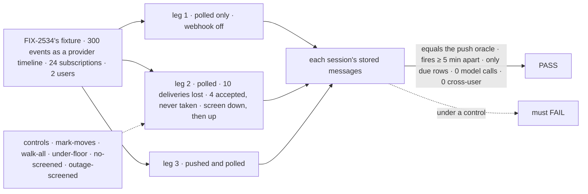
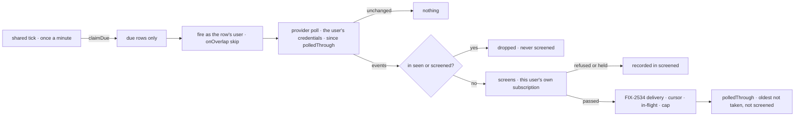

# FIX-2536 · Polling

**Spec** · [Decisions](DECISIONS.md)

## Five people, before and after

| Someone who… | Today | After |
|---|---|---|
| **runs Shift Manager on a laptop** | No public URL, no webhook: a subscribed task hears nothing | Each subscription polls on its own row, at most every 5 minutes, into the same screens and delivery |
| **follows a thread that is both pushed and polled** | n/a | Each event once per session |
| **follows a PR whose delivery the host lost while polling** | n/a | The next poll fetches it again; it lands once ([D2](DECISIONS.md#d2)) |
| **follows a private repo that another user also follows** | n/a | A poll made on your credentials reaches only your sessions ([D1](DECISIONS.md#d1)) |
| **pays for the GitHub calls** | n/a | A quiet thread costs `304`s; only due rows fire |

Inputs: the epic's ([FIX-2471](../../epics/FIX-2471/SPEC.md)) D10 and ER-4; FIX-2534's
([spec](../FIX-2534/SPEC.md), #4687) row, cursor, screens and delivery.

## The goal, and how we'll know it's met

**With no webhook at all, a session that subscribed to a thread hears each event on it once,
within one poll period, through the same screens and delivery as a pushed event; no
subscription is polled more often than every 5 minutes, and no user's poll reaches another
user.**

| Is it the right goal? | |
|---|---|
| **The real need** | The epic's *"runs Shift Manager on a laptop … the same flow polls, at most every 5 minutes"* |
| **Smaller, and rejected** | "A poll handler fetches and routes": a lost delivery stays lost, and a laptop has no tick to fire it |
| **Bigger, and not this issue's** | Catch-up for pushed apps ([Q-A](DECISIONS.md#qa)) · GitHub's normalizer (FIX-2535) · end to end (FIX-2539) |
| **Not done if** | Poll's set differs from push's · a row fires under 5 minutes, or when not due · a lost delivery never arrives, or arrives twice · a judged version is judged again · one user's poll reaches another · an ended subscription still polls |



| How we verify | |
|---|---|
| **Goal check** | `goals/webhook-routing/polls-each-event-once-without-a-webhook/` · no model (the outage uses a stub screen) |
| **Signal** | (a) Each session's rows equal FIX-2534's push oracle, every leg. (b) A row's fires are ≥ 5 minutes apart. (c) Fires equal due rows claimed. (d) Unchanged polls deliver nothing and send ETags. (e) Each lost delivery, and each accepted but never taken, lands exactly once, later. (f) 0 cross-user reads. (g) A version a screen refused or held is screened once, across polls. (h) Stub screen down, then up: each of its events is judged on the next poll, exactly once. Leg 3 counts versions push refused that a poll judged again |
| **Input** | FIX-2534's `fixtures/` as a timeline, a fake provider with ETags, the shared tick on a fake clock over SQLite |
| **Anti-game** | Assert on stored rows and claims, not poll calls; losses drawn from a fixed seed |
| **Control that must fail** | `mark-moves` (mark moves every poll): (e). `walk-all` (every row each tick): (c). `under-floor` (a 1-minute row): (b). `no-screened`: (g). `outage-screened` (unjudged recorded as screened): (h). Today's `main`: (a) |

## What changes


Past the poll, everything is FIX-2534's, reused.

```diff
 // the app
 defineSubscriptionServiceFlow({
   kind: "github-service", provider: github, installation,
+  poll: { everyMinutes: 5, index: createSQLiteScheduleIndex(db) },  // under 5 throws
 })

 // the provider (FIX-2535 builds GitHub's normalize; this issue its poll)
 const github: SubscriptionProvider = {
   provider: "github", canRead, self,
+  poll: (thread, cursor, ctx) => fetchSince(thread, cursor, ctx),   // as the user; since polledThrough; conditional
 }

 // fsdev dev and serve(): no new config
+// serve() starts @flow-state-dev/scheduled's tick for a flow with a schedule index
```

`poll` and `fetchSince` are illustrations; [D2](DECISIONS.md#d2) locks the cursor fields. A
worker's `subscribe` call does not change.

**Docs:** in the change, `docs/architecture/scheduled-actions.md`. At release (`/release-docs`,
from the changeset's `Docs:` pointers): the workforce README, `server/schedule-index.md`, `server/webhooks.md` (*no public URL*).

## How a poll reaches a session



**Stays:** the subscription row and tools, the thread index, the push path, `seen` (*seen only
when taken*), the in-flight marks, the screens.

## What's already here, and the debt

| Already here | What this does with it |
|---|---|
| **"Fire a user's row on a schedule":** `packages/scheduled/src/`, as `workforce/src/schedules/scheduled-work.ts` uses it | **Reuses**, as epic D10 signed |
| **"Walk a due index":** Vercel's `createScheduleTickHandler` (`vercel/src/schedules.ts` ~105). `fsdev dev` serves through `node`'s `serve()` (`cli/src/commands/dev.ts`); neither ticks | **Extends** (below) |
| FIX-2534's cursor: `seen`, in-flight marks, *seen only when taken* (`subscriptions/rows.ts` ~102, `service-flow.ts` ~262–357) | **Builds on:** `seen` is read, never written outside delivery ([D2](DECISIONS.md#d2)) |

## Reuse verdicts

| Item | Verdict |
|---|---|
| The schedule row | **Reuse** `defineScheduleCollection` |
| The poll fire | **Reuse** `createResourceCollectionScheduleResolver` + `onOverlap: "skip"`, the shape of `scheduled-work.ts` |
| `SubscriptionProvider.poll` | **Extend** `SubscriptionProvider` with an optional method |
| `polledThrough`, `screened`, ETags | **Extend** `subscriptionCursorSchema`: one extension, optional fields (BP-030); genuinely new |
| Lease, screens, delivery | **Reuse** `deliverToRow` and `configScreenChain`, unchanged |
| GitHub's poll | **New**, on FIX-2535's normalizer |
| The tick | **Extend:** Vercel's handler body moves into `scheduled`, run on an interval like `stale-request-sweeper.ts` |

| The debt | |
|---|---|
| **Removes** | Nothing; Vercel's tick body moves rather than being copied |
| **Adds** | A second way into delivery, beside the thread index ([D1](DECISIONS.md#d1)), permanent by design. `vercel` and `node` load `scheduled` at runtime |
| **Leaves** | Per-repo batching; tenants' subscriptions unpolled, since the resolver's principal has no tenant ([Decided, not asked](DECISIONS.md#decided-not-asked)) |

**Net: up, a little.** One collection, one fire, one cursor extension; the tick is shared.

## Sign off

**[The goal](#the-goal-and-how-well-know-its-met):** the push set, by poll alone. If wrong: a
laptop that hears most events and loses the rest.

**[The debt](#whats-already-here-and-the-debt): up a little.** If wrong: the second delivery
entry drifts from the index's rules.

1. **[D1](DECISIONS.md#d1) · A poll reaches only its own user's subscriptions.** If wrong: N
   users on one repo make N polls.
2. **[D2](DECISIONS.md#d2) · The mark holds at the oldest event neither taken nor screened; a
   judged version is recorded in `screened`.** If wrong: a lost delivery on a laptop never
   arrives, or Jev judges one event twice.

**Open, owner: [Q-A](DECISIONS.md#qa)** · pushed subscriptions also poll hourly, as a follow-up.

Feature · workforce, scheduled, vercel, node · medium · epic FIX-2471 · GitHub's poll needs FIX-2535 on `main`
