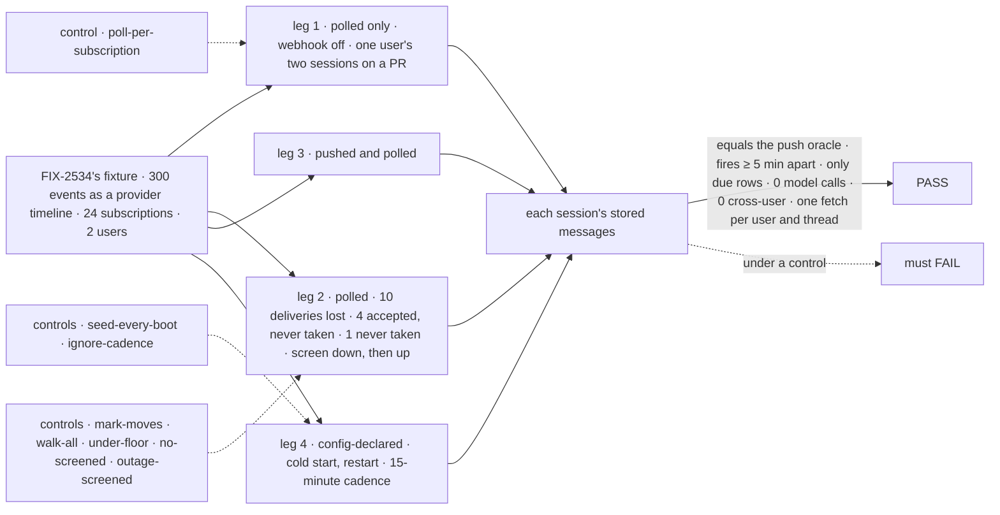
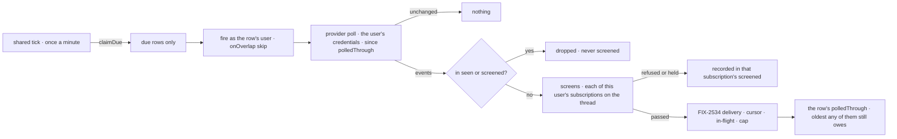

# FIX-2536 · Polling

**Spec** · [Decisions](DECISIONS.md)

## Six people, before and after

| Someone who… | Today | After |
|---|---|---|
| **runs Shift Manager on a laptop** | No public URL, so no webhook: a subscribed task hears nothing | Each followed thread polls once per user, at most every 5 minutes |
| **follows a thread both pushed and polled** | n/a | Each event once per session |
| **follows a PR whose polled delivery was lost** | n/a | The next poll fetches it; it lands once ([D2](DECISIONS.md#d2)) |
| **follows a private repo another user follows** | n/a | A poll on your credentials reaches only your sessions ([D1](DECISIONS.md#d1)) |
| **pins a repo in the flow's config** | Only a model's `subscribe` call | It polls from the first boot; a redeploy adds no row ([D3](DECISIONS.md#d3)) |
| **pays for the GitHub calls** | n/a | Quiet threads cost `304`s; only due rows fire; quiet repos can poll hourly |

Inputs: the epic's ([FIX-2471](../../epics/FIX-2471/SPEC.md)) D10 and ER-4; FIX-2534's
([spec](../FIX-2534/SPEC.md), #4687) row, cursor, screens and delivery.

## The goal, and how we'll know it's met

**With no webhook, a session subscribed to a thread hears each event on it once, within one
poll period, through the same screens and delivery as push; nothing polls more often than every
5 minutes, and no user's poll reaches another user. A subscription declared in config polls the
same way from startup, as one row.**

| Is it the right goal? | |
|---|---|
| **The real need** | The epic's *"runs Shift Manager on a laptop … polls, at most every 5 minutes"*, and the owner's pinned repos |
| **Smaller, and rejected** | "A poll handler routes": a lost delivery stays lost; a laptop has no tick |
| **Bigger, and not this issue's** | Catch-up for pushed apps ([Q-A](DECISIONS.md#qa)) · GitHub's normalizer (FIX-2535) · end to end (FIX-2539) · routines (FIX-2614) |
| **Not done if** | Poll's set differs from push's · a row fires under 5 minutes, or when not due · a lost delivery is lost, or lands twice · a judged version is judged again · a user fetches a thread twice a cadence · a poll crosses users · an ended row polls · a restart adds a row · an off-list cadence is taken |



| How we verify | |
|---|---|
| **Goal check** | `goals/webhook-routing/polls-each-event-once-without-a-webhook/` · no model |
| **Signal** | (a) Each session's rows equal the push oracle, every leg. (b) A row's fires are ≥ 5 minutes apart. (c) Fires equal due rows. (d) Unchanged polls deliver nothing; ETags only while no mark is held. (e) Each lost or never-taken delivery lands once, later. (f) 0 cross-user reads. (g) A refused or held version is screened once. (h) Screen down, then up: judged next poll, once. (i) Never taken: given up after 3 polls. (j) Config polls after a cold start; a restart adds no row; a removed entry ends at its next fire. (k) A cadence of 15 fires 15 minutes apart; a 3 throws. (l) Two sessions, one user, one PR: one fetch per cadence. Leg 3 counts push refusals a poll judged again |
| **Input** | FIX-2534's `fixtures/` as a timeline; a fake provider with ETags; the tick on a fake clock over SQLite |
| **Anti-game** | Assert on stored rows and claims, not poll calls; losses from a fixed seed |
| **Control that must fail** | `poll-per-subscription`: (l). `mark-moves`: (e). `walk-all`: (c). `under-floor`: (b). `no-screened`: (g). `outage-screened`: (h). `hold-forever`: (i). `etag-while-held`: (e). `seed-every-boot`: (j). `ignore-cadence`: (k). Today's `main`: (a) |

## What changes


```diff
 // the app
 defineSubscriptionServiceFlow({
   kind: "github-service", provider: github, installation,
+  poll: { everyMinutes: 5, index: createSQLiteScheduleIndex(db) },  // the default; off the list throws
 })
+hireWorkforce(installation, { routines: { declared: [{ id: "api-repo", owner: { userId, orgId }, worker: "triage",
+  trigger: { event: { provider: "github", thread: "github:acme/api", everyMinutes: 60, interest: "new issues" } } }] } })  // D3; FIX-2614's surface

 // a worker's call
+saveRoutine({ trigger: { event: { provider: "github", thread, interest, everyMinutes: 15 } } })  // 5, 10, 15, 20, 30, 60

 // the provider (FIX-2535 builds GitHub's normalize; this issue its poll)
 const github: SubscriptionProvider = {
   provider: "github", canRead, self,
+  poll: (thread, cursor, ctx) => fetchSince(thread, cursor, ctx),   // as the user; since polledThrough; conditional
 }

 // fsdev dev and serve(): no new config
+// serve() starts @flow-state-dev/scheduled's tick for a flow with a schedule index
```

Shapes are illustrations; [D2](DECISIONS.md#d2) locks the cursor, [D3](DECISIONS.md#d3) the seed.

**Seam with FIX-2614:** it owns *routine*, its list, tools and `routines.declared`; ours:
*subscription*, the polled seed and cadence.

**Docs:** `docs/architecture/scheduled-actions.md` in the change; workforce README and `server/`
pages at release (`/release-docs`).

## How a poll reaches a session



**Stays:** the thread index, the push path, `seen`, the in-flight marks, the screens.

## What's already here, and the debt

| Already here | What this does with it |
|---|---|
| **Fire a user's row on a schedule:** `packages/scheduled/src/` | **Reuses** (epic D10) |
| **Walk a due index:** Vercel's `createScheduleTickHandler` (`vercel/src/schedules.ts` ~105); `node`'s `serve()` doesn't tick | **Extends** (below) |
| FIX-2534's row, cursor and `subscribe` (`subscriptions/rows.ts`, `subscribe.ts`, `service-flow.ts` ~262–357) | **Builds on:** `seen` written only by delivery ([D2](DECISIONS.md#d2)); the seed reuses `subscribe`'s write ([D3](DECISIONS.md#d3)) |

## Reuse verdicts

| Item | Verdict |
|---|---|
| The schedule row, per user and thread | **Reuse** `defineScheduleCollection` |
| The poll fire | **Reuse** `createResourceCollectionScheduleResolver`, `onOverlap: "skip"` |
| `SubscriptionProvider.poll` | **Extend** `SubscriptionProvider` with an optional method |
| `screened`; `polledThrough`, ETags | **Extend** `subscriptionCursorSchema`; the poll row (BP-030) |
| Lease, screens, delivery | **Reuse** `deliverToRow` and `configScreenChain`, unchanged |
| The config seed | **Reuse** `subscribe`'s write, as the owner; `deriveWorkerSessionId`'s session |
| Per-subscription cadence | **Extend** `subscribeInputSchema` and the row: `everyMinutes` (BP-030) |
| GitHub's poll | **New**, on FIX-2535's normalizer |
| The tick | **Extend:** Vercel's handler body moves into `scheduled`, run like `stale-request-sweeper.ts` |

| The debt | |
|---|---|
| **Removes** | Nothing; Vercel's tick body moves, not copied |
| **Adds** | A second way into delivery beside the thread index ([D1](DECISIONS.md#d1)), by design; `vercel` and `node` load `scheduled` |
| **Leaves** | Per-repo batching; tenants unpolled ([Decided, not asked](DECISIONS.md#decided-not-asked)) |

**Net: up, a little.** One collection, fire, cursor extension and seed; a shared tick.

## Sign off

**[The goal](#the-goal-and-how-well-know-its-met):** the push set, by poll alone. If wrong: a
laptop hears most events and loses the rest.

**[The debt](#whats-already-here-and-the-debt): up a little.** If wrong: the second way into
delivery drifts from the index's.

1. **[D1](DECISIONS.md#d1) · One poll per user and thread, reaching only that user's
   subscriptions.** Owner, 2026-11-09. If wrong: N users on one repo, N polls.
2. **[D2](DECISIONS.md#d2) · The mark holds at the oldest event neither taken nor screened.** If
   wrong: a lost delivery never arrives, or Jev judges one event twice.
3. **[D3](DECISIONS.md#d3) · Config seeds rows under stable ids, for the owner it names; each row
   may set its cadence.** The owner's call (2026-11-08); the owner rule is an EM call. If wrong: a
   redeploy doubles every pinned repo.

**Open, owner: [Q-A](DECISIONS.md#qa)** · pushed subscriptions also poll hourly, later.

Feature · workforce, scheduled, vercel, node · medium · epic FIX-2471 · GitHub's poll needs FIX-2535 on `main`
