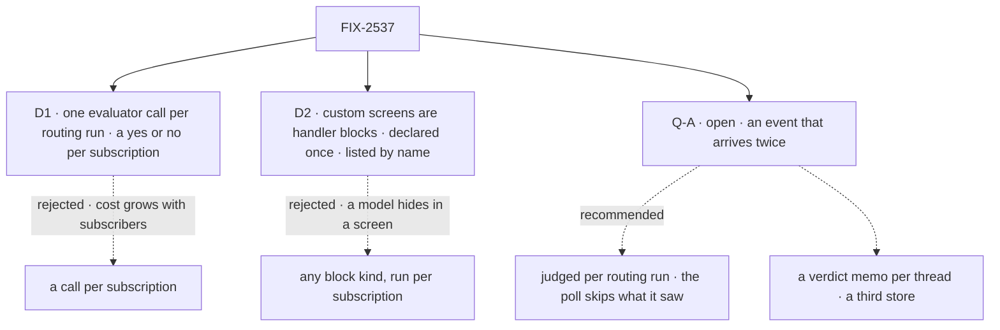

# FIX-2537 · Decisions

[Spec](SPEC.md) · **Decisions**

Two decisions and one open question are the sign-off surface; the epic's D2, D6, D7, ER-1 and
FIX-2534's D1 are inputs.

## The tree

Solid edges are signed; dashed edges lost, or are the open question's options.

## D1 · One evaluator call per routing run, a yes or no per subscription that listed `interest`

| | |
|---|---|
| **Instead of** | One call per subscription, as `fit-check` asks · a model on every subscription that lists no screen |
| **Because** | Epic ER-1: cost stays flat as subscribers multiply. Core's `evaluator` asks many questions in one call (`questions` is a function of the input, as `fit-check.ts` ~110 uses it), each answered on its own, and makes one provider call with no retry or fallback (`evaluator.ts` header; `evaluate.ts` ~12). Opt-in keeps "reviews on my PR" at zero tokens, and keeps FIX-2534's share reading what it read |
| **Locks in** | A sixth public kind name, `interest`, carried by saved subscriptions. The sentences of every subscription asking on one event, in one org, share one call |

It comes down to cost as subscribers grow: a call each is ten calls on a busy PR.

**The price, named.** A sentence, or the event's own text, can steer a neighbour's answer in
the same call. It can only refuse or pass an event on a thread both subscribers follow: a pass
still meets the delivery's read check as that user (ER-4), so nothing private crosses. Each
sentence goes in as data under its own question, and the event as outside content.

## D2 · A custom screen is the app's handler block, declared once, listed by name

| | |
|---|---|
| **Instead of** | Any block kind as a screen, run once per subscription |
| **Because** | Epic D2 lets the evaluator be routing's only model use. A `handler` is a leaf: it holds no generator or evaluator step, so the chain refuses any other kind when it is built, and ER-1 has one place to hold. One run per event over the subscriptions that list it keeps code screens flat too. The subscriber is a model in a turn: it can name a screen, not write one |
| **Locks in** | The listing `{ screen: "custom", name }` and handler-only custom screens. Renaming a declared screen breaks the subscriptions that list it |

It comes down to a hidden model: any block kind lets a generator into routing unseen.

<b>Decided, not asked</b> — engineering calls

## Decided, not asked

- **Where.** `workforce/src/subscriptions/`. No core change: the evaluator exists.
- **The chain (epic D7).** Config `.stepIf`s, then one `.stepIf` per declared custom screen in
  the app's declared order, then one evaluator `.stepIf`, then pass the rest. A sequencer, no router.
- **ER-1's convergence point.** The one evaluator step, built where the chain is built. Custom
  screens are refused unless handler blocks. Nothing else in routing resolves a model.
- **Declared once.** Custom screens and the evaluation model are declared where both `subscribe`
  and the service flow read them (the provider object today). `subscribe` refuses an unknown
  name (`no_screen`) and `interest` with no model (`no_interest_model`). The tool's description
  lists the app's custom screens.
- **A custom screen's contract.** In: the event and only the subscriptions that list it. Out:
  `{ verdicts }`. A verdict for a subscription it wasn't handed is ignored; a missing one
  refuses; a throw refuses all it was handed (`custom:<name>: failed`).
- **The judgment.** One `boolean` question per survivor, keyed by subscription id, its sentence
  as the instructions. State: kind, title, bounded text, labels, sender role, marked as outside
  content. Pass at probability ≥ 0.5; the reason carries it. Missing answer: refused.
- **A failed call (epic D7's "refuses or holds").** Rejected, malformed or timed out: each
  asking subscription is refused `interest: unjudged`, and a hold-only owner run counts it on
  its cursor, so the next message says how many were held. It sends nothing and asks no model.
  No retry, no split, no generator. A cancelled request rethrows, as `fit-check` does.
- **The bound.** At most 32 questions per call; past it, the rest are refused and held as above.
- **The index.** It mirrors the sentence only for a subscription that lists `interest`; an old
  entry without one reads as not listed (BP-030). Server-only, org-scoped, as today.
- **The share.** The kill line's numerator stays config-decided (FIX-2534's rule). The run
  reports config, custom, interest and open beside it.
- **A sentence alone** is still refused (epic D6): `interest` needs a thread like any screen.

## Considered and dropped

| Alternative | Why not |
|---|---|
| Reuse `fit-check` | Its fallback asks a generator; it asks one choice, not a verdict each |
| A model on every subscription that lists no screen | Spends a call on "reviews on my PR", which the thread and kinds already say |
| One `choice` over the subscriptions | One pick, where each subscription needs its own yes or no |
| Judging after the fence, in each delivery | One call per subscription again |

## Open

### Q-A · May an event that arrives twice be judged twice?

- **In plain terms:** routing keeps no memory of what it judged, so a redelivery, or the same
  event from push and then from a poll, asks the model again. Delivery still sends it once. The
  epic's closure asserts one call per normalized event, which this misses whenever both run.
- **The trade-off:** a memo of verdicts per thread costs one call per event, but it is a third
  dedupe store, which epic D4 rules out. Counting per routing run keeps the store count at two
  and pays up to twice on fuzzy subscriptions when push and poll overlap.
- **My recommendation: count per routing run,** amend the closure to "≤1 per routing run" and
  report calls per normalized event, and have FIX-2536's poll skip events its own
  subscription's cursor has seen, which costs no tokens.
- **What would change my mind:** apps running push and poll together by default, or leg c
  measuring well over one call per normalized event after the poll skip.
- **If wrong:** fuzzy subscriptions cost up to twice on events that arrive twice; the other way,
  a store kept in step with the cursor forever.

It comes down to a third dedupe store: the memo needs one, which epic D4 ruled out.

## Settled

None built. The premises were read in the code: routing reads only the index before its screens
(`service-flow.ts` ~190–260), the cursor is read only in delivery (~274), and
`routeServiceEvent` runs routing once per call (`engine/src/durability/owner-runs.ts` ~146).

## Analysis

2026-11-05 · watermark 2026-11-04 (FIX-2534 merged) · **Right approach, one fork raised.** Run
by the authoring worker (no sub-agent tool); say so at the gate.

1. **Reuse:** every Adds row composes; core's `evaluator`, not `fit-check`.
2. **Prior art:** a classifier behind cheap filters, as mail filtering and alert routing do it.
3. **Other shapes:** a call per subscription ([D1](#d1)); any block as a screen ([D2](#d2)).
4. **New factors:** FIX-2534 measured 0.820, so the kill line holds with room.
5. **Necessity:** the epic's fuzzy row has no path without it.
6. **Ergonomics:** two listed kinds; one place to declare.
7. **Concerns:** an event judged twice, [Q-A](#qa), an epic amendment if signed.

## How it got here

- **Draft:** FIX-2534's custom slot and the epic's Jev note, as two stages behind the config
  screens, with one evaluator call per routing run; the closure's per-event count raised as Q-A.
