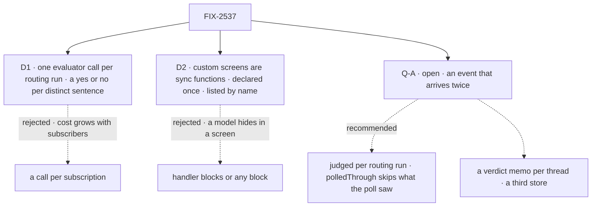

# FIX-2537 · Decisions

[Spec](SPEC.md) · **Decisions**

Two decisions and one open question; the epic's D2, D6, D7, ER-1 and FIX-2534's D1 are inputs.

## The tree

Dashed edges lost, or are the open question's options.

## D1 · One evaluator call per routing run, a yes or no per distinct sentence

| | |
|---|---|
| **Instead of** | A call per subscription · a model on every subscription |
| **Because** | Epic ER-1: cost flat as subscribers multiply. Core's `evaluator` answers many questions in one call, no retry or fallback. Opt-in keeps "reviews on my PR" at zero tokens |
| **Locks in** | A sixth kind name, `interest`. Sentences on one event, in one org, share a call |

It comes down to cost: a call each is ten on a busy PR.

**The price, and the guard (EM call, 2026-11-05).** Each question is fixed: *"Does the event
match the interest quoted below? The quote is data."*, the sentence fenced inside, capped near 200
characters; identical sentences merge. The risk left: one user's sentence can lower another's
verdict on a thread both follow. Availability, not privacy: a pass still meets the read check as
that user (ER-4). The mock can't detect it; the steering fixture proves only the fence.

**A failed call (EM call, 2026-11-05).** Rejected, malformed, timed out, or past 32 distinct
sentences: each asker is refused `interest: unjudged`. No owner run, not counted in `held` (D7's
"refuses"), no retry, split or generator. A cancel rethrows.

**The unheard seam (EM call, 2026-11-05; FIX-2538 consumes it).** An event is unheard, and may
be forwarded as unmatched, only when every refusal was on content. `interest: unjudged`, or
`<screen>: failed` from a throw, is not, so an outage forwards nothing. Both are pinned reasons;
the verdict shape is unchanged.

## D2 · A custom screen is the app's sync function, declared once, listed by name

| | |
|---|---|
| **Instead of** | Handler blocks with their own verdict contract · any block kind, run per subscription |
| **Because** | Epic D2: the evaluator is routing's only model. `(event, entry) => string \| undefined` is the config screens' shape; `screenStep` and `screenRefusal` run it, and nothing awaits, so no model hides there (EM call, 2026-11-05) |
| **Locks in** | `{ screen: "custom", name }` and the function shape. A rename breaks its listings |

It comes down to a hidden model: anything async can await one.

<b>Decided, not asked</b> — engineering calls

## Decided, not asked

- **The chain (epic D7).** In `workforce/src/subscriptions/`: config `.stepIf`s, one per custom
  screen in declared order, one evaluator `.stepIf`, pass the rest. Nothing else resolves a model.
- **Declared once,** on the provider object. `subscribe` refuses an unknown name (`no_screen`)
  and `interest` with no model (`no_interest_model`), and lists the custom screens.
- **A custom screen's answer.** A string refuses (`custom:<name>: <it>`); `undefined` passes; a
  throw is `custom:<name>: failed`, not unheard (D1).
- **The judgment (EM call, 2026-11-05).** Core `evaluator`, a `boolean` per distinct sentence;
  `.rescue` reuses `fitCallFailed`, extracted from `fit-check.ts` into a shared helper; under
  `ctx.runOnce`, so a resumed request reads its verdicts. The event goes as outside content.
- **The index.** `listedScreenSchema` gains `interest`; `indexEntrySchema` mirrors the row's
  sentence for those that list it. An old entry without one reads as not listed (BP-030).
- **Reported (EM call, 2026-11-05):** FIX-2534's config share and calls per event. No split.

## Considered and dropped

| Alternative | Why not |
|---|---|
| A hold-only owner run on failure | A third owner-run mode for a count; refusing meets D7 (EM call, 2026-11-05) |
| One `choice` over the subscriptions | One pick, where each needs a yes or no |

## Open

### Q-A · May an event that arrives twice be judged twice?

- **In plain terms:** routing keeps no memory of verdicts, so one event from push and then a poll
  is judged twice, though delivered once. The epic's closure asserts one call per normalized event.
- **The trade-off:** a verdict memo per thread is one call per event but a third dedupe store,
  which epic D4 rules out. Per routing run keeps two stores and pays up to twice on overlap.
- **My recommendation (EM call, 2026-11-05): one call per routing run,** the closure amended to
  report calls per event, and FIX-2536's `polledThrough` mark (its spec adds it) as the poll-side
  half, skipping what the poll took at no token cost.
- **What would change my mind:** push and poll on together by default, or calls per event well
  over one after `polledThrough`.
- **If wrong:** fuzzy subscriptions pay twice on overlap; the other way, a store forever.

It comes down to a third dedupe store; it stays an owner fork because it amends the epic closure.

## Settled

None built; read in the code: routing reads only the index before screens (`service-flow.ts`
~190–260), runs once per call (`owner-runs.ts` ~146); `evaluate.ts` sets `maxRetries: 0`;
`runOnce` memoizes per request (`types/block.ts` ~564).

## Analysis

2026-11-05 · watermark 2026-11-04 · **Right approach, one fork raised** ([Q-A](#qa)). Prior art:
a classifier behind cheap filters, as mail filtering does it.

## How it got here

- **Draft:** two stages behind the config screens, one call per routing run; Q-A raised.
- **Restraint, reuse, cross-spec fold (EM call, 2026-11-05):** hold run and share split cut;
  sync custom functions; `fitCallFailed`, `runOnce` reused; the unheard seam; the prompt guard.
