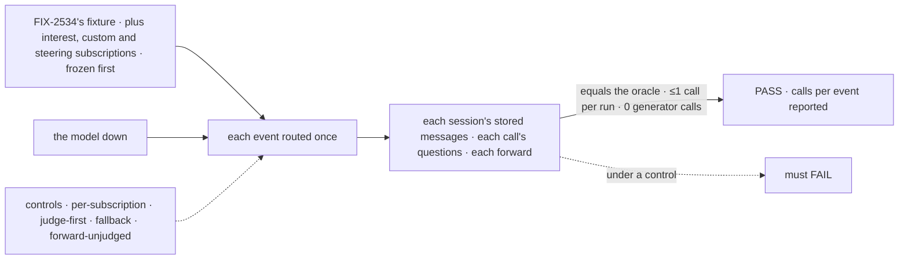
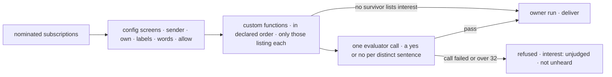

# FIX-2537 · Custom and Jev screens

**Spec** · [Decisions](DECISIONS.md)

## Six people, before and after

| Someone who… | Today | After |
|---|---|---|
| **follows something fuzzy** ("crash reports") | Hears all the code screens pass; nobody reads the sentence | Lists `interest`; a model judges what code passed |
| **builds an app with a check config can't say** | Can't add one | Declares a function once; a subscription names it |
| **shares a busy PR with ten fuzzy subscriptions** | n/a | One call per event, not ten; each sentence quoted as data |
| **is subscribed while the model is down** | n/a | Refused, asked once, never forwarded as unheard |
| **lists no `interest`** | Zero tokens | The same |
| **decides whether the epic goes on** | Config share 0.820 (FIX-2534) | That share, plus calls per normalized event |

The epic ([FIX-2471](../../epics/FIX-2471/SPEC.md)) gives this issue ER-1, D7's note and the kill line.

## The goal, and how we'll know it's met

**A subscription can say what it wants in code or in a sentence; each event costs at most one
model call however many subscriptions ask, only after the code screens passed them, and a failed
call refuses them, never asking again, asking a generator, or fanning the event out as unmatched.**

| Is it the right goal? | |
|---|---|
| **The real need** | The epic's *"cares about something fuzzy … Jev reads only what config screens pass"*, cost flat as subscribers grow |
| **Smaller, and rejected** | "An evaluator screen exists": a call per subscription meets it |
| **Bigger, and not this issue's** | One judgment per event across push and poll ([Q-A](DECISIONS.md#qa)) · the closure's four legs (FIX-2539) |
| **Not done if** | Two calls in one routing run · the model sees a subscription code refused or that lists no `interest` · a failed call is retried, split or sent to a generator · an `unjudged` or failed-screen refusal makes an event unheard · user B hears A's private repo |



| How we verify | |
|---|---|
| **Goal check** | `goals/webhook-routing/judges-each-event-once/` · `mockEvaluationModel`, answering by a fixed rule over the event and the sentence · verdict on the implementation PR |
| **Signal** | (a) Rows equal the oracle's. (b) ≤1 evaluator call per routing run, 1 where the oracle has a sentence. (c) 0 generator calls. (d) Questions are the oracle's distinct survivors. (e) Model down: those get nothing, (b) and (c) hold, 0 forwards. (f) 0 rows across users. (g) The steering fixture's neighbours keep their verdicts; its sentence arrives fenced and capped. **Reported:** config share, calls per normalized event |
| **Input** | FIX-2534's fixture, plus `interest`, custom and one steering subscription, frozen in a commit `goal.md` names |
| **Anti-game** | The oracle imports no screen code; calls are counted on the mock. The mock can't be steered, so (g) proves the fence, not resistance ([D1](DECISIONS.md#d1)) |
| **Control that must fail** | `GOAL_CONTROL=per-subscription`: (b). `judge-first`: (d). `fallback` to a generator: (c). `forward-unjudged`, unjudged counted unheard: (e) |

## What changes


The chain grows two stages behind the config screens, and only the last one reads a model ([D1](DECISIONS.md#d1)).

```diff
 // the app, once per provider
 const github = { provider: "github", canRead, self,
+  screens: {
+    interestModel: "typesafe-ai/jev",            // one evaluation model; none, and `interest` is refused
+    custom: {
+      "stack-trace": {
+        describe: "the text holds a stack trace",
+        screen: (event, entry) => (/\n\s+at .+:\d+/.test(event.text) ? undefined : "no stack trace"),
+      },
+    },
+  },
 };

 // a worker's turn
 subscribe({
   provider: "github",
   thread: "github:acme/api",
   kinds: ["issue"],
-  interest: "crash reports",                      // kept; nothing read it
+  screens: [{ screen: "custom", name: "stack-trace" }, { screen: "interest" }],
+  interest: "crash reports from production",      // quoted to the model as data
 })
```

`screens` on the provider is illustrative; [D2](DECISIONS.md#d2) locks the `custom` listing and
function shape.

**Docs:** the workforce README's *Subscriptions*; `messaging-workers.md` → *Messages from a
service* ("screens don't read it" no longer holds); the `subscriptions` row in
`mechanisms.yaml`. No new page.

## How an event is screened



A sequencer of `.stepIf` steps plus one evaluator (epic D7), each stage running only while a
subscription is undecided. **Stays:** the config screens, the verdict shape, the owner run, the
cursor, FIX-2534's share rule.

**The seam FIX-2538 reads** ([D1](DECISIONS.md#d1)): an event is unheard, and may be forwarded as
unmatched, only when every refusal was on content. An `interest: unjudged` refusal or a screen
that threw is not, so an outage forwards nothing.

## What's already here, and the debt

| Already here | What this does with it |
|---|---|
| **The job, "does an event reach a subscription".** FIX-2534's chain (`subscriptions/screens.ts`) | **Extends it:** `screenStep` and `screenRefusal` run custom functions too |
| Core's `evaluator` (one `experimental_evaluate` call, `maxRetries: 0`); `fit-check.ts`'s `fitCallFailed` | **Reuses both;** `fitCallFailed` moves to a shared helper. Not `fit-check`'s generator fallback |
| `ctx.runOnce` (`core/src/types/block.ts` ~564) | **Wraps the judgment:** a resumed request doesn't ask again |
| Epic D2, D6, D7, ER-1; FIX-2534 D1's verdict shape and custom slot | **Kept;** this fills the slot |

| Adds | Composed from |
|---|---|
| The `interest` listed screen | `listedScreenSchema`; `indexEntrySchema` mirrors the row's `interest` |
| The `custom` listed screen | `screenStep` / `screenRefusal`, one `.stepIf` each |
| The judgment step | Core's `evaluator`, `.rescue` to the shared `fitCallFailed`, under `runOnce` |

| The debt | |
|---|---|
| **Removes** | Nothing |
| **Adds** | A model step in routing, opt-in: permanent (epic D2). User sentences in the org's server-only index, until FIX-2532 replaces it |
| **Leaves** | `fit-check`'s generator fallback, fenced off. An event that arrives twice may be judged twice, bar FIX-2536's `screened` ([Q-A](DECISIONS.md#qa)) |

**Net: up, slightly.** One optional model step; no new store, sender, block kind or owner-run mode.

## Sign off

**[The goal](#the-goal-and-how-well-know-its-met):** at most one model call per routing run, after
code, no fallback, no fan-out on failure. If wrong: the fuzzy path costs per subscriber.

**[The debt](#whats-already-here-and-the-debt): up, slightly.** If wrong: user sentences outlive
their subscriptions in the index.

1. **[D1](DECISIONS.md#d1) · One evaluator call per routing run, a yes or no per distinct
   sentence.** The one to weigh. If wrong: a coworker's sentence lowers your verdict on a thread you both follow.
2. **[D2](DECISIONS.md#d2) · A custom screen is the app's sync function, declared once, listed by
   name.** If wrong: an app that needs I/O or a model in its screen has only `interest`.

**Open: [Q-A](DECISIONS.md#qa)** · may an event that arrives twice be judged twice?

Feature · workforce · medium: one package, three adds, no new store · epic FIX-2471
