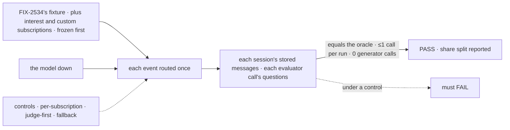
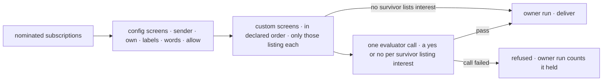

# FIX-2537 · Custom and Jev screens

**Spec** · [Decisions](DECISIONS.md)

## Six people, before and after

| Someone who… | Today | After |
|---|---|---|
| **follows something fuzzy** ("crash reports on acme/api") | Hears every event the code screens pass; the sentence is a note nobody reads | Lists the `interest` screen; a model judges each event that the code screens passed |
| **builds an app with a check config can't say** ("has a stack trace") | Can't add one | Declares a custom screen once; a subscription names it |
| **shares a busy PR with ten other fuzzy subscriptions** | n/a | One model call per event for all of them, not ten |
| **is subscribed while the model is down** | n/a | The event is refused for them, nothing is asked twice, and their next message says how many were held |
| **lists no `interest` screen** | No model, zero tokens | The same, byte for byte |
| **decides whether the epic goes on** | Config share 0.820 (FIX-2534) | The share, split: config, custom, interest, open |

The epic ([FIX-2471](../../epics/FIX-2471/SPEC.md)) gives this issue ER-1, D7's note and the kill line.

## The goal, and how we'll know it's met

**A subscription can say what it wants in code or in a sentence; each event costs at most one
model call however many subscriptions ask, only after the code screens passed them, and a failed
call holds them, never asking again or asking a generator.**

| Is it the right goal? | |
|---|---|
| **The real need** | The epic's *"cares about something fuzzy … Jev reads only what config screens pass"*, with cost flat as subscribers multiply |
| **Smaller, and rejected** | "An evaluator screen exists": a call per subscription meets it, and so does a fit check that falls back to a generator |
| **Bigger, and not this issue's** | One judgment per event across a redelivery or push and poll ([Q-A](DECISIONS.md#qa)) · the closure's four legs (FIX-2539) |
| **Not done if** | Two evaluator calls in one routing run · the model is asked about a subscription a code screen refused, or that didn't list `interest` · a failed call is retried, split or sent to a generator · a custom screen passes a subscription that didn't list it · a subscription with no `interest` screen costs a token · user B hears A's private repo |



The check reads stored rows and the questions each call carried, not which blocks ran.

| How we verify | |
|---|---|
| **Goal check** | `goals/webhook-routing/judges-each-event-once/` · `mockEvaluationModel`, answering by a fixed rule over the event and the sentence · verdict on the implementation PR |
| **Signal** | (a) Each session's rows equal the oracle's set. (b) ≤1 evaluator call per routing run, and exactly 1 where the oracle has a subscription to ask. (c) 0 generator calls. (d) Each call's questions are the oracle's survivors, no more. (e) With the model down: those subscriptions get nothing, (b) and (c) hold, and their next message counts the held. (f) 0 rows across users. **Reported:** the share split, and evaluator calls per normalized event, for [Q-A](DECISIONS.md#qa) |
| **Input** | FIX-2534's normalized fixture, its subscriptions frozen, plus new ones that list `interest` or a custom screen, frozen in a commit named in `goal.md` before the first run |
| **Anti-game** | The oracle restates the rules and imports no screen code. Count calls on the mock, not on block traces |
| **Control that must fail** | `GOAL_CONTROL=per-subscription`: (b) FAILS. `judge-first`, the model before the code screens: (d) FAILS. `fallback`, a failed call asks a generator: (c) FAILS |

## What changes


The chain grows two stages behind the config screens, and only the last one reads a model ([D1](DECISIONS.md#d1)).

```diff
 // the app, once per provider
 const github = { provider: "github", canRead, self,
+  screens: {
+    interestModel: "typesafe-ai/jev",            // one evaluation model; none, and `interest` is refused
+    custom: { "stack-trace": { describe: "the text holds a stack trace", block: stackTraceScreen } },
+  },
 };

 // a worker's turn
 subscribe({
   provider: "github",
   thread: "github:acme/api",
   kinds: ["issue"],
-  interest: "crash reports",                      // kept; nothing read it
+  screens: [{ screen: "custom", name: "stack-trace" }, { screen: "interest" }],
+  interest: "crash reports from production",      // the question the model answers
 })
```

`screens` on the provider is an illustration; [D2](DECISIONS.md#d2) locks the `custom` listing
and the handler-only rule, [D1](DECISIONS.md#d1) the `interest` kind.

**Docs:** update the workforce README's *Subscriptions* (the two listed kinds, custom screens, a
failed call) and `apps/docs/docs/workforce/messaging-workers.md` → *Messages from a service*,
whose "screens don't read it" line no longer holds; update the `subscriptions` row's job in
`docs/mechanisms/mechanisms.yaml`. No new page.

## How an event is screened



A sequencer of `.stepIf` steps plus one evaluator (epic D7): each stage runs only while a
subscription is still undecided, so the model sees only what code passed. **Stays:** the five
config screens, the verdict shape, the owner run and the cursor, and FIX-2534's share rule.

## What's already here, and the debt

| Already here | What this does with it |
|---|---|
| **The job, "decide whether an event reaches a subscription".** FIX-2534's config chain (`subscriptions/screens.ts`), the only one | **Extends it.** Not a second way |
| **Judging text against a sentence with a model**: `workforce/src/fit-check.ts`, `orchestration/src/skills/skill-evaluator.ts`, `harness-manager/src/goal-judge.ts` | **Uses core's `evaluator` directly**, as they do. Not `fit-check`: its fallback asks a generator, and it asks one choice, not a yes or no per subscription |
| Epic D2, D6, D7, ER-1; FIX-2534 D1 (the verdict shape; the custom slot cut for this issue) | **Kept.** This fills the slot D1 named |
| The `endOnly` owner run; the cursor's `held` count and its line in the next message | **Builds on:** a failed call's subscriptions are counted the same way |

| Adds | Composed from |
|---|---|
| The `interest` listed screen, its sentence mirrored in the index | `listedScreenSchema`, `indexEntrySchema`: one more kind, one optional field |
| The `custom` listed screen, and an app's declared screens | Handler blocks, one `.stepIf` each, answering `screenVerdictsSchema` |
| The judgment step | Core's `evaluator` with a question per subscription, `.rescue` to a refusal |
| A hold-only owner run | The delivery entry's `endOnly` mode, beside it |

| The debt | |
|---|---|
| **Removes** | Nothing |
| **Adds** | A model step in routing, opt-in: permanent (epic D2). User sentences in the org's server-only index, until FIX-2532 replaces it. A third owner-run mode |
| **Leaves** | `fit-check`'s generator fallback, fenced off. An event that arrives twice is judged twice ([Q-A](DECISIONS.md#qa)) |

**Net: up, slightly.** One optional model step and one owner-run mode; no new store, sender or block kind.

## Sign off

**[The goal](#the-goal-and-how-well-know-its-met):** at most one model call per routing run, after
code, with no fallback. If wrong: the fuzzy path costs per subscriber, and the kill line's
premise goes.

**[The debt](#whats-already-here-and-the-debt): up, slightly.** If wrong: user sentences outlive
their subscriptions in the index.

1. **[D1](DECISIONS.md#d1) · One evaluator call per routing run, a yes or no per subscription
   that listed `interest`.** The one to weigh. If wrong: a coworker's sentence steers your verdict on a shared thread.
2. **[D2](DECISIONS.md#d2) · A custom screen is the app's handler block, declared once, listed by
   name.** If wrong: an app that needs a model in its screen has only `interest`.

**Open: [Q-A](DECISIONS.md#qa)** · may an event that arrives twice be judged twice?

Feature · workforce · medium: one package, four adds, no new store · epic FIX-2471
