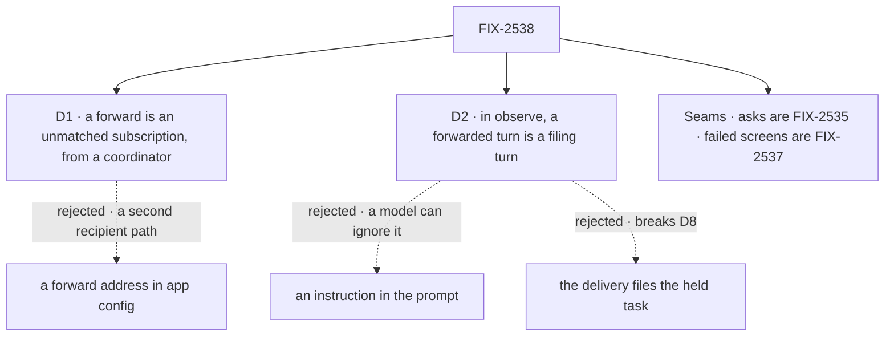

# FIX-2538 · Decisions

[Spec](SPEC.md) · **Decisions**

Two decisions are the sign-off surface; no fork is open. Inputs: the epic's D7, D8, D11, Q3, ER-2.

## The tree

Solid edges are signed; dashed edges lost, for the reason on the label.

## D1 · A forward is a subscription with `unmatched: true`, made from a coordinator's session

| | |
|---|---|
| **Instead of** | A `forward:` option naming one coordinator, by user and session, in the app's config |
| **Because** | FIX-2534's path already runs as the subscriber: the read check (ER-4), the sender screen (Q1), the per-session id (ER-8), the cap. A forward address copies each, and sends every org event to one user. Routing runs the unmatched subscriptions only when no ordinary subscription passed and none failed or held ([seams](#seams)), and only for kinds the app lists in `forwards.kinds` (epic D8). Without `forwards`, nothing is forwarded |
| **Locks in** | `unmatched` on `screenSettingsSchema`, so on saved rows and index entries; `subscribe` refuses it outside a coordinator's session (`not_a_coordinator`), since only a coordinator reads `inferredWork` |

It comes down to a private repo: a forward address is a second read check to keep in step.

## D2 · In `observe`, a turn on a forwarded event is a filing turn, enforced in code

| | |
|---|---|
| **Instead of** | Telling the coordinator's model, in its prompt, to file held · the delivery filing the held task itself |
| **Because** | A prompt only asks. The delivery writes a flag beside `addressedBy` on `workerMessageRowSchema`, server-written; the received entry copies it to request state. In `observe`, that turn gets read tools and `createTask`, wrapped through a request-dependent `uses` so every filing carries `questions: [{ kind: "confirm", prompt }]` whatever the model passed (BP-031); a No cancels, the default. No `sendMessage`, no catalog tools. A filing from the delivery breaks D8: the service flow never calls `createTask` |
| **Locks in** | A turn whose tools depend on the message it answers. `off`: a forward lands as a line and wakes no turn. `auto`: the ordinary turn |

It comes down to a model that ignores the prompt: in the filing turn, every task it files waits on a yes.

## Seams

| With | They own | This spec does |
|---|---|---|
| **FIX-2535** (EM call, 2026-11-05) | `addressed` on the event, filling it, and what counts as asking the agent | Every forward is inferred work. An ask to a subscribed coordinator rides an ordinary subscription as a normal message, in every mode |
| **FIX-2537** · epic D7, #4809 (EM call, 2026-11-05) | The screen chain's failed or held outcome (`interest: unjudged`, a hold-only owner run) | Consumes it: a content refusal is unheard and forwardable; a failed or held screen fans out to no unmatched coordinator. Signal (e) |

<b>Decided, not asked</b> — engineering calls

## Decided, not asked

- **Where.** All in `workforce`; `orchestration` is reused as it is (EM call, 2026-11-05).
- **Unmatched means no ordinary subscription *passed* on content.** A comment a coding task's
  `kinds` or screens refused is unheard; a failed or held screen is not. End-only runs don't count.
- **Kinds.** An unmatched subscription hears the intersection of its own `kinds` and
  `forwards.kinds`; with no `kinds` of its own, every forwarded kind.
- **The count (epic D8).** `Routed` gains `unmatched: { forwarded, dropped? }` with a reason
  (`kind not forwarded`, `no coordinator follows`). No store: totals are the closure ledger's.
- **The key.** Read at the turn, so a change applies to the next forward.
- **The mark.** One flag, since every forward is inferred (EM call, 2026-11-05).
- **Every routing policy.** A forward runs the coordinator's own turn; `round-robin` and
  `everyone` don't route it.
- **The confirm.** Its prompt is the goal and the event's link; yes releases the task as filed.
- **Cost.** One turn per forward in `observe` or `auto`, under the cap; an outage adds none.

## Considered and dropped

| Alternative | Why not |
|---|---|
| An Inbox item with no task | Epic Q3: the Inbox lists only task-row holds |
| The delivery files the held task | Epic D8 and ER-2: the service flow never files |
| A new board-side held-filing path | `createTask`'s confirm already is one (EM call, 2026-11-05) |
| `held: true` instead of a confirm | Nothing asks the person; a held row has no Inbox item |

## Settled

None built. Read in the code: `uses` takes a function of the request (`UsesSlot`); the received
entry has request state (`message-received-entry.ts` ~167).

## Notes from review

- **Architecture pass, item 1:** *"`uses` only *adds* context/tools."* For the implementer: the
  wrapped `createTask` must replace the static one. If `uses` can't, use a filing entry with its own fixed `tools:`.

## Analysis

2026-11-05 · watermark FIX-2534 (#4687) · **Right approach.** By the authoring worker (no
sub-agent tool). Other shapes: [D1](#d1), [D2](#d2). Cutting child 5 keeps today's drop.
Concern: the review note above.

## How it got here

- **Draft (2026-11-05):** from the epic's D8, D11 and Q3, on FIX-2534 as merged.
- **Restraint and reuse fold (2026-11-05):** asks to FIX-2535, closing the fork; the confirm
  reused; failed screens forward nothing (FIX-2537); one goal line cut. EM calls.
