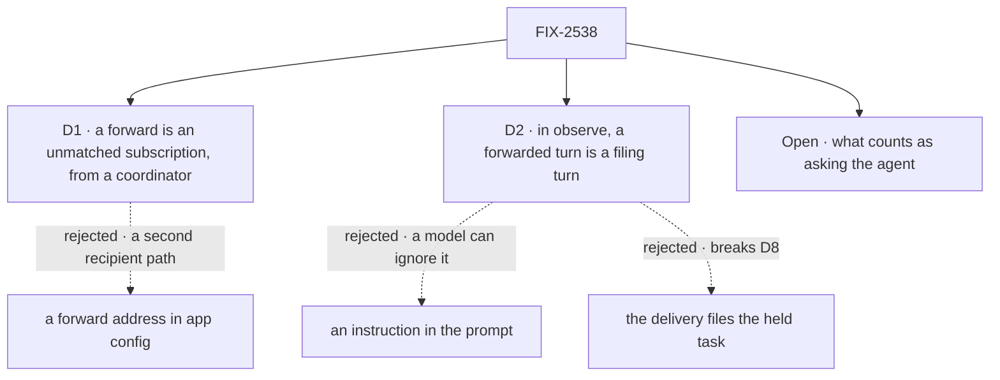

# FIX-2538 · Decisions

[Spec](SPEC.md) · **Decisions**

Two decisions are the sign-off surface, and one fork is open. The epic's D8, D11, Q1, Q3 and ER-2
are inputs.

## The tree

Solid edges are signed; dashed edges lost, for the reason on the label.

## D1 · A forward is a subscription with `unmatched: true`, made from a coordinator's session

| | |
|---|---|
| **Instead of** | A `forward:` option naming one coordinator, by user and session, in the app's config |
| **Because** | FIX-2534's path already runs as the subscriber: read access at subscribe and again on a private event (ER-4), the sender screen (Q1), the per-session id (ER-8), the cap. A forward address needs its own copy of each, and sends every org event to one user. Routing runs the unmatched subscriptions only when no ordinary subscription passed, and only for kinds the app lists in `forwards.kinds` (epic D8). Without `forwards`, nothing is forwarded |
| **Locks in** | `unmatched` on saved rows and index entries; `subscribe` refuses it outside a coordinator's session (`not_a_coordinator`), since only a coordinator reads `inferredWork` |

It comes down to a private repo: a forward address is a second read check to keep in step.

## D2 · In `observe`, a turn on a forwarded inferred event is a filing turn, enforced in code

| | |
|---|---|
| **Instead of** | Telling the coordinator's model, in its prompt, to file held · the delivery filing the held task itself |
| **Because** | The epic's *not done if* is "`observe` runs inferred work", and a prompt only asks. The delivery writes `forward: "ask" \| "inferred"` on the message row (server-written, like the received mark). The received entry copies it to request state. In `observe`, the turn on an inferred forward gets only read and filing tools (`listDelegates`, `listTasks`, `createTask`); the board's filing path adds a confirm (`onNo: "cancel"`) to each task it files. No `sendMessage`, no catalog tools. A filing from the delivery breaks D8: the service flow never calls `createTask` |
| **Locks in** | A turn whose tools depend on the message it answers. `off`: an inferred forward lands as a line and wakes no turn. `auto` and asks: the ordinary turn |

It comes down to a model that ignores the prompt: in the filing turn, it can only file held.

## Open

### What counts as asking the agent?

- **In plain terms:** epic D11 says an ask (it *"addresses the agent"* and passes the sender
  rule) runs in every mode, even `off`. The event must say whom it addresses. FIX-2535's GitHub
  normalize fills an optional `addressed` list (mentions, assignees, requested reviewers), and
  something must say which entry is "the agent".
- **The trade-off:** a handle the app names (`forwards.agent`) never treats a mention of a person
  as an ask, but two users' coordinators on one repo both act on it. The coordinator's own user
  (the provider's `self`) needs nothing new and is one coordinator per mention, but a mention meant
  for the person runs work, even with inferred work `off`.
- **My recommendation: the app's handle.** It keeps `off` meaning off for a person's mentions.
- **What would change my mind:** teams that run several coordinators on one repo.
- **If wrong:** a team that mentions its agent gets the work twice.

<b>Decided, not asked</b> — engineering calls

## Decided, not asked

- **Where.** The mode, the filing turn and `unmatched` in `workforce`; `addressed` in `core`'s event.
- **Unmatched means no ordinary subscription *passed*.** Not "none nominated": a comment a coding
  task's `kinds` or screens refused is still unheard. End-only runs on a closing thread don't count.
- **Kinds.** An unmatched subscription hears the intersection of its own `kinds` and
  `forwards.kinds`.
- **The count (epic D8).** The routing answer gains `unmatched: { forwarded, dropped? }` with a reason
  (`kind not forwarded`, `no coordinator follows`). `off`'s drop is the delivery's `act`. No
  store: totals are the closure ledger's.
- **The key.** `inferredWork: off | observe | auto`, default `observe`. Read at the turn, so a
  change applies to the next forward. Under `observe`, nothing changes until a coordinator
  subscribes `unmatched` and the app lists kinds.
- **An ask.** `addressed` names an agent handle (per the [open fork](#open)) and the `sender` screen
  passed. The mark is computed at delivery, as the user, never from model input (BP-031).
- **Every routing policy.** A forward runs the coordinator's own turn, as any received message
  does today; `round-robin` and `everyone` don't route it.
- **The confirm.** Its prompt is the coordinator's goal and the event's link; `onNo: "cancel"`.
  Yes releases the task to its assignee as filed.
- **Cost.** Each forward in `observe` or `auto` is one coordinator turn, under the per-subscription
  cap. The app's kind list bounds it.

## Considered and dropped

| Alternative | Why not |
|---|---|
| An Inbox item with no task | Epic Q3: the Inbox lists only task-row holds |
| The delivery files the held task | Epic D8 and ER-2: the service flow never files |
| Forwarding to every coordinator in the org | Crosses users (ER-4) |
| `held: true` instead of a confirm | Nothing asks the person; a held row has no Inbox item |

## Settled

None built. Two premises were read in the code: a worker turn's `uses` accepts a function of the
request (`agent-worker-flow.ts`, `UsesSlot`), and the received entry has request state
(`message-received-entry.ts` ~167).

## Analysis

2026-11-05 · watermark 2026-11-05 (FIX-2534 merged, #4687) · **Right approach, one fork raised.**
Run by the authoring worker (no sub-agent tool); say so at the gate.

1. **Reuse:** the subscription path carries delivery; the confirm hold carries the wait.
2. **Prior art:** GitHub's "Participating and @mentions" versus "Watching": an ask outranks a watch.
3. **Other shapes:** a forward address ([D1](#d1)); a prompt rule ([D2](#d2)).
4. **New factors:** FIX-2534 shipped no count; this adds it.
5. **Necessity:** the epic says *"If five is four, cut child 5."* Cutting it keeps today's drop.
   The team row would go unserved; the goal check above is the case for keeping it.
6. **Ergonomics:** one flag, one key, one app option.
7. **Concerns:** the [open fork](#open). FIX-2535 must fill `addressed`.

## How it got here

- **Draft (2026-11-05):** from the epic's D8, D11 and Q3, on FIX-2534 as merged.
