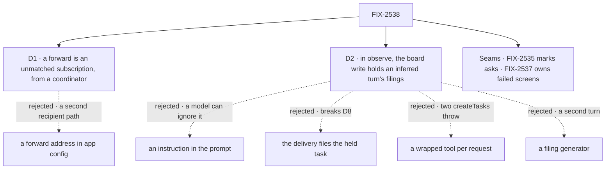

# FIX-2538 · Decisions

[Spec](SPEC.md) · **Decisions**

Two decisions are the sign-off surface; no fork is open. Inputs: the epic's D7, D8, D11, Q3, ER-2.

## The tree

Solid edges are signed; dashed edges lost, for the reason on the label.

## D1 · A forward is a subscription with `unmatched: true`, made from a coordinator's session

| | |
|---|---|
| **Instead of** | A `forward:` option naming one coordinator, by user and session, in the app's config |
| **Because** | FIX-2534's path already runs as the subscriber: the read check (ER-4), the sender screen (Q1), the per-session id (ER-8), the cap. A forward address copies each, and sends every org event to one user. The one screen run judges unmatched entries with the rest; `finish` takes one only when no ordinary subscription passed and none failed or held ([seams](#seams)), and only for kinds the app lists in `forwards.kinds` (epic D8). Without `forwards`, nothing is forwarded |
| **Locks in** | `unmatched` on `screenSettingsSchema`, so on saved rows and index entries; `subscribe` refuses it outside a coordinator's session (`not_a_coordinator`), since only a coordinator reads `inferredWork` |

It comes down to a private repo: a forward address is a second read check to keep in step.

## D2 · In `observe`, the board's write holds every filing on an inferred turn

| | |
|---|---|
| **Instead of** | An instruction in the prompt · the delivery filing the held task · a wrapped `createTask` swapped in per request · a separate filing generator |
| **Because** | A prompt only asks. The board ref's `createTask` already branches per request on `routes.routing(ctx)`, fed from request state. The delivery writes `ask` or `inferred` from the event's `addressed`, beside `addressedBy`; the received entry copies it to request state. On an `inferred` turn in `observe`, the write adds `questions: [{ kind: "confirm", prompt }]`, server-side (BP-031), on every tool path. A No cancels, the default. The turn keeps one tool set; a send to a delegate on that turn refuses on the same flag. A tool swap lost ([Settled](#settled)) |
| **Locks in** | A board write that reads the turn's mark. `off`: an inferred forward lands as a line, through the received entry's turnless landing. Asks, and `auto`: the ordinary turn (EM call, 2026-11-05) |

It comes down to a model that ignores the prompt: on the write, every task it files waits on a yes.

## Seams

| With | They own | This spec does |
|---|---|---|
| **FIX-2535** (EM call, 2026-11-05) | Produces `addressed` on the event and `agentHandles` on `githubServiceFlow`: the one knob, and what counts as asking | Reads `addressed` only. An unmatched forward with it is an ask, delivered in every mode, `off` included; any other is inferred |
| **FIX-2537** · epic D7, #4809 (EM call, 2026-11-05) | The screen chain's failed or held outcome | A content refusal is unheard and forwardable; a failed or held screen reaches no unmatched coordinator. Signal (e) |

<b>Decided, not asked</b> — engineering calls

## Decided, not asked

- **Where.** All in `workforce`; `orchestration` is reused as it is (EM call, 2026-11-05).
- **Unmatched means no ordinary subscription *passed* on content.** A comment a coding task's
  `kinds` or screens refused is unheard; a failed or held screen is not. End-only runs don't count.
- **Kinds.** An unmatched subscription hears the intersection of its own `kinds` and
  `forwards.kinds`; with no `kinds` of its own, every forwarded kind.
- **The count (epic D8).** `Routed` gains `unmatched: { forwarded, dropped? }` with a reason
  (`kind not forwarded`, `no coordinator follows`). No store: totals are the closure ledger's.
- **The key.** Read at the turn, so a change applies to the next forward.
- **The mark.** `ask | inferred`, from `addressed`, never model input (BP-031).
- **The confirm.** Its prompt is the goal and the event's link; yes releases the task as filed.
- **Cost.** One turn per ask, or per forward in `observe` or `auto`, under the cap.

## Considered and dropped

| Alternative | Why not |
|---|---|
| An Inbox item with no task | Epic Q3: the Inbox lists only task-row holds |
| `held: true` instead of a confirm | Nothing asks the person; a held row has no Inbox item |

## Settled

**A tool swap: REFUTED** ([POC](poc/dynamic-uses-override/README.md), 2026-11-05). A dynamic
same-named `createTask` beside the board throws (`assertUniqueToolNames`), and a catalog wrapper
behind a `tools:` fence is silently dropped. So D2 holds on the write and swaps no tool.

## Analysis

2026-11-05 · watermark FIX-2534 (#4687) · **Right approach.** By the authoring worker (no
sub-agent tool). Other shapes: [D1](#d1), [D2](#d2). Cutting child 5 keeps today's drop.

## How it got here

- **Draft (2026-11-05):** from the epic's D8, D11 and Q3, on FIX-2534 as merged.
- **Restraint and reuse fold (2026-11-05):** the ask fork to FIX-2535; the confirm reused; failed
  screens forward nothing; one screen run; after the POC, the hold moved onto the board's write. EM calls.
