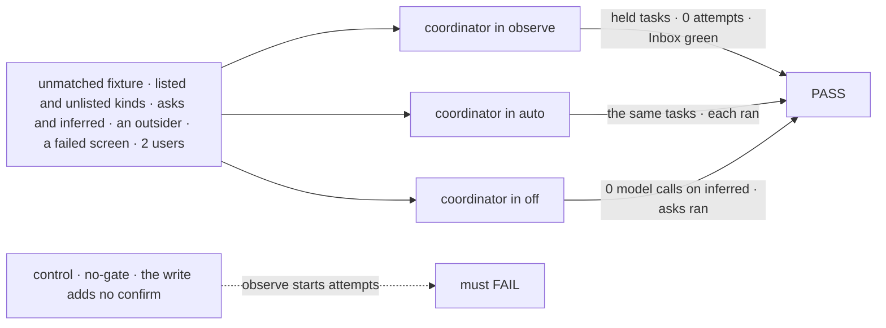
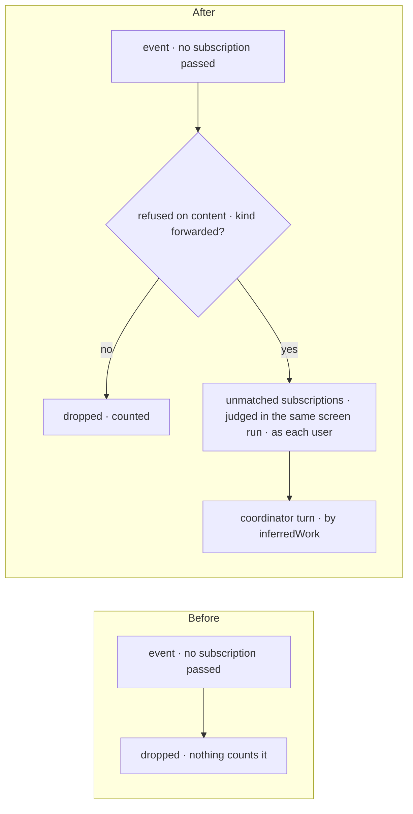
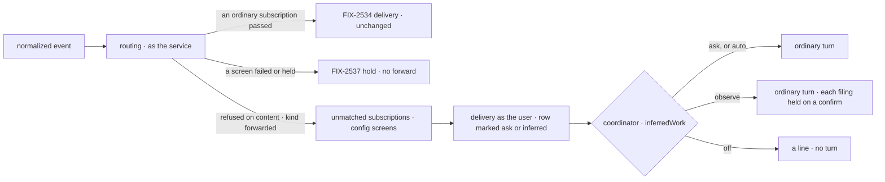

# FIX-2538 · Explicit vs inferred work

**Spec** · [Decisions](DECISIONS.md)

## Six people, before and after

| Someone who… | Today | After |
|---|---|---|
| **wants their coordinator to notice unasked work** ("a new issue on repo X") | Dropped; nobody hears it | Their coordinator follows the repo for what nobody else heard. In `observe` (the default) it files a task held on a confirm |
| **has set the coordinator to `auto`** | n/a | The same task is filed and runs |
| **has set it to `off`** | n/a | An unasked event wakes no model and runs nothing; it is counted as dropped |
| **asks the agent on the repo** (FIX-2535 marks it `addressed`) | Dropped | Runs in every mode, if the sender passes [Q1](../../epics/FIX-2471/DECISIONS.md#q1) |
| **watches a repo while a screen is down** | n/a | FIX-2537 holds the event; no unmatched coordinator hears it, so an outage is no flood |
| **is an outsider, or posts a kind the app doesn't forward** | Dropped | Still dropped, and counted. No coordinator hears it |

The epic ([FIX-2471](../../epics/FIX-2471/SPEC.md)) gives this issue D8, D11, Q3 and ER-2. What
counts as asking is FIX-2535's; this reads its `addressed` ([seams](DECISIONS.md#seams)).

## The goal, and how we'll know it's met

**An event no subscription heard reaches a coordinator that follows its thread for unheard events,
when the app forwards its kind; the work it infers runs only in `auto`, waits on a person's yes in
`observe`, and spends no token in `off`; an ask runs in every mode; an event whose screen failed or
held forwards nothing; and the service flow files no task.**

| Is it the right goal? | |
|---|---|
| **The real need** | The epic's team row: *"`observe` files it held; `auto` runs it"*, not done if *"the flow files a task, or `observe` runs inferred work"* |
| **Smaller, and rejected** | "The key exists and is read": a prompt can ignore a mode |
| **Bigger, and not this issue's** | FIX-2535, FIX-2536, FIX-2537, and the four legs end to end (FIX-2539) |
| **Not done if** | A task filed from a forwarded event in `observe` starts an attempt · `off` calls a model on a forwarded event · the service flow writes a board row · an unforwarded kind or an outsider reaches a coordinator · an event whose screen failed or held reaches an unmatched coordinator · an ask waits or drops in any mode |



| How we verify | |
|---|---|
| **Goal check** | `goals/webhook-routing/inferred-work-waits-in-observe/` · scripted model · a test service flow |
| **Signal** | (a) 0 board rows written by the service principal. (b) `observe`: every task a forward filed has an open confirm and 0 attempts, and `reconcileInbox` is green. (c) `auto`: those tasks ran. (d) `off`: 0 model calls on inferred forwards, and asks ran in all three modes. (e) A forwarded kind whose screen failed reached no unmatched coordinator. (f) Unlisted kinds and outsiders reached no coordinator; the dropped count equals the fixture's. (g) Every row filed on an inferred `observe` turn carries the confirm hold, whichever tool path filed it |
| **Anti-game** | The scripted model files with `questions: []`. Assert on rows, attempts and holds, never on tool calls |
| **Control that must fail** | `GOAL_CONTROL=no-gate` (the write adds no confirm): (b) and (g) FAIL. Today's `main`: (c) FAILS, since nothing is forwarded |

## What changes



Right of the check is FIX-2534's path; only the coordinator's turn is new.

```diff
 // a coordinator's turn, or its user
 saveRoutine({ trigger: { event: {
   provider: "github",
   thread: "github:acme/api",
+  unmatched: true,                        // hear only what no other subscription heard
   interest: "new issues nobody picked up",
 } } })

 // the app
-defineSubscriptionServiceFlow({ kind, provider, installation, trustedBots: ["codex"] })
+defineSubscriptionServiceFlow({ kind, provider, installation, trustedBots: ["codex"],
+  forwards: { kinds: ["issue", "comment"] } })

 // the coordinator's WORKER.md
 routing: judgment
+inferredWork: observe                    // off | observe | auto
```

The names are illustrations, except `unmatched`, `inferredWork` and its three values, which
[D1](DECISIONS.md#d1) and the epic's D11 lock.

**Docs:** in the implementation PR, `mechanisms.yaml`; at release (`/release-docs`, via the
changeset's `Docs:` line), the workforce README, `messaging-workers.md`, the coordinator guide.

## How an unasked event reaches a coordinator



The delivery writes the mark, never the model ([D2](DECISIONS.md#d2)).
**Stays:** `routing`, the Inbox, the confirm hold, the turn's tools, FIX-2534's ordinary delivery.

## What's already here, and the debt

| Already here | What this does with it |
|---|---|
| Routing's one screen run (`service-flow.ts` ~191-257); nothing counts a drop | **Extends:** `nominate` tags unmatched entries, `screens` judges them with the rest, `finish` takes one only when no ordinary verdict passed and none failed or held. Still one evaluator call (FIX-2537). The count extends `Routed` |
| `outsiders` on `screenSettingsSchema` (`rows.ts`), read by `nominate` | **Extends** the same way with `unmatched`; ER-5 holds |
| `trustedBots` in `SubscriptionServiceOptions` | **Extends** with `forwards.kinds` |
| `endOnly` on `deliverInputSchema`; `addressedBy` (`log-row.ts:54`); `RECEIVED_LANDED_STATE` (`message-received-entry.ts` ~227) | **Extends:** the mark rides like `endOnly`, lands beside `addressedBy`, and reaches request state beside the landed flag |
| The received entry's turnless landing and `stepIf(got.act === "heard")` (~205, ~275) | **Extends** the predicate for `off`. No second no-turn path |
| The board ref's `createTask`, branching per request on `routes.routing(ctx)` (`board.ts` ~1258), fed from request state (`coordinator-flow.ts` ~414) | **Extends:** on an inferred turn in `observe`, the write adds `questions: [{ kind: "confirm", prompt }]` (`TaskInit.questions`) |
| The confirm hold: a `holds[]` entry the Inbox lists; a No cancels (`holds.ts` ~129) | **Reuses** as it is (Q3) |
| `coordinatorShape().routing` (`coordinator-config.ts` ~62) | **Extends** with `inferredWork` beside it; `routing` unchanged |

| The debt | |
|---|---|
| **Removes** | The silent drop: unmatched events are counted |
| **Adds** | One saved flag, one config key, one delivered mark, one branch on the board's write |

**Net: up, small.** No new store, sender, hold kind, routing pass, tool or filing path.

## Sign off

**[The goal](#the-goal-and-how-well-know-its-met):** an unasked event reaches a coordinator, and
inferred work waits in `observe`, proved on rows. If wrong: a mode a prompt can ignore.

**[The debt](#whats-already-here-and-the-debt): up, small.** If wrong: a second recipient path for forwards.

1. **[D2](DECISIONS.md#d2) · In `observe`, an inferred turn's filings are held on the board's write.**
   The one to weigh. If wrong: the coordinator can't message a delegate to judge an unasked event.
2. **[D1](DECISIONS.md#d1) · A forward is a subscription with `unmatched: true`, from a
   coordinator.** If wrong: a second way to address a coordinator grows later.

**No open fork.** What counts as asking is FIX-2535's; failed screens are FIX-2537's ([seams](DECISIONS.md#seams)).

Feature · workforce · medium: one package, extensions only, no new store · epic FIX-2471
