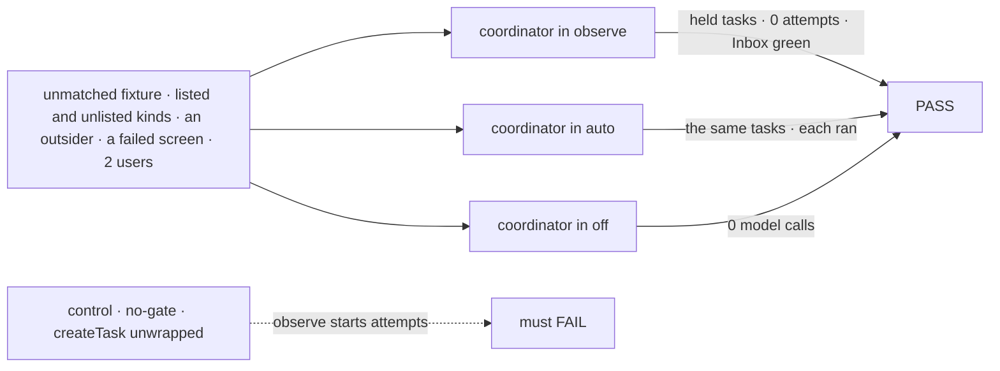
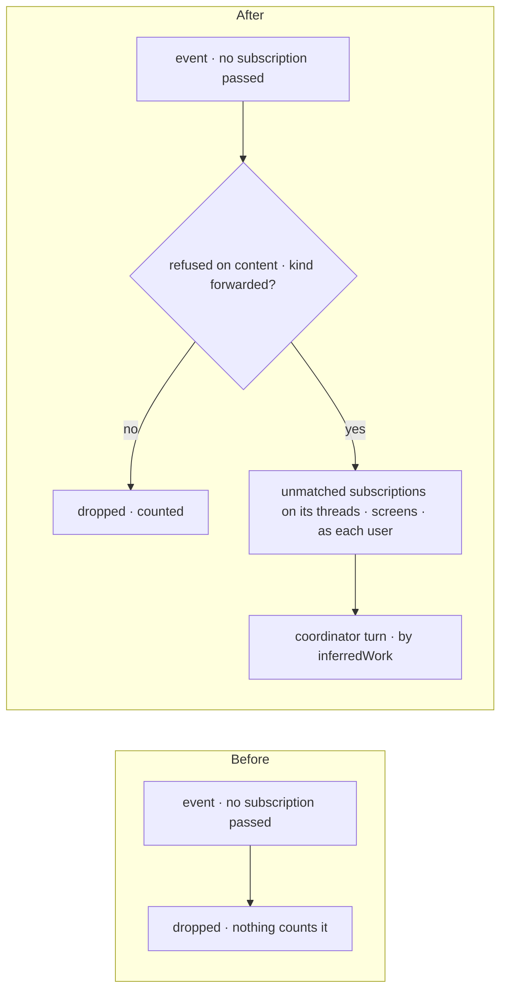
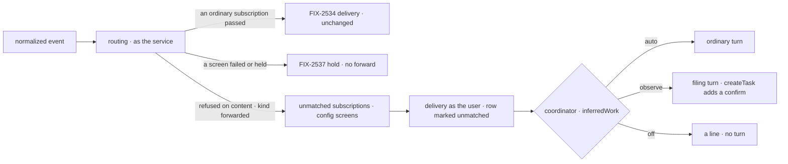

# FIX-2538 · Explicit vs inferred work

**Spec** · [Decisions](DECISIONS.md)

## Five people, before and after

| Someone who… | Today | After |
|---|---|---|
| **wants their coordinator to notice unasked work** ("a new issue on repo X") | The event is dropped; nobody hears it | Their coordinator follows the repo for what nobody else heard. In `observe` (the default) it files a task held on a confirm |
| **has set the coordinator to `auto`** | n/a | The same task is filed and runs |
| **has set it to `off`** | n/a | An unasked event wakes no model and runs nothing; it is counted as dropped |
| **watches a repo while a screen is down** (the evaluator fails) | n/a | FIX-2537 holds the event for its subscriber; no unmatched coordinator hears it, so an outage is not a flood |
| **is an outsider, or posts a kind the app doesn't forward** | Dropped | Still dropped, and counted. No coordinator hears it |

The epic ([FIX-2471](../../epics/FIX-2471/SPEC.md)) gives this issue D8, D11, Q3 and ER-2. Asking
the agent is FIX-2535's ([seams](DECISIONS.md#seams)): here every forwarded event is inferred work.

## The goal, and how we'll know it's met

**An event no subscription heard reaches a coordinator that follows its thread for unheard events,
when the app forwards its kind; the work it infers runs only in `auto`, waits on a person's yes in
`observe`, and spends no token in `off`; an event whose screen failed or held forwards nothing; and
the service flow files no task.**

| Is it the right goal? | |
|---|---|
| **The real need** | The epic's team row: *"wants the coordinator to notice unasked work"*, with *"`observe` files it held; `auto` runs it"* and *"Not done if … the flow files a task, or `observe` runs inferred work"* |
| **Smaller, and rejected** | "The key exists and is read": a prompt can ignore a mode |
| **Bigger, and not this issue's** | GitHub's normalize and asks (FIX-2535), polling (FIX-2536), Jev on forwards (FIX-2537), the four legs end to end (FIX-2539) |
| **Not done if** | A task filed from a forwarded event in `observe` starts an attempt · `off` calls a model on a forwarded event · the service flow writes a board row · an unforwarded kind or an outsider reaches a coordinator · an event whose screen failed or held reaches an unmatched coordinator |



| How we verify | |
|---|---|
| **Goal check** | `goals/webhook-routing/inferred-work-waits-in-observe/` · scripted model · a test service flow |
| **Signal** | (a) 0 board rows written by the service principal. (b) `observe`: every task a forward filed has an open confirm and 0 attempts, and `reconcileInbox` is green. (c) `auto`: those tasks ran. (d) `off`: 0 model calls on forwards. (e) A forwarded kind whose screen failed reached no unmatched coordinator. (f) Unlisted kinds and outsiders reached no coordinator; the dropped count equals the fixture's |
| **Anti-game** | The scripted model files with `questions: []`. Assert on rows, attempts and holds, never on tool calls |
| **Control that must fail** | `GOAL_CONTROL=no-gate` (the turn gets the board's `createTask` unwrapped): (b) FAILS. Today's `main`: (c) FAILS, since nothing is forwarded |

## What changes



Right of the check is FIX-2534's path, as the subscriber; only the coordinator's turn is new.

```diff
 // a coordinator's turn, or its user
 subscribe({
   provider: "github",
   thread: "github:acme/api",
+  unmatched: true,                        // hear only what no other subscription heard
   interest: "new issues nobody picked up",
 })

 // the app
-defineSubscriptionServiceFlow({ kind, provider, installation, trustedBots: ["codex"] })
+defineSubscriptionServiceFlow({ kind, provider, installation, trustedBots: ["codex"],
+  forwards: { kinds: ["issue", "comment"] } })

 // the coordinator's WORKER.md
 routing: judgment
+inferredWork: observe                    // off | observe | auto
```

The names are illustrations, except `unmatched`, `inferredWork` and its three values, which
[D1](DECISIONS.md#d1) and the epic's D11 lock.

**Docs:** the workforce README, `messaging-workers.md`, the coordinator guide.

## How an unasked event reaches a coordinator



The mark is written by the delivery on the message row, never by the model ([D2](DECISIONS.md#d2)).
**Stays:** `routing` and its four policies, the Inbox, the confirm hold, `createTask`, and
FIX-2534's delivery for every ordinary subscription.

## What's already here, and the debt

| Already here | What this does with it |
|---|---|
| **The job, "notice work nobody asked for".** Searched `mechanisms.yaml`, `packages/`: rules and schedules file work a person set up; nothing hears events nobody follows | **New** |
| FIX-2534's routing: an event no subscription passes gets no owner run; **nothing counts it** (`service-flow.ts` `finish`, ~216) | **Extends:** a second pass in `finish` over unmatched entries when nothing passed; the drop count extends `Routed` (~90) |
| The subscription row and index entry (`rows.ts`, `screenSettingsSchema`) | **Extends:** `unmatched` is new here, on `screenSettingsSchema` and so on the index entry; ER-5 holds |
| `SubscriptionServiceOptions` (`trustedBots`) | **Extends:** `forwards` beside `trustedBots` |
| The message row (`messages/log-row.ts`, `workerMessageRowSchema`) | **Extends:** one server-written flag beside `addressedBy` |
| `createTask`'s confirm: `questions: [{ kind: "confirm", prompt }]` (`skills/task-tools-capability.ts` ~1033); a No cancels by default (`tasks/collection/holds.ts` ~129) | **Reuses:** wrapped in workforce through a request-dependent `uses`. No new filing path; the Inbox lists it already (Q3) |
| `routing` (`coordinator-config.ts` ~62) | **Leaves alone;** `inferredWork` is a key beside it |

| Adds | Composed from |
|---|---|
| `unmatched` subscriptions | `screenSettingsSchema`, coordinator sessions only |
| `forwards.kinds` on the service flow | `trustedBots`' place in the options |
| `inferredWork` | One key beside `routing`, default `observe` (epic D11) |
| The filing turn | The coordinator's turn with read tools and a wrapped `createTask` |

| The debt | |
|---|---|
| **Removes** | The silent drop: unmatched events are counted |
| **Adds** | A second routing pass. One saved flag, one config key, one message-row flag. A turn whose tools depend on its message |

**Net: up, small.** No new store, sender, hold kind or filing path.

## Sign off

**[The goal](#the-goal-and-how-well-know-its-met):** an unasked event reaches a coordinator, and
inferred work waits in `observe`, proved on rows. If wrong: a mode a prompt can ignore.

**[The debt](#whats-already-here-and-the-debt): up, small.** If wrong: a second recipient path for forwards.

1. **[D2](DECISIONS.md#d2) · In `observe`, a forwarded turn is a filing turn, enforced in code.**
   The one to weigh. If wrong: the coordinator can't message a delegate to judge an unasked event.
2. **[D1](DECISIONS.md#d1) · A forward is a subscription with `unmatched: true`, from a
   coordinator.** If wrong: a second way to address a coordinator grows later.

**No open fork.** Asks and failed screens are settled at the [seams](DECISIONS.md#seams).

Feature · workforce · medium: one package, four adds, no new store · epic FIX-2471
