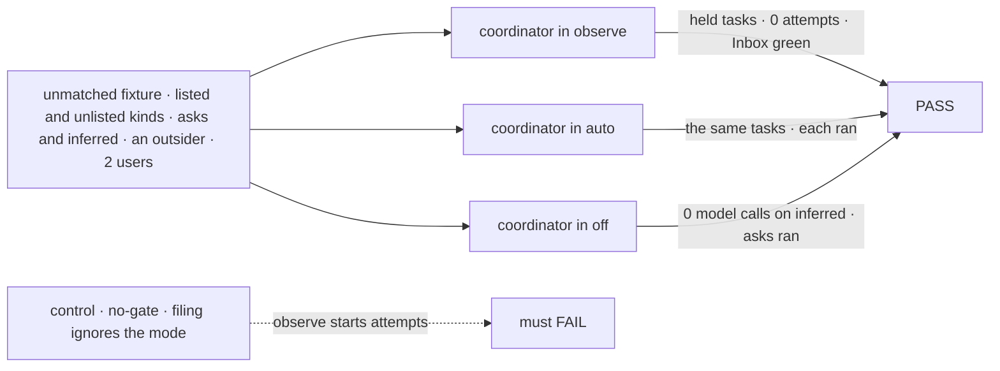
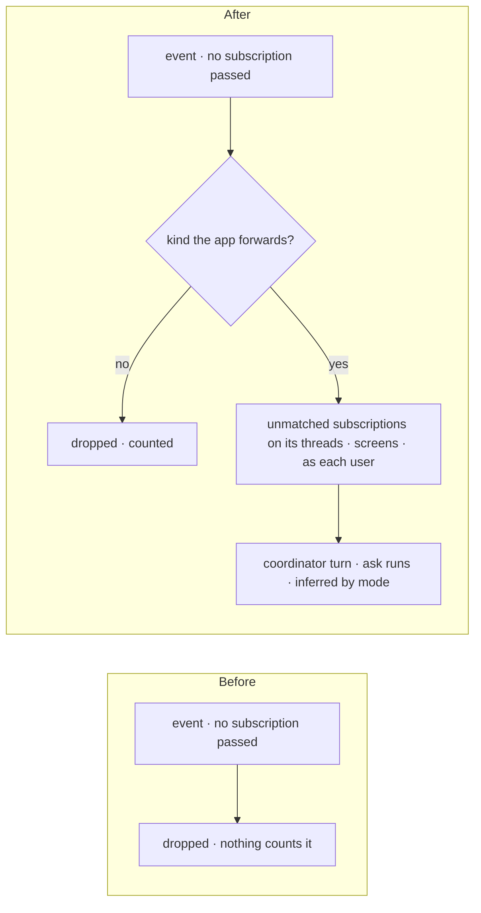
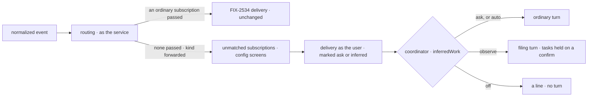

# FIX-2538 · Explicit vs inferred work

**Spec** · [Decisions](DECISIONS.md)

## Five people, before and after

| Someone who… | Today | After |
|---|---|---|
| **wants their coordinator to notice unasked work** ("a new issue on repo X") | The event is dropped; nobody hears it | Their coordinator follows the repo for what nobody else heard. In `observe` (the default) it files a task held on a confirm; nothing runs until they say yes |
| **has set the coordinator to `auto`** | n/a | The same task is filed and runs |
| **has set it to `off`** | n/a | An unasked event wakes no model and runs nothing; it is counted as dropped |
| **asks the agent on the repo** (a teammate mentions the app's agent) | Dropped | Runs in every mode, if the sender passes the sender rule ([Q1](../../epics/FIX-2471/DECISIONS.md#q1)) |
| **is an outsider, or posts a kind the app doesn't forward** | Dropped | Still dropped, and counted. No coordinator hears it |

The epic ([FIX-2471](../../epics/FIX-2471/SPEC.md)) gives this issue D8, D11, Q3 and ER-2.

## The goal, and how we'll know it's met

**An event no subscription heard reaches a coordinator that follows its thread for unheard events,
when the app forwards its kind; work the coordinator infers from it runs only in `auto`, waits on a
person's yes in `observe`, and spends no token in `off`; an ask addressed to the agent runs in every
mode; and the service flow files no task.**

| Is it the right goal? | |
|---|---|
| **The real need** | The epic's team row: *"wants the coordinator to notice unasked work"*, with *"`observe` files it held; `auto` runs it"* and *"Not done if … the flow files a task, or `observe` runs inferred work"* |
| **Smaller, and rejected** | "The key exists and is read": a prompt can ignore a mode, so nothing proves `observe` ran nothing |
| **Bigger, and not this issue's** | GitHub's normalize (FIX-2535), polling (FIX-2536), Jev on forwards (FIX-2537), the four legs end to end (FIX-2539) |
| **Not done if** | A task filed from an unasked event in `observe` starts an attempt · a turn in `observe` messages a delegate · `off` calls a model on an unasked event · the service flow writes a board row · an unforwarded kind or an outsider reaches a coordinator · an ask to the agent waits in `observe` |



| How we verify | |
|---|---|
| **Goal check** | `goals/webhook-routing/inferred-work-waits-in-observe/` · scripted model · verdict on the implementation PR, through a test service flow |
| **Signal** | (a) 0 board rows written by the service principal. (b) `observe`: every task an inferred forward filed has an open confirm and 0 attempts, and `reconcileInbox` is green. (c) `auto`: those tasks ran. (d) `off`: 0 model calls on inferred forwards. (e) Asks ran in all three modes. (f) Unlisted kinds and outsiders reached no coordinator; the dropped count equals the fixture's |
| **Anti-game** | The scripted model always tries `createTask` *and* `sendMessage` to a delegate. Assert on board rows, attempts and stored messages, never on tool calls |
| **Control that must fail** | `GOAL_CONTROL=no-gate` (the filing path ignores the mode): (b) FAILS. Today's `main`: (c) and (e) FAIL, since nothing is forwarded |

## What changes



Everything right of the kind check is FIX-2534's path, as the subscriber; only the coordinator's turn is new.

```diff
 // a coordinator's turn, or its user
 subscribe({
   provider: "github",
   thread: "github:acme/api",
+  unmatched: true,                        // hear only what no other subscription heard
   interest: "new issues nobody picked up",
 })

 // the app
-defineSubscriptionServiceFlow({ kind, provider, installation, trustedBots: ["codex"] })
+defineSubscriptionServiceFlow({ kind, provider, installation, trustedBots: ["codex"],
+  forwards: { kinds: ["issue", "comment"], agent: ["fsd-agent"] } })

 // the coordinator's WORKER.md
 routing: judgment
+inferredWork: observe                    // off | observe | auto
```

`forwards.agent` is the [open fork](DECISIONS.md#open); the names are illustrations, except
`unmatched`, `inferredWork` and its three values, which [D1](DECISIONS.md#d1) and the epic's D11 lock.

**Docs:** the workforce README (subscriptions, coordinator config), `messaging-workers.md`, the coordinator guide.

## How an unasked event reaches a coordinator



The mark is written by the delivery on the message row, never by the model ([D2](DECISIONS.md#d2)).
**Stays:** `routing` and its four policies, the Inbox and its sources, the confirm hold, and
FIX-2534's delivery for every ordinary subscription.

## What's already here, and the debt

| Already here | What this does with it |
|---|---|
| **The job, "notice work nobody asked for".** Searched `mechanisms.yaml`, `packages/`: standing rules and schedules file work a person set up; nothing hears outside events nobody follows | **New, and the only one** |
| FIX-2534's routing: an event no subscription passes returns empty verdicts and no owner run; **nothing counts it** (`service-flow.ts` `finish`) | **Extends:** a second pass over unmatched subscriptions, and the count in the routing answer |
| The subscription row, index entry, `subscribe` | **Extends** with `unmatched`; ER-5 holds |
| `sendServiceMessage`, the received mark (`messages/received-mark.ts`) | **Extends** with the ask-or-inferred mark |
| The confirm row hold (`tasks/schema/hold.ts`), `questions` at filing | **Reuses:** a held task is an ordinary confirm; the Inbox lists it already (Q3) |
| `routing` (`coordinator-config.ts`) | **Leaves alone;** `inferredWork` sits beside it |

| Adds | Composed from |
|---|---|
| `unmatched` subscriptions | The subscription row and index, coordinator sessions only |
| `forwards` on the service flow | `trustedBots`' shape: kinds and the agent's handles |
| An optional `addressed` list on the event | ER-6's event, one optional field; FIX-2535's normalize fills it |
| `inferredWork` | One key beside `routing`, default `observe` (epic D11) |
| The filing turn | The coordinator's turn with read and filing tools, every filing held |

| The debt | |
|---|---|
| **Removes** | The silent drop: unmatched events are counted |
| **Adds** | A second routing pass. One saved flag, one config key, one event field. A turn whose tools depend on its message |
| **Leaves** | Nothing to clean up |

**Net: up, small.** No new store, sender or hold kind.

## Sign off

**[The goal](#the-goal-and-how-well-know-its-met):** an unasked event reaches a coordinator, and
inferred work waits in `observe`, proved on rows. If wrong: a mode a prompt can ignore.

**[The debt](#whats-already-here-and-the-debt): up, small.** If wrong: a second recipient path appears for forwards.

1. **[D2](DECISIONS.md#d2) · In `observe`, a forwarded turn is a filing turn, enforced in code.**
   The one to weigh. If wrong: the coordinator can't message a delegate to judge an unasked event.
2. **[D1](DECISIONS.md#d1) · A forward is a subscription with `unmatched: true`, from a
   coordinator.** If wrong: a second way to address a coordinator grows later.

**Open: [what counts as asking the agent](DECISIONS.md#open).** Recommended: a handle the app names.

Feature · workforce, core · medium: two packages, five adds, no new store · epic FIX-2471
