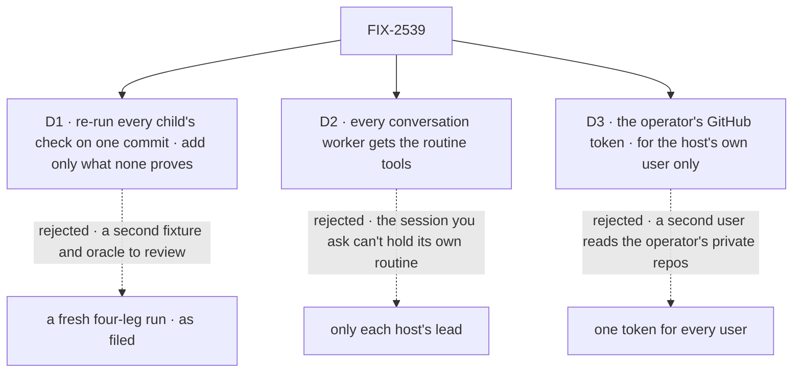

# FIX-2539 · Decisions

[Spec](SPEC.md) · **Decisions**

## The tree

Solid edges are what you sign. Dashed edges lost, and the label says why.

## D1 · The closure re-runs every child's goal check on one `main` commit, and adds only what none proves

| | |
|---|---|
| **Instead of** | A fresh run of legs a to d over one new fixture, as filed |
| **Because** | Each leg has a goal check whose controls were seen to fail: FIX-2534 (delivery, dedupe), FIX-2535 (push), FIX-2536 (poll), FIX-2537 (screens), FIX-2538 (observe, auto), FIX-2614 (the list). None proves the 5× bar, Slack-shaped events, push and poll with redeliveries together, or the laptop journey; the closure adds those |
| **Locks in** | The verdict is the children's on one SHA plus the new legs. A child check changed later changes what the closure proved |

**What would change my mind:** a review that finds a bug visible only when legs share one fixture.

It comes down to trust: a fresh run needs a new oracle reviewed, for a cross-leg bug nobody has named.

## D2 · Every conversation worker in each host gets the routine tools; coding workers don't

| | |
|---|---|
| **Instead of** | Only each host's lead, named in its `WORKER.md` |
| **Because** | The owner asked for *sessions* to manage their routines. An event routine is heard in the session that saved it, so the worker you talk to must hold the tool. A coding task already follows its PR (FIX-2535) |
| **Locks in** | Any conversation can start work that runs as you. The Routines view names its maker and stops it. A host wanting fewer installs it quieter on that flow |

**What would change my mind:** workers saving routines nobody asked for, in the real-model leg.

It comes down to who hears the event: lead-only means the session you asked can't follow its PR.

## D3 · A host's GitHub reads use its operator's token, for the host's own user only

| | |
|---|---|
| **Instead of** | One token for every user of the host · a per-user token in settings |
| **Because** | Epic ER-4: a user hears only what they can read. A lab runs as one user on the operator's laptop. A second user, which devteam can have, gets no token, so their GitHub routine is refused: fail closed |
| **Locks in** | GitHub routines work for whoever started the host. A team sharing one Shift Manager needs per-user tokens first |

**What would change my mind:** a team asking to share one devteam host this quarter.

It comes down to a second user: one shared token hands them the operator's private repos.

## Decided, not asked

- **The labs poll; none mounts the webhook transport.** The owner's direction: a laptop has no
  public URL. Cadence is the routine's, 5 minutes at the fastest (epic D10).
- **Two schedule indexes per host, one SQLite file each, beside its store.** One ticks the roster
  (clock routines), one the service flow (polls). `createSQLiteScheduleIndex` has one table, so
  a shared file would hand polls to the roster. `serve()` ticks both; no host ticks itself.
- **The token is `GITHUB_TOKEN`, else `gh auth token`, read once at start**, never from a request.
  Missing, a GitHub routine is refused naming the variable.
- **Coordinator flows take the capability in their agent turn.** `routines: true` stays off:
  Shift Manager acts through the roster.
- **ER-7 is graded as built:** a PR closing, or its task failing or cancelled, ends the
  subscription. The epic still lists ER-7 open; its wrap records it.
- **The verdict waits for FIX-2647 and FIX-2648**, poll bugs another thread is fixing.
  FIX-2651's move may land either side; the checks import package entry points.
- **The kill line is read first.** Under 5×, or a share under half, the epic stops. The lab wiring
  stands on its own: it is the owner's ask.

## Considered and dropped

| Alternative | Why not |
|---|---|
| A workforce helper that wires routines in one call | Eight lines per host; new API for glue. A fourth host earns it |
| A webhook in each lab through a tunnel | Needs a public URL and a secret, which a laptop lacks |
| Routines in Kitchen Sink | Not asked |
| A goal check per host | One oracle over three hosts reads cheaper |

## Settled

No POC: the premises are what the children's checks ran (the capability on a worker's turn,
FIX-2614; the tick body, FIX-2536). No counted facts beyond those, so no factual-base checker.

## Analysis

2026-11-11 · watermark 2026-11-04 (epic merge) · **Right approach.** Run inline by the author;
no fresh sub-agent was available in this session.

1. **Reuse:** the Adds table is empty; a host helper is dropped.
2. **Prior art:** polling triggers are how no-webhook integrations work; a tunnel is the usual
   local-webhook route, dropped.
3. **Other shapes:** a fresh fixture (D1); lead-only tools (D2).
4. **New factors:** FIX-2647, FIX-2648 (the verdict waits); FIX-2649, FIX-2650 (Leaves);
   FIX-2655's three controls run in goal check 2; FIX-2630 follows the closure.
5. **Necessity:** the epic can't close without it; the owner asked for the tools.
6. **Ergonomics:** ask in words; one environment variable.
7. **Concerns:** a shared index file misfires silently. Recorded above.

## How it got here

- **Draft** — the epic's closure plus the owner's fold of FIX-2670 (2026-11-11). The closure
  composes the children's checks on one commit; three hosts wire shipped routines, polling and
  the service flow, with no package change.
