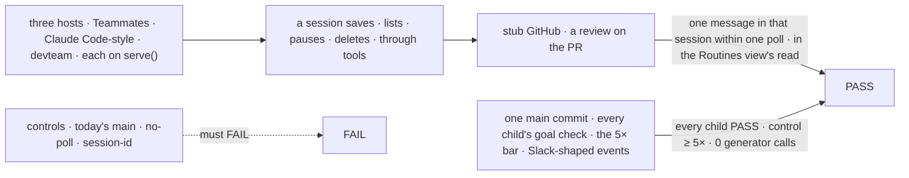
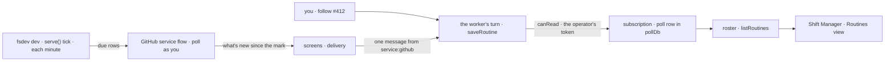

# FIX-2539 · Closure (required): an outside event reaches the sessions that asked for it

**Spec** · [Decisions](DECISIONS.md)

## Six people, before and after

| Someone who… | Today | After |
|---|---|---|
| **asks Teammates' Chief of Staff to "follow acme/api#412 and tell me about reviews"** | It has no tool for that | It saves an event routine; each review lands in that conversation within one 5-minute poll, with no public URL |
| **asks a Claude Code-style session to "check open PRs every Monday at 9"** | Nothing runs on a clock | A clock routine files that task each Monday, ticked by `fsdev dev` |
| **asks a session "what are you following? stop the #412 one"** | n/a | It lists its routines and pauses or deletes one |
| **opens Shift Manager's Routines view on its own team** | Always empty | Every routine a worker made, *made by* that worker, with pause, resume, delete |
| **has no GitHub token, or is a second user of the host** | n/a | A GitHub routine is refused, naming `GITHUB_TOKEN`; clock routines work ([D3](DECISIONS.md#d3)) |
| **owns the epic** | Each child proved its leg alone; the 5× bar was never measured | One `main` commit runs every leg and the 5× bar. Under 5×, the epic stops ([D1](DECISIONS.md#d1)) |

Rows 1 to 4 are [FIX-2670](https://linear.app/fixpoint-labs/issue/FIX-2670), folded in by the
owner (2026-11-11); row 6 is the closure of [FIX-2471](../../epics/FIX-2471/SPEC.md).

## The goal, and how we'll know it's met

**In either lab and in Shift Manager's own team, a person asks a session to follow a GitHub PR or
run something on a clock, then lists, pauses, resumes or deletes it by asking or in the Routines
view, and the PR's events reach that session by polling with no public URL; and on one `main`
commit every leg of the epic passes, at a fifth or less of the tokens a coordinator reading
every event would spend.**

| Is it the right goal? | |
|---|---|
| **The real need** | The owner: *"I want the ability for sessions to manage their routines using tools"*, polling on a laptop. The epic's closure |
| **Smaller, and rejected** | "The tools appear in each lab": nothing fires without a token, a tick and a service flow. "Re-run the children's checks": no laptop journey, no 5× bar |
| **Bigger, and not this issue's** | Sessions publishing events (FIX-2630) · a Slack flow (epic Q4) · webhooks through a tunnel · per-user tokens on a shared host |
| **Not done if** | A routine fires only in a test host, or only because the check ticked it · the view misses a worker's routine · a second user reads with the operator's token · the closure mixes commits · the 5× bar is estimated · FIX-2647 or FIX-2648 is open |



The top path reads what a person sees; the bottom is the epic's check, on one commit.

| How we verify | |
|---|---|
| **Goal check 1** | `goals/routines/sessions-in-the-labs-manage-their-routines/` · each host's own open function, on `serve()` · scripted model, plus a real-model leg (`openai/gpt-6-luna`) |
| **Signal 1** | Per host: (a) tools save an event routine on a PR and a clock routine. (b) The roster's `listRoutines`, through Shift Manager's `toRoutines`, lists both, *made by* the worker. (c) A stub review reaches that session once, within one poll of `serve()`'s tick. (d) Paused, nothing; resumed, delivered; deleted, gone. (e) The clock files one task. (f) A second user is refused. (g) Real model, in words: saved, listed, deleted |
| **Goal check 2** | `goals/webhook-routing/an-outside-event-reaches-the-sessions-that-asked/` · no model · one SHA, after FIX-2647 and FIX-2648 merge |
| **Signal 2** | Each child check PASSes, each named control FAILs. Every-event-through-the-coordinator costs ≥ 5× the routed path's tokens (`createTiktokenCounter`, `cl100k_base`). Config share ≥ 0.5. Slack-shaped events match the oracle. Push and poll with redeliveries, two sessions on a PR: nothing twice. 0 generator calls; ≤ 1 evaluator call per event |
| **Input** | 1: a stub GitHub API at the provider's `apiUrl`; another repo must pass too. 2: FIX-2534's fixture and redeliveries, plus Slack-shaped events |
| **Anti-game** | Grade stored routines and messages, never a tool's answer or the model's reply. The tick is `serve()`'s; the check dispatches nothing |
| **Control that must fail** | Today's `main`: (a). `GOAL_CONTROL=no-poll`: (c). FIX-2535's `session-id`; FIX-2534's `one-key` |

## What changes


Each row is something a person relies on, in all three hosts. No package changes.

```diff
 // each host: labs/teammates, labs/claude-code-style, shift-manager's devteam
+const github = githubSubscriptionProvider({ token: … })  // D3: GITHUB_TOKEN, else one `gh auth token` read at start
 flows = {
   agent: defineAgentWorkerFlow({ installation, …,
-    uses: [ … ],
+    uses: [ …, createRoutinesCapability(installation) ],                          // D2
   }),
   coordinator: defineCoordinatorFlow({ installation, …,                           // CCS and devteam only; Teammates has none. Never `routines: true` here
-    agent: { … },
+    agent: { …, uses: [ …, createRoutinesCapability(installation) ] },
   }),
 }
-const copies = hireWorkforce(installation)
+const copies = hireWorkforce(installation, { routines: {
+  index: createSQLiteScheduleIndex(clockDb),           // clock routines
+  providers: [github],
+  poll: { index: createSQLiteScheduleIndex(pollDb) },   // a different SQLite file from clockDb: one index ticks one flow
+} })
+const service = githubServiceFlow({ provider: github, installation, poll: true })
 createFlowState({
-  flows: { …copies },
+  flows: { …copies, [service.id]: service },
+  adapters: [createScheduledTransportAdapter()],
 })
```

```diff
 # the operator's shell
+export GITHUB_TOKEN=…   # else the host asks `gh auth token` once at start
```

**Docs:** update the two labs' READMEs and `packages/shift-manager/teams/devteam/README.md` in
the change (the token; asking a session to follow a PR). At release, extend Shift Manager's
*From a checkout* page the same way. No new page; FIX-2614 publishes routines.

## How a review reaches the session



Every box is a piece the epic's children shipped; the hosts add wiring.

## What stays as it is

- Every package, and Shift Manager's Routines view and its read.
- Coding workers: a coding task already follows the PR it opens (FIX-2535).
- The webhook transport, which no lab mounts.

## What's already here, and the debt

| Already here | What this does with it |
|---|---|
| **Standing work from a session:** mechanism `routines`, over `subscriptions` | **Builds on.** The only way; no host installs it (searched `createRoutinesCapability`, `saveRoutine` in `apps/`, `labs/`, `examples/`, `packages/shift-manager/`) |
| `githubSubscriptionProvider`, `githubServiceFlow` | **Builds on**, polling |
| Mechanism `schedule`: `createSQLiteScheduleIndex`, `serve()`'s tick, the scheduled transport adapter | **Builds on.** Two index files per host: one file is one table |
| The children's goal checks (`goals/webhook-routing/`, `goals/routines/`) | **Builds on** ([D1](DECISIONS.md#d1)) |
| Epic [D10](../../epics/FIX-2471/DECISIONS.md#d10), [ER-4](../../epics/FIX-2471/DECISIONS.md#who-owns-what) | **Kept.** D3 is ER-4 on a laptop |
| FIX-2539 as filed: one fresh four-leg run | **Amended** by [D1](DECISIONS.md#d1) |

| Adds | Existing piece considered | How composed |
|---|---|---|
| Nothing in a package | The pieces above | Each host composes them; [a helper was dropped](DECISIONS.md#considered-and-dropped) |

| The debt | |
|---|---|
| **Removes** | Nothing |
| **Adds** | The same wiring in three hosts (a few dozen lines with imports, two database files and the token). Glue; a fourth copy earns a helper |
| **Leaves** | Two polling providers share an index (FIX-2649) · webhook-poll parity (FIX-2650) · per-user tokens · Shift Manager opening the labs, unchecked · epic ER-7 reads open |

**Net: flat.** No package surface; three hosts gain the same short wiring.

## Sign off

**[The goal](#the-goal-and-how-well-know-its-met), at that size:** the tools in three hosts,
firing by polling, and the epic's legs and 5× bar on one commit. If wrong: the epic closes on
tools nobody can fire.

**[The debt](#whats-already-here-and-the-debt), net flat:** no package change; three copies of
a few dozen lines. If wrong: a fourth host copies it before a helper exists.

1. **[D1](DECISIONS.md#d1) · The closure re-runs every child's goal check on one commit and adds
   only what none proves.** If wrong: a bug seen only when legs share a fixture stays hidden.
   **The one to weigh.**
2. **[D2](DECISIONS.md#d2) · Every conversation worker gets the routine tools.** If wrong: a side
   worker follows a busy repo and spends turns nobody asked for.
3. **[D3](DECISIONS.md#d3) · GitHub reads use the operator's token, for the host's own user
   only.** If wrong: a team on one Shift Manager can't follow PRs until per-user tokens exist.

**Open: none.** Reasoning and what lost: [DECISIONS.md](DECISIONS.md).

Feature · three hosts and two goal checks · no package change · medium · epic FIX-2471
