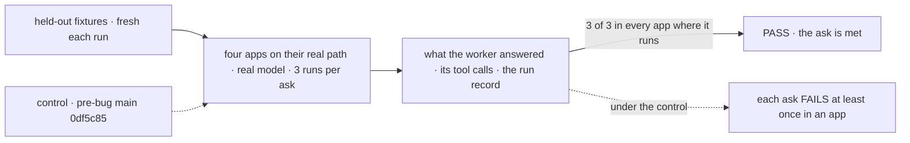
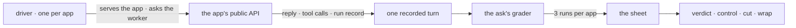

# FIX-2541 · Closure: workers in all four apps answer time-sensitive, multi-file and coding asks with evidence

**Spec** · [Decisions](DECISIONS.md)

## Four people, before and after

| Someone who… | Today | After |
|---|---|---|
| **decides which layers FIX-2490 builds** | Has no measure. A layer ships because the epic listed it | Reads the cut run: an ask that already passes in every app cancels its layer, with the run cited |
| **signs off the epic at wrap** | Would have to trust each child's own tests | Reads one verdict per ask and app, 3 runs each, on a real model, and a control that failed first |
| **reads a worker's answer in one of the four apps** | Gets a stale or missing date, a half-read answer, a coder's "tests pass" nobody checked | Is the person the asks stand in for: each ask is something they type, graded on what they see |
| **builds the next workforce app** | Nothing tells them the defaults work in an app like theirs | Can run the same scripts against their app's workers |

## The goal, and how we'll know it's met

**Before FIX-2490 wraps, one run of four app scripts on a real model shows that a user of each
app gets today's date, a multi-file answer in one turn, a coder's report whose checks really
ran, a cited knowledge answer, a short answer to a short question, a skill used without a
slash, and (in the two labs) a decision kept across a summary fold, with nothing written by
the app.**

| Is it the right goal? | |
|---|---|
| **The real need** | The epic's outcome: a user of any of the four apps gets a finished answer sized to the ask with the evidence it checked, without each app writing that guidance ([epic goal](../../epics/FIX-2490/SPEC.md#the-goal-and-how-well-know-its-met), [Q1](../../epics/FIX-2490/DECISIONS.md#q1)) |
| **Smaller, and rejected** | "Each child's tests pass." Every layer can pass its own test while no worker in an app ever says the date. The epic names this as *not done if* |
| **Bigger, and not this issue's** | "Workers feel smarter." An eval of about 10 tasks per app; the epic's D2 rules it out |
| **Not done if** | The scripts ran on fewer than 3 runs, or on one app · a control never failed · an ask passed on a run where its mechanism did not fire · an app's WORKER.md carries date or "done" text the closure's sweep finds · the wrap set a switch the defaults should carry |

The check reads what the worker answered and the records its app keeps, never a layer's own
output.

| How we verify | |
|---|---|
| **Goal check** | `goals/closure-smarter-agents/<app>/run.mts`, one per app, each composing seven shared legs from one module (the graders this spec's POC built). Real model through the AI Gateway, or, opt-in with `GOAL_HAIKU=1`, every app's agents and evaluators and Claude Code on one Haiku model on Anthropic directly; coder legs on Claude Code. Run by the coordinator three times: the control, the cut run, the wrap. Verdicts land on this issue and in each `goal.md` |
| **Signal** | Per ask, per run: **date** a date the reply names is today by the run's own clock, and no other · **multi-file** one request, and every value planted in separate files is in the reply · **coder** the report names at least one check and each named check is in the record with the outcome it reports; a `null` record fails · **knowledge** at least 3 lookups, and a cited source is one a lookup returned · **sizing** the fixture's fact, in 50 words or fewer ([D2](DECISIONS.md#d2)) · **skill** the worker holds the skill, the ask has no slash, the turn loads it, the reply carries a marker only the skill holds · **fold** a fold is in the record before the last ask, and the reply uses the decision and not the one it replaced. An ask passes in an app on 3 of 3; it passes on a pass only in every app where it runs ([D1](DECISIONS.md#d1)) |
| **Input** | Held out and new each run: the planted file values (`LC-<6>-<3>`), the skill's marker, the decision and its rejected option, the one-line question's fact. Another valid fixture passes a correct app |
| **Anti-game** | The date is read from the wall clock at ask and reply, never seeded. A cited source must be one a lookup returned; a check the report names must be in the record. The fold and skill asks fail, not pass, when their mechanism did not fire. Nothing asserts on a layer's prompt text |
| **Control that must fail** | `GOAL_COMMIT=0df5c85` (main when the epic merged, before any bug fix): each ask fails at least one run in at least one app where it runs, by its own named signal. An ask that never fails is reported, and goes to the cut run like any other (epic ER-7) |

## What changes

Twenty-six ask-and-app cells, 78 runs a pass, and the same scripts run three times. Only the
commit and the switches differ between the passes.

**Who is asked.** Each ask goes to the worker a user of that app would ask. This is the
starting map; the drivers confirm each one on the app.

| Ask | Claude Code-style lab | Teammates lab | Kitchen Sink | Shift Manager |
|---|---|---|---|---|
| Date, sizing, skill, fold | the main session | Chief of Staff | the support desk | Shift Coordinator |
| Multi-file | the main session, over the project | researcher, over the working folder | support `fsd`, over the docs | researcher, over the project |
| Coder | a coding run from the main session | the Claude Code coder | a Claude Code harness session | the coder, through the EM |
| Knowledge | researcher | researcher | support `fsd` | researcher |

**The switches.** On the control and the cut run, the scripts turn on what `main` has but
leaves off: `skills.activateTool` with a fitting skill held, in all four apps, and Teammates'
checks. Teammates already folds (its `historySummary`). The Claude Code-style lab has no fold
to switch on: that is the [open question](DECISIONS.md#open). At the wrap the scripts set
nothing.

**Docs:** no documentation impact. The closure is a goal check under `goals/`, which is not
user documentation; the epic's docs line (FIX-2498's page) covers what users read.

## What stays as it is

- **Every app.** The scripts change no app code. A switch is set through the app's own config
  for the run, and restored.
- **Each child's own goal check.** The closure does not replace them; it grades the outcome
  they serve.
- **The kill line.** ER-6 is the coordinator's. The closure reports; the coordinator cancels.

## What's already here, and the debt

| Already here | What this does with it |
|---|---|
| **Whatever already does this job** (grade a worker's answer on a real model, k of k): `goals/claude-code-style-lab/reads-project-files` (3 of 3, held-out value in one file), `goals/teammates-lab/works-it-out-first` (3 runs, reply graded), `goals/history-window/remembers-turns-past-the-window` (a fact across a fold). Searched `goals/` for `GOAL_RUNS`, `historySummary`, `activateTool`, `commandCheck`. No goal grades several apps or a date. This is the fourth way to grade a worker's reply over 3 runs | **Builds on.** Their app drivers and their grading shapes; the closure composes them into one sheet rather than a fifth one-off |
| `goals/lib`: `runGoal`, `tell.over`, `goalModel`, `goalTmpDir`, `modulePatchEnv` | **Builds on.** Every leg reports through `runGoal` and floors what it reads |
| `goals/harness-manager/checks-gate-done` | **Builds on.** Its reading of the run record's `checks` is the coder leg's oracle |
| `goals/history-window/remembers-turns-past-the-window` | **Builds on.** Its fold detection (`historyStart` on the last request, the `historySummary` resource) is the fold leg's precondition |
| `commandCheck` (harness-manager) in the Claude Code-style lab, Teammates and Shift Manager; `verify` on Kitchen Sink's harness session | **Reads.** The coder leg's record. Kitchen Sink records checks on the turn, not a run |
| Epic [ER-7](../../epics/FIX-2490/DECISIONS.md#who-owns-what), [D2](../../epics/FIX-2490/DECISIONS.md#d2), [Q1](../../epics/FIX-2490/DECISIONS.md#q1) | **Kept.** This spec pins what they left to it: the sizing threshold, the cut's reach across apps, the control commit |

| Adds | Existing piece considered | Why it doesn't fit, or how it is composed |
|---|---|---|
| Seven ask graders and the sheet rules, in `goals/` | Each existing goal's own grader | Composed: each grader is the existing goal's shape, lifted so four apps share one copy instead of four |
| Four app drivers | `lab.mts` (two labs), `goals/lib/kitchen-sink.mts`, `goals/lib/shift-manager.mts` | Composed: each driver calls its app's existing start helper and client |

| The debt | |
|---|---|
| **Removes** | Nothing. No app code moves |
| **Adds** | Four goal scripts and one shared module in `goals/`, run by hand. 78 real-model runs a pass, three passes; the coder legs run Claude Code. Permanent by design: they are the epic's regression record |
| **Leaves** | The asks measure seven things, not "smarter" (epic D2) |

**Net: up, in `goals/` only.** Goal code and real-model cost, no product code.

## Sign off

**The goal: seven asks, four apps, 3 of 3, with a control that failed first.** If wrong: the
epic wraps on scripts that pass while workers still feel dumb, or holds for a bar no app needs.

**The debt: up in `goals/` only.** One shared module and four drivers; no product code. If
wrong: 78 runs a pass we stop running, and the record goes stale.

1. [D1](DECISIONS.md#d1) · a layer is cut only when its ask passes in every app where it runs.
   **The one to weigh.** If wrong: we build layers that one app never needed, or cut one an app
   still fails.
2. [D2](DECISIONS.md#d2) · a short answer is the right fact in 50 words or fewer, by count.
   If wrong: a curt or padded answer passes.

**Open:** [the Claude Code-style lab has no fold to switch on](DECISIONS.md#open). Recommend:
decide the summary's cut on Teammates alone.

**Decided, not asked:** [the real path, the control commit, where the scripts live](DECISIONS.md#decided-not-asked).

Improvement · `goals/` only · four app goal scripts and one shared module · epic FIX-2490 (closure, required)
