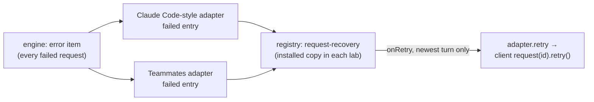

# FIX-2550 · The labs show a failed turn inline, with its reason and Retry

**Spec** · [Decisions](DECISIONS.md)

Child of epic [FIX-2369](../../epics/FIX-2369/SPEC.md). This is the lab half of
[FIX-2370](../FIX-2370/SPEC.md), whose spec Jake approved on 2026-11-01. FIX-2370 shipped the
registry's `request-recovery` line; its two lab slices never landed, though the issue is Done.
The direction is FIX-2370's and is not reopened here. This spec settles only what the labs'
code adds to it.

## Who feels it, before and after

| Someone who… | Today | After |
|---|---|---|
| **sends a turn that fails** (no API key, a provider error, max steps) in the Claude Code-style lab | The working line goes away and nothing else shows. A crash looks like a short answer | A red line in the thread: *The main session couldn't finish this turn*, the reason, and **Retry** |
| **sends a turn that fails** in the Teammates lab | The same: *… is answering* stops, and nothing says why | The same line under the worker's name: *Researcher couldn't finish this turn* |
| **presses Retry** | — | The button says *Retrying…*; the turn runs again and its reply streams into the thread. A refused retry says so and Retry comes back |
| **reads an older failed turn** | — | The reason stays; Retry shows only on the newest turn, and not while one is running |
| **watches a reply fail half-way** | The half reply reads as a finished one | The half reply is marked *Incomplete*, with the failure line under it |

## The goal, and how we'll know it's met

**In both labs, a failed turn reads as a failure, with its reason and a working Retry, drawn by
the registry's `request-recovery`.**

- **The real need:** FIX-2370's R-01, "a crash looks the same as a short answer". Both labs
  still drop the engine's `error` item: Claude Code-style reads only `message` and
  `tool_output`; Teammates reads every item and draws none of type `error`.
- **Smaller, and rejected:** a red text line in each lab's own markup. That is the third copy
  FIX-2370's D1 and the epic's ER-4 rule out.
- **Not done if:** either lab still shows nothing for a failed turn; Retry is drawn and does not
  start a new turn; or a lab draws its own failure line instead of `RequestRecovery`.

**How we verify.**

- *Adapter cases, per lab:* built from an error item shaped the way `runAction.ts` writes one
  (`type: "error"`, `status: "failed"`, `message`, `code`, `requestId`). It maps to one failed
  entry carrying the reason; a message of the same request that never completed is marked
  incomplete; only the newest turn's failed entry is retryable.
- *Retry, per lab:* the adapter's `retry` posts the client's retry for that request.
- *Screen, per lab:* the failed entry draws `request-recovery` with the reason; Retry is drawn on
  the newest turn and calls the adapter; an older one draws no button.
- *A real failed turn:* each lab's host with no model key; a send fails, and the thread shows
  the line with the engine's reason.

**Control that must fail:** dropping the `"error"` branch from each adapter fails its adapter
case; passing `onRetry` on every failed entry fails the newest-only case. Each is run red in the
PR.

## What changes

- **Each lab's adapter** maps an `error` item to a `failed` entry (reason, code, details, its
  request, and whether it is the newest turn), and marks an unfinished `message` of a failed
  request incomplete. Claude Code-style adds `error` to the item types it reads.
- **Each lab's adapter gains `retry(sessionId, requestId)`**, the client's
  `flow(f).request(id).retry()` on the session's flow ([D1](DECISIONS.md#d1)). Each lab's fake
  gains the same verb.
- **Each lab installs `request-recovery`** in `src/components/flow-state/`, byte-identical to the
  registry, and its `Entry` draws a `failed` entry with it. The screen passes `onRetry` only for
  the newest turn while nothing runs ([D2](DECISIONS.md#d2)).
- **Docs:** each lab README's table of what it reads gains the failed-turn row. No `apps/docs`
  change; the component's docs shipped with FIX-2370.

## What stays as it is

The engine's error item and request record, the client's `retry()`, the registry component,
and Kitchen Sink. No package changes.

## What's already here, and the debt

| Piece | What this does with it |
|---|---|
| `request-recovery` (`packages/ui/registry`) | **Installed as is** in both labs |
| `error.tsx` (`ErrorBody`), already installed in both labs | **Reused** through `request-recovery` |
| `RequestHandle.retry()` (client) | **Reused** as Retry |
| The labs' `interrupted` entry (Claude Code-style, after you stop a turn) | **Left alone**: a stop you made is not a failure |
| FIX-2406's contract matrix (spec [#4719](https://github.com/fixpoint-labs/flow-state-dev/pull/4719)) | Its failed-turn row is `it.fails` against this issue; whichever lands second removes the mark |

**Removes:** nothing. **Adds:** one adapter verb and one entry kind per lab. **Debt:** none new.
Newest-only Retry has one owner per layer: the adapter decides which turn is newest (`latest`,
[D2](DECISIONS.md#d2)), because only it sees every item; the screen passes `onRetry` for that
entry and adds only "not while a turn runs", as FIX-2370 has every caller do.

## Sign off

**Approve by merging.** The direction is FIX-2370's, already approved; this signs the two calls
the labs' code needed. *If wrong:* the labs' line changes, the registry does not.

- [D1](DECISIONS.md#d1) · Retry is a new adapter verb, not the component reaching the client.
- [D2](DECISIONS.md#d2) · "Newest turn" is read from the thread's own items.

Improvement · Claude Code-style and Teammates labs · small · one PR · child of
[FIX-2369](https://linear.app/fixpoint-labs/issue/FIX-2369)
