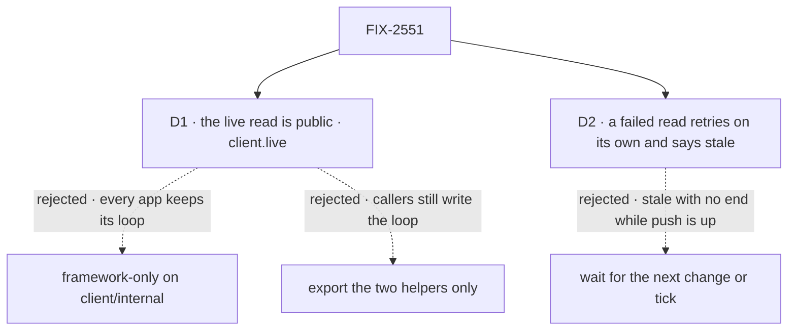

# FIX-2551 · Decisions

[Spec](SPEC.md) · **Decisions**

What was considered, what was chosen, and what each choice locks in. Two decisions are the
sign-off surface. The epic's rules bind this issue as written ([ER-7](../../epics/FIX-2618/DECISIONS.md#who-owns-what)
is built here; ER-1 and FIX-2367's ER-2 and ER-3 are obeyed).

## The tree

Solid edges are what you're signing. Dashed edges lost, and the label says why.

## D1 · The live read is a public call on the client, `client.live`

| | |
|---|---|
| **Instead of** | A framework-only piece on `@flow-state-dev/client/internal` (as `followSession` is), used by React, workforce and Shift Manager · or exporting only the coalescer and the path rule as helpers |
| **Because** | The copies that drift are in apps too: both labs carry one, the teammates adapter outlives this epic, and the epic expects an app to keep its own pieces in a kit of its own, whose client half watches. Exporting only the helpers leaves each caller to write the loop around them (read, compare, report, retry, close), which is most of every copy |
| **Locks in** | `client.live` and the term *live read* are public, with a glossary entry in the implementation PR (epic ER-9) and a `minor` changeset for `@flow-state-dev/client`. Its shape must take FIX-2625's ids and FIX-2623's views as additions, never as a break: what a read is handed is "the notice that woke it, or `null`", and ids extend that |

It comes down to who stops copying: framework-only leaves every app's loop to drift.

**What would change my mind:** FIX-2623 and FIX-2626 showing that no app code ever watches
anything except through a view or a kit's hooks. Then it could move to `/internal` before the
release that ships it, at no cost to anyone.

## D2 · A failed read retries on its own, and the screen says it is stale

| | |
|---|---|
| **Instead of** | Waiting for the next change, connect or timer tick, as React's panels and the roster watch do today |
| **Because** | While push is up the client runs no timer, so after a failed read a screen waits for an unrelated change that may never come. The labs and Shift Manager already retry, each with its own timer; one rule for all is the point of this issue |
| **Locks in** | Every live screen recovers by itself, on the client's own backoff (1 s doubling to 30 s, shared with the socket), and reports stale until a read lands. During an outage each open watcher sends at most one read every 30 s |

It comes down to a failed read with nothing changing: waiting leaves the screen stale with no end.

**What would change my mind:** outage retries showing up as real server load. Then the
retry slows or caps; it doesn't go away.

## Decided, not asked

### Invariants

- **One convergence point.** The invariant (filter, then merge, then one read in flight and at
  most one waiting) lives in `client.live` only. Every caller passes through it:
  `useSubscription`, the two panel drivers, `useSession`'s state reads, `useLiveSessionRead`,
  workforce's `watchRoster`, Shift Manager's snapshot, every lab `watch*` that reads on notices,
  and next FIX-2623's `useView`, FIX-2624's live direct reads and each kit's client half. The
  path rule is also called on streamed `resource_change` items by `useResourceCollection`; it
  uses the client's rule, not a copy. [`poc/copy-count/check.mjs`](poc/copy-count/check.mjs)
  `--after` enforces it.
- **Internal pieces stay internal.** The coalescer and the path rule move into `packages/client`
  and are not exported; callers move to `client.live`, not to its parts.
- **Topics can come from the last result.** A read may return `{ value, topics }`. When that
  set changes (deduped and sorted, so an unchanged set never churns), the live read closes its
  subscription, mints the new one (`Subscription` has only `close()`, `push-hub.ts:58`), and
  reads once after the new topics are held, so a change between the two is not missed. This is
  FIX-2623's view seam, in the first shape, so it is an addition rather than a break under D1.
- **The filter runs before the merge.** A notice no caller hears never turns a waiting read into
  a full one. That is what Shift Manager's wrapper did by hand.
- **The merge is one function.** Same notice: kept. Different: `null`, read everything.
  FIX-2625 changes only this function, to union ids with a cap: it extends the merge options
  and adds no second entry point for the same loop.
- **The path rule is FIX-1506's, unchanged.** Bare path, unknown prefix, a pattern with no
  static prefix, `null` and `resync`: all read. Roots are passed in; how a caller learns them
  (a manifest, its own constants) stays the caller's, so the rule needs no session.
- **Report only on change**, compared by value, as the roster watch and the labs do. A caller
  that sets state inside its read (`useSubscription`) keeps that.

### Defaults and scope

- **A default pace of 3 s** for the timer where push can miss a change, overridable. Today's
  callers use 1.5 s, 3 s and 30 s, and keep theirs.
- **Both labs move now.** claude-code-style's adapter is frozen and deleted by FIX-2628, but the
  move only shrinks it (ER-8 forbids growth, not this), and it lets the inventory reach one.
- **`useSubscription` stays public**, its signature unchanged. Whether `useView` retires it is
  FIX-2623's call.

### Seams to other issues

- **Seams.** FIX-2623 builds `useView` on `client.live`, using topics from the last result, and adds no loop; if a view's notices
  need new topics, that goes through FIX-2367's ER-2, not around it. FIX-2624 makes its live
  direct reads call `client.live` and supplies roots for a user or org resource without a
  session. FIX-2625 adds ids in the merge. FIX-2466 (in development) moves more lab polls behind
  notices: whichever lands second puts them on `client.live`.

## Considered and dropped

| Alternative | Why not |
|---|---|
| Export `coalescedReads` and `mayBelongTo` from the client and import them (the smaller goal) | The loop around them is most of each copy, and the three retry timers stay. `useView` would write a fourth loop |
| Leave the labs to FIX-2628 and the follow-up epic | Two copies stay that the totality check must exempt, and teammates' outlives this epic |
| Share one read among several watchers of the same thing in one client | A real saving, and the place FIX-2656's exposure would shrink. Not needed for one copy; it belongs with `useView`, where watchers of one view are common |

## Settled

- **How many copies exist** — counted by [`poc/copy-count/check.mjs`](poc/copy-count/check.mjs):
  4 coalescers (React, workforce, both labs) and 5 path rules (adding Shift Manager), against the
  issue's "three". Every hit is classified or exempt with a reason; an unclassified one fails.
  A planted coalescer fails the run, and `--after` fails on today's `main`, both seen red. The
  premise held, larger than written; the scope grew to match.

## Analysis

2026-11-11 · watermark 2026-11-04 (issue filed) · **Right approach.** Run inline by the author:
this dispatch has no sub-agent tool, so it is not the independent analyst the skill asks for.
Cross-spec review over stage 2 is the independent pass.

1. **Reuse** — one Add, `client.live`: **extends** `push-delivery`'s `subscribe`, composed from
   the moved coalescer and rule and the client's backoff. No other client piece does the job;
   `sessionFeed` follows items, not reads. See [Builds on / Adds](SPEC.md#whats-already-here-and-the-debt).
2. **Prior art** — TanStack Query and SWR keep one fetch in flight per key and refetch on
   invalidation; Apollo refetches on a subscription event. All put the loop in the client
   library, not the app. A single flight plus one trailing call is the shape here.
3. **Other shapes** — internal-only, helpers-only, and shared-across-watchers; all in
   *Considered and dropped*.
4. **New factors** — FIX-2656 (per-read growth, server-side): unchanged by this, recorded in the
   debt. FIX-2466 in development touches the labs' polls: a seam above.
5. **Necessity** — earns its place: ER-7 names it, and `useView` needs it.
6. **Ergonomics** — one call replaces a loop; one new word, *live read*.
7. **Concerns** — the public shape before keys (D1's lock).

| Finding | Objective | Changes the approach? | Disposition |
|---|---|---|---|
| Shift Manager carries a fifth path rule and a wrapper the issue missed | 1 | Scope, not direction | Folded |
| Sharing one read across watchers would lower FIX-2656 exposure | 3, 4 | No | Recorded for FIX-2623 |

## How it got here

- **Draft** — framed as one live read in the client for every watcher; the counted inventory
  found five places, not three, and the retry as a third duplicated piece; built on
  `client.subscribe` and FIX-1506's rule.

**Open: none.**
