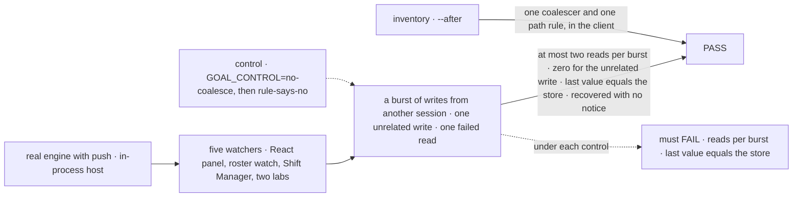
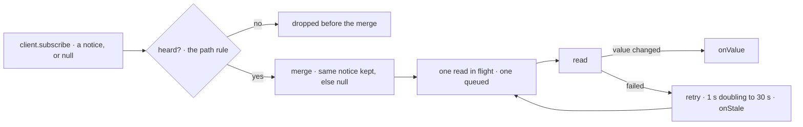

# FIX-2551 · One live read in the client: the coalescer and the path rule

**Spec** · [Decisions](DECISIONS.md)

## Four people, before and after

| Someone who… | Today | After |
|---|---|---|
| **builds a package that keeps a screen current** (the roster watch, a kit's client half) | Copies a re-read loop and a path rule from React's internals, as FIX-2412 did | Calls `client.live` with what to read and which paths matter |
| **keeps a lab screen current** (teammates, claude-code-style) | Carries a 60-line loop, a path test and a retry timer per adapter | One call per watch |
| **watches a screen whose read failed once** (a roster, a board panel) | Stays stale until something else changes; with push up, no timer tick comes | The read retries on its own, 1 s doubling to 30 s, and the screen says it is stale until one lands |
| **fixes a live-read bug** (a missed bare notice, a read storm) | Fixes it in one of five places; the other four keep it | Fixes it once, in the client |

Five places carry this logic today: four coalescers, five path rules and three retry timers
([inventory](poc/copy-count/check.mjs)). `useView` would be the sixth.

## The goal, and how we'll know it's met

**Any package or app keeps a screen current on notices by calling one live read in the
client, and every live screen behaves the same: one read in flight, at most one waiting, no
change missed, and a failed read recovered without another change.**

| Is it the right goal? | |
|---|---|
| **The real need** | "One shared way, in the client, to turn notices into coalesced reads of a collection, so a package or app that watches a collection does not re-implement it" (the issue); epic [ER-7](../../epics/FIX-2618/DECISIONS.md#who-owns-what): "`useView` and every package watch sit on it" |
| **Smaller, and rejected** | "Move `coalescedReads` and `mayBelongTo` into the client and import them." The three callers still write the loop around them, the retry stays in three places, and `useView` would be a fourth loop |
| **Bigger, and not this issue's** | Watching a view (FIX-2623), notices with keys (FIX-2625), live direct reads by scope (FIX-2624), and one read shared by several watchers of the same thing |
| **Not done if** | Any coalescer or path rule is left outside the client · the inventory passes but a live screen misses a change · the retry exists but no screen says it is stale · Shift Manager keeps its pre-merge filter |



The check reads what each watcher reported against what the store holds, on the real push
path. Each control breaks one half of the live read, and the signal it breaks must go red.

| How we verify | |
|---|---|
| **Goal check** | `goals/live-read/one-loop-every-watcher/`, no model, run by the implementer at completion, verdict in the implementation PR. With it, [`poc/copy-count/check.mjs`](poc/copy-count/check.mjs) `--after` |
| **Signal** | Per watcher: ≤ 2 reads for 50 writes landing during one read; 0 reads for a write outside its paths; 1 read for a bare notice; last value equals the store; after one injected failure, a value lands within 2 s with no notice sent. Inventory: exactly one coalescer and one path rule, both under `packages/client/src` |
| **Input** | Writes to a watched collection from a second session. A different collection, or a burst landing during a read, must pass too |
| **Anti-game** | Don't count `read` calls against a fake `subscribe`: that passes while a caller still loops on its own. Count requests the server answers |
| **Control that must fail** | `GOAL_CONTROL=no-coalesce` (every notice reads at once) fails *≤ 2 reads per burst*. `GOAL_CONTROL=rule-says-no` fails *last value equals the store*. Today's `main` fails the inventory: 4 coalescers and 5 path rules outside the client (run, red) |

## What changes


Five copies on the left become five thin callers on the right; the dashed children add to the
green box, never beside it.

**A package watch, as written** (workforce's roster; sketch, the names past `client.live` are
the implementer's):

```diff
- const reads = coalesced(async () => { /* read, compare, report, catch */ });
- const subscription = fsd.subscribe([topic.user()], {
-   onChange: (notice) => { if (rosterMayHaveChanged(notice)) reads.request(); },
-   pollIntervalMs: ROSTER_POLL_MS
- });
- reads.request();
- return () => { live = false; reads.close(); subscription.close(); };
+ return fsd.live([topic.user()], {
+   paths: ROSTER_PREFIXES,
+   read: () => client.roster(),
+   onValue: onRoster,
+   onError: watchOptions?.onError,
+ }).close;
```

**A lab watch:** `onNotice(client, topics, isPlanWrite, read, onValue, POLL_MS, onStale)` and its
60-line body become `client.live(topics, { paths, read, onValue, onStale, pollIntervalMs })`.
`useSubscription` keeps its signature and runs on the live read.

**Docs:** update the realtime guide, `docs/client/react.md` and `docs/api/react.md` where they
describe `useSubscription`; add `client.live` to the client README. No new page. In the
implementation PR: `flows-and-actions.md` → Reads, `resources-and-client-data.md`, the glossary's
*Live read* entry, and the `push-delivery` mechanism row.

## How a notice becomes a read



The filter runs before the merge, so an unheard notice can never widen a waiting read. The
merge is where FIX-2625's keys will union.

## What stays as it is

- `client.subscribe`, its one socket, its timer and its topics. No topic, notice kind or poll is
  added (FIX-2367 ER-2, ER-3).
- What each screen reads, and when it reads on connect, reconnect, `resync` and a tick.
- `useSubscription`'s public signature.

## What's already here, and the debt

| Already here | What this does with it |
|---|---|
| The job, "read again when a notice says this changed": mechanism `push-delivery` (`client.subscribe`), then five places that each loop on it. React's `coalescedReads` and `mayBelongTo`, workforce's `coalesced` and `rosterMayHaveChanged`, Shift Manager's `heard` and pre-merge wrapper, both labs' `onNotice`. Found by the [checker](poc/copy-count/check.mjs) over `packages`, `labs`, `apps`, `examples` | **Replaces** all five with one. It would have been the sixth way |
| The client's reconnect backoff (`internal/backoff.ts`, 1 s doubling to 30 s) | **Reused** for the read retry |
| `sessionFeed` ([FIX-2374](https://linear.app/fixpoint-labs/issue/FIX-2374)), which follows one session's items | **Leaves alone.** A different job |
| [FIX-1506](https://linear.app/fixpoint-labs/issue/FIX-1506)'s path rule: a false yes costs one read, a false no leaves a screen stale | **Kept** as written, moved to the client |
| [FIX-2412 D1](../FIX-2412/DECISIONS.md#d1): `watchRoster` public on workforce, "a copy until FIX-2551" | **Kept;** the copy it filed is paid here |
| [FIX-2428](https://linear.app/fixpoint-labs/issue/FIX-2428)'s `useSubscription` and its merge (one notice, or `null` for several) | **Kept** as the React wrapper; the merge moves into the live read |
| Epic [ER-7](../../epics/FIX-2618/DECISIONS.md#who-owns-what) | **Built** here |

| Adds | Existing piece considered | Why it doesn't fit / how composed |
|---|---|---|
| `client.live` | `push-delivery` · `client.subscribe`; React's `coalescedReads` | **Extends** `subscribe` with the loop every caller writes around it; composed from the moved coalescer, path rule and the client's backoff ([D1](DECISIONS.md#d1)) |

| The debt | |
|---|---|
| **Removes** | Three coalescers and four path rules outside the client (React's two move in), two lab `onNotice` loops, three retry timers, Shift Manager's pre-merge wrapper, workforce's FIX-2412 copy |
| **Adds** | One public client method and one glossary term ([D1](DECISIONS.md#d1)). Permanent by design |
| **Leaves** | [FIX-2656](https://linear.app/fixpoint-labs/issue/FIX-2656), a repeated read slowing as a process runs: exposure unchanged, since each watcher still reads at most once per burst and a retry reads only while reads fail. Views multiply it by watchers; FIX-2623's to weigh |

**Net: down.** Nine copies in five places become one coalescer and one path rule in the client; one public method is added.

## Sign off

**[The goal](#the-goal-and-how-well-know-its-met), at that size:** every caller on one live read,
and every live screen recovering the same way. If wrong: we ship an import and keep five loops,
and `useView` is the sixth.

**[The debt](#whats-already-here-and-the-debt), net down:** seven copies go, one public method
comes. If wrong: a public contract that FIX-2625's keys have to bend.

1. **[D1](DECISIONS.md#d1) · The live read is public, `client.live`, not framework-only.** The
   one to weigh. If wrong: a public shape fixed before views and keys, changed later as a break.
2. **[D2](DECISIONS.md#d2) · A failed read retries on its own and the screen says it is stale.**
   If wrong: in an outage, each open screen retries every 30 s.

**Open: none.**

Improvement · `client`, `react`, `workforce`, `shift-manager`, two labs · medium (one public
method, five callers moved, seven copies removed) · epic [FIX-2618](../../epics/FIX-2618/SPEC.md), stage 2
