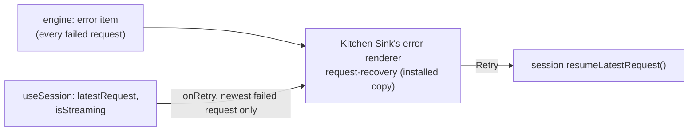

# FIX-2559 · Kitchen Sink shows a failed turn once, inline, with its reason and Retry

**Spec** · [Decisions](DECISIONS.md)

Child of epic [FIX-2369](../../epics/FIX-2369/SPEC.md). This is the Kitchen Sink half of
[FIX-2370](../FIX-2370/SPEC.md), whose spec Jake approved on 2026-11-01 ("App slices" and
[E6](../FIX-2370/DECISIONS.md#decided-not-asked)). FIX-2370 shipped the registry's
`request-recovery` line; this slice never landed. The direction is FIX-2370's and is not
reopened here. This spec settles only what Kitchen Sink's code adds to it. The labs' half is
[FIX-2550](https://linear.app/fixpoint-labs/issue/FIX-2550).

## Who feels it, before and after

| Someone who… | Today | After |
|---|---|---|
| **sends a turn that fails** in the Flow State assistant (no model key, a provider error, max steps) | A plain red box in the stream with the reason, and nothing to do about it | A red line: *Assistant couldn't finish this turn*, the reason, and **Retry** |
| **presses Retry** | — | The button says *Retrying…*; the turn runs again and its reply streams in under it |
| **has the retry refused** | — | The line says *Retry failed: …* and Retry comes back. The page's own error box stays quiet about it, so the refusal shows once |
| **reads an older failed turn** | — | The reason stays; Retry shows only on the session's newest request, and not while a turn runs |
| **has a send refused** before any request exists (the server is down, a 409) | The red box under the thread | The same box, unchanged |

## The goal, and how we'll know it's met

**In Kitchen Sink's Flow State mode, a failed turn reads as a failure, once, with its reason and
a working Retry, drawn by the registry's `request-recovery`.**

- **The real need:** FIX-2370's R-01, "a crash looks the same as a short answer", and its E6,
  one failure path. Kitchen Sink draws the engine's `error` item with `ErrorDisplay`, which has
  no Retry, and keeps the registry's `request-recovery` uninstalled (the drift test's
  not-installed list says so).
- **Smaller, and rejected:** a Retry button beside `ErrorDisplay` in the page's own markup.
  That is the copy FIX-2370's D1 and the epic's ER-4 rule out.
- **Not done if:** a failed turn in Flow State mode draws without Retry; Retry is drawn and
  does not start a new request; Retry shows on an older turn; or a refused retry shows twice.

**How we verify.**

- *Renderer, unit:* built from an error item shaped the way `runAction.ts` writes one
  (`type: "error"`, `message`, `code`, `requestId`). It draws `request-recovery` with the reason;
  Retry is drawn only when the item's request is the session's newest, its status is `failed`,
  and nothing streams; pressing it calls `resumeLatestRequest` once.
- *Error box, unit:* the page's box shows a refused send, and stays quiet for the refusal the
  line already shows.
- *Browser, e2e:* a scripted turn whose model fails once. The line shows the reason and Retry;
  Retry starts a new request whose reply streams in.
- *Drift:* Kitchen Sink's installed `request-recovery.tsx` is byte-identical to the registry's.

**Control that must fail:** drawing `ErrorDisplay` again fails the renderer case and the e2e;
passing `onRetry` on every failed line fails the newest-only case; showing every
`session.error` in the box fails the once-only case. Each is run red in the PR.

## What changes

- **Kitchen Sink installs `request-recovery`** in `components/flow-state/`, byte-identical to the
  registry. The drift test drops it from its not-installed list, and its count moves from 42 to 43.
- **Flow State mode's renderers** (`chatAgentRenderers`, already the page's own override of the
  registry's set) draw an `error` item with a small app renderer around `RequestRecovery`, fed
  by a context the chat panel fills from `useSession` ([D1](DECISIONS.md#d1),
  [D2](DECISIONS.md#d2)).
- **The page's error box** shows `session.error` unless it is the refused retry the line
  already reports ([E1](DECISIONS.md#decided-not-asked)).
- **An e2e scenario** whose assistant model fails on its first call and answers on the retry.
- **Docs:** none. The component's docs shipped with FIX-2370, and the app's README does not
  list its renderers.

## What stays as it is

The engine, client, react and the registry; the registry's `chatAssistantRenderers`, which the
coding harness modes and other apps keep drawing with `ErrorDisplay`; `StuckRequestBanner`; the
interrupted-request `ResumePrompt`, which FIX-2377 moves into this same component.

## What's already here, and the debt

| Piece | What this does with it |
|---|---|
| `request-recovery` (`packages/ui/registry`) | **Installed as is** |
| `error.tsx` (`ErrorBody`), already installed | **Reused** through `request-recovery`; its fallow ignore for Kitchen Sink goes, since the export is now drawn |
| `useSession().resumeLatestRequest` and `latestRequest` | **Reused** as Retry and as "newest" |
| `chatAgentRenderers` in `app/flow-state/page.tsx` | **Extended** with an `error` entry |
| The page's red box in `ConversationBody` | **Kept**, for errors no item carries |

**Removes:** `ErrorDisplay` from Flow State mode's stream. **Adds:** one installed copy, one app
renderer and its context. **Debt:** none new. Newest-only Retry has one owner, the chat panel,
which holds the session; the renderer only draws what it is handed.

## Sign off

**Approve by merging.** The direction is FIX-2370's, already approved; this signs the two calls
Kitchen Sink's code needed. *If wrong:* the page's wiring changes, the registry does not.

- [D1](DECISIONS.md#d1) · Retry reaches the renderer through a context the chat panel fills.
- [D2](DECISIONS.md#d2) · "Newest" is the session's newest request, read from `useSession`.

Improvement · Kitchen Sink · small · one PR · child of
[FIX-2369](https://linear.app/fixpoint-labs/issue/FIX-2369)
