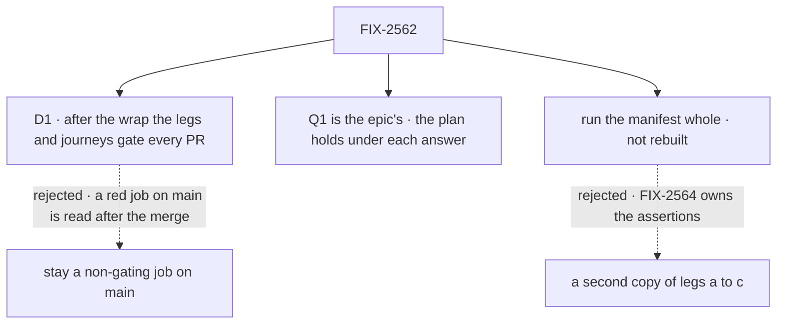

# FIX-2562 · Decisions

[Spec](SPEC.md) · **Decisions**

The plan's four rows are the [closure rule's](../../../docs/contributing/orchestration.md#the-closure-issue-every-epic-ends-in-qa),
and its legs are FIX-2564's, built to the [epic's goal](../../epics/FIX-2447/SPEC.md#the-goal-and-how-well-know-its-met).
One call is this spec's: what keeps the first hour green after the wrap (D1). How the plan holds
under each answer to the epic's open Q1 is [below](#q1).

## The tree

Solid edges are what you're signing. Dashed edges lost, and the label says why.

## D1 · After the wrap, the legs and the journeys gate every PR in the `packed-install` job

| | |
|---|---|
| **Instead of** | Leaving them as the non-gating job on `main` that the epic runs while its rows are expected to fail |
| **Because** | The first hour regresses through ordinary PRs: a new root export, a JSDoc that names a ticket, a quick start edit. A red job on `main` is read after the merge, and nobody owns reading it once the epic wraps. The `packed-install` job already packs and installs every package on every PR, so the legs add their run time, not a second install. Once every row is `expect: pass`, a row that turns red is a regression, which is what a gate is for |
| **Locks in** | Every PR pays the legs' and journeys' minutes inside the job's 20-minute budget. A flaky leg blocks merges until it is fixed, never retried green. The closure PR moves the steps into the `packed-install` job |

It comes down to when a regression is seen: before the merge, or after it by whoever reads `main`.

**What would change my mind:** the legs pushing the job past its 20-minute budget, or flaking
on a clean commit. Then they gate the release (`changeset publish`) instead, and the PR job keeps
today's checks.

## How the plan holds under epic Q1

[Q1](../../epics/FIX-2447/DECISIONS.md#q1) is the owner's and still open. Only two things in this
plan depend on it: **which commit is pinned**, and **how many hops j5 takes**.

| Q1's answer | The pinned commit | j5's upgrade | *Shims* |
|---|---|---|---|
| **Alias, then one removal** | At or after the removal's merge, once that minor has shipped to npm, whether a 19th child or the named minor carries it | Two hops: 0.4.0 → the last alias minor from npm, pinned by integrity, where each moved name compiles with a `@deprecated` naming its new path and removal version → the pinned commit, where the name is gone and the changelog line names its home | The aliases' exemption has ended, so the row must pass with no alias left |
| **Hold**, or **break as each lands** | After the last child merges | One hop: 0.4.0 → the pinned commit. Each moved name fails to compile, and the package's changelog line names its new home ([ER-7](../../epics/FIX-2447/DECISIONS.md#who-owns-what)). The compile error itself names nothing, weaker than the epic's *upgrades across a rename* row; the report says so | No exemption |

A retired runtime value ([epic D3](../../epics/FIX-2447/DECISIONS.md#d3)) refuses loudly under
every answer, so `j5:retired-value-refused` doesn't move.

## The plan in full

| # | What runs | PASS means |
|---|---|---|
| 1 | FIX-2564's `run.mjs` and manifest, whole, then its goal control | Every row PASS with its assertion ids printed; under the control, every row FAILs |
| 2 | The [journeys](SPEC.md#the-journeys): j1, j2, j4, j5. *Answers a user's stop from React* is leg c | Each assertion green; each journey's named assertion red under the control |
| 3 | Every child's own goal check, read from its merged spec's *How we verify* at run time and printed. Skipped only where a manifest row carries that check's assertion; the manifest is the skip list. FIX-2451's and FIX-2554's regression tests re-run. A check that needs a browser, a model or a signed-in harness runs here first; a browser check goes to `fsd-qa` only if that fails | Each PASS beside its documented control's FAIL |
| 4 | The gap sweep below, the docs pages followed as written, every *Not done if* state checked absent | Every seam two-sided; every page holds |

**Must be green first:** every other child merged with its goal check's PASS and its control's
FAIL, FIX-2564 among them; under Q1's alias, the removal minor shipped. At drafting, no child's
spec has merged.

### The gap sweep

| Seam ([epic](../../epics/FIX-2447/DECISIONS.md#coordination-seams)) | Exercised as |
|---|---|
| `core/src/index.ts` · FIX-2448, 2449, 2458, 2460, 2463 | On the installed core: every name a child moved is absent from the root and resolves at its new subpath; no name a later child removed came back |
| Core's `Benchmark*` types · FIX-2448, 2460 | Absent from core's root; resolve from `testing/benchmark` to one declaration |
| `engine/src/index.ts` · FIX-2449, 2452 | Engine's root is an explicit list, and the store constructors resolve from it as FIX-2452's one family |
| `react/src/index.ts` · FIX-2449, 2450, 2455, 2456 | React's root has `answer` and the read, no `resumedBy`, no UI chrome; every name has a README entry |
| `client.ts` request handle · FIX-2450, 2455 | One handle in one run answers a stop and then returns the output through `sent.result()` |
| Orchestration's exports · FIX-2459, 2462 | No name sits on both the root and `./internal`; deleted names are on neither; `./tasks` is the one browser-safe entry and bundles for a browser |
| The quick start · FIX-2451, 2452 | Leg a runs it; its snippet uses FIX-2452's shorthand if that shipped, never both forms |
| Kitchen Sink · FIX-2554, 2461, 2458, 2456 | Builds, its tests pass, and each mode opens in a browser after all four edits |
| Task-collection storage primitives · FIX-2462 × FIX-2532 | `findBy` is written on FIX-2462's primitives, with no second copy of the method |
| The closure manifest · FIX-2564 × every row owner | `git log -p` on the manifest: each child's commits change only its rows' `expect`; every assertion change is FIX-2564's |

**Docs followed as written:** the quick start, from its own code blocks (leg a), and *what each
package root is for*: every subpath it names resolves in the installed project, and it says
`/internal` is not for apps. **Not done if:** the epic's six rows (item 1), and no open child of
FIX-2447 blocks this issue in Linear.

## Decided, not asked

- **Run the manifest whole, never rebuild it.** FIX-2564 owns the assertions (ER-9); the closure
  reads its verdicts and adds only the journeys.
- **The journeys join the manifest as `closure` rows in the closure PR.** Every child has merged
  by then, so no child's own row can be gamed by them. ER-9's rule binds child PRs; the closure is
  the last writer and adds rows, never edits one.
- **The journeys run on the installed project, like the legs.** A journey on workspace `src` reads
  what the adopter never installs.
- **j2's editor check runs the TypeScript language service in the installed project**, the calls an
  editor makes, plus one look by hand recorded in the report. That makes D2's manual spot-check
  repeatable. A finding goes to that package (`typesVersions` or a `types` condition), not the epic.
- **j2 grep covers installed `.d.ts` files too**, since the lint reads source and a build can copy
  JSDoc into a declaration.
- **The control is FIX-2564's goal control.** `run.mjs --control` already names the 0.1.1 control,
  so the goal control takes FIX-2564's own flag; the closure names whichever it ships.
- **Packed tarballs at the pinned commit, not the registry,** except j5's 0.4.0 and alias-minor
  installs. One commit is the closure rule, and the packer is the one `changeset publish` uses.
- **Nothing that ships carries a tracker id** (ER-5): journey ids, titles and fixtures name behaviour only.
- **j5's fixture lives beside the legs' fixtures** in `scripts/packed-install/fixtures/`, and must pass on 0.4.0 before it is upgraded, so a broken fixture can't pass as a refusal.
- **Model `n/a`,** except an example in j1 that needs a key. The quick start's first snippets and every journey compute with handlers.
- **Necessity:** build as scoped. The closure rule requires it; nothing else grades the set.
- **No counted facts of its own,** so no fact checker: every count is the epic's.

## Considered and dropped

| Alternative | Why not |
|---|---|
| Re-run the children's checks and stop | Each passed on its own commit; workspace ratchets read source, not an editor's view of the install |
| A journey for *answers a stop from React* | Leg c walks it |
| Kitchen Sink as the adopter | It resolves workspace packages; it is graded as a seam instead |
| Gate the release, not PRs | A regression is found at release time, after the PRs that caused it merged; kept as D1's fallback |

## Analysis

Skipped in this dispatch by the spec-set rule: the epic-agent runs `analysis` and `reuse-review`
over the whole set.

## How it got here

- **Draft** — the closure rule's four rows over FIX-2564's manifest, run whole on one pinned
  commit; four journeys for the teams leg c doesn't walk; the ten seams; D1 for after the wrap;
  the run point and j5 written to hold under each answer to Q1.
- **Goal validation (blind)** — planted controls for the two journey assertions the 0.4.0
  control can't fail; calls observed at `fetch`; bulk README lists refused; j5's fixture named;
  four *Not done if* states added from the closure rule.

**Open: none of its own.**
