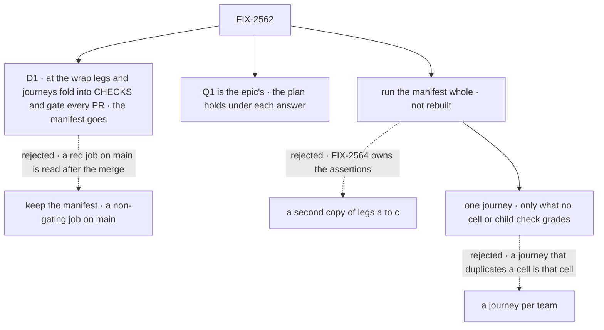

# FIX-2562 · Decisions

[Spec](SPEC.md) · **Decisions**

The plan's four rows are the [closure rule's](../../../docs/contributing/orchestration.md#the-closure-issue-every-epic-ends-in-qa),
and its legs are FIX-2564's, built to the [epic's goal](../../epics/FIX-2447/SPEC.md#the-goal-and-how-well-know-its-met).
One call is this spec's: what keeps the first hour green after the wrap (D1). How the plan holds
under each answer to the epic's open Q1 is [below](#q1).

## The tree

Solid edges are what you're signing. Dashed edges lost, and the label says why.

## D1 · At the wrap, the passing legs and journeys fold into `CHECKS` and gate every PR; the manifest goes

| | |
|---|---|
| **Instead of** | Keeping the manifest after the wrap, with the journeys as its rows, as the non-gating job on `main` that the epic runs while its cells are expected to fail |
| **Because** | The first hour regresses through ordinary PRs: a new root export, a JSDoc that names a ticket, a quick start edit. A red job on `main` is read after the merge, and nobody owns reading it once the epic wraps. The `packed-install` job already packs and installs every package on every PR, so the legs add their run time, not a second install. An expectations file has no job once every cell is `pass`: a check that turns red is a regression, which is what a gate is for. This is FIX-2564's own debt line, so the manifest has one lifetime |
| **Locks in** | Every PR pays the legs' and journeys' minutes inside the job's 20-minute budget. A flaky leg blocks merges until it is fixed, never retried green. The closure PR runs the manifest whole, then moves the passing legs and journeys into `run.mjs`'s `CHECKS` and deletes the manifest and its workflow |

It comes down to when a regression is seen: before the merge, or after it by whoever reads `main`.

**What would change my mind:** the legs pushing the job past its 20-minute budget, or flaking
on a clean commit. Then they gate the release (`changeset publish`) instead, and the PR job keeps
today's checks. The manifest goes either way.

## How the plan holds under epic Q1

[Q1](../../epics/FIX-2447/DECISIONS.md#q1) is the owner's and still open. Only two things in this
plan depend on it: **which commit is pinned**, and **how many hops j5 takes**.

| Q1's answer | The pinned commit | j5's upgrade | *Shims* |
|---|---|---|---|
| **Alias, then one removal** | At or after the removal's merge, once that minor has shipped to npm, whether a 19th child or the named minor carries it | Two hops: 0.4.0 → the last alias minor from npm, pinned by integrity, where each moved name compiles with a `@deprecated` naming its new path and removal version → the pinned commit, where the name is gone and the changelog line names its home | The aliases' exemption has ended, so the row must pass with no alias left |
| **Hold**, or **break as each lands** | After the last child merges | One hop: 0.4.0 → the pinned commit. Each moved name fails to compile, and the package's changelog line names its new home ([ER-7](../../epics/FIX-2447/DECISIONS.md#who-owns-what)). A TypeScript "no exported member" error names nothing, so the changelog line is the only thing that does: j5 grades that line and the report records the gap against the epic's *upgrades across a rename* row. The epic's Q1 ask states this | No exemption |

A retired runtime value ([epic D3](../../epics/FIX-2447/DECISIONS.md#d3)) refuses loudly under
every answer, so FIX-2454's *Shims* cells don't move.

## The plan in full

| # | What runs | PASS means |
|---|---|---|
| 1 | FIX-2564's `run.mjs --goal` and manifest, whole, then `run.mjs --control=adopter-goal` | Every row PASS with its assertion ids printed; under the control, every row FAILs |
| 2 | The [journey](SPEC.md#the-journeys): j5, the only thing no cell or child's check grades | Green, and red under its planted control |
| 3 | Every child's own goal check, read from its merged spec's *How we verify* at run time and printed. Skipped only where a manifest cell carries that check's assertion; the manifest is the skip list. FIX-2462's check runs as FIX-2459's. FIX-2451's and FIX-2554's regression tests re-run. A check that needs a browser, a model or a signed-in harness runs here first; a browser check goes to `fsd-qa` only if that fails | Each PASS beside its documented control's FAIL |
| 4 | The gap sweep below, the docs pages followed as written, every *Not done if* state checked absent | The *Surface* row as narrowed; every seam two-sided; every page holds |

**Must be green first:** every other child merged with its goal check's PASS and its control's
FAIL, FIX-2564 among them; under Q1's alias, the removal minor shipped. At drafting, no child's
spec has merged.

### The gap sweep

First, the *Surface* row as the epic narrowed it: on the installed tarballs, every root the set owns
is clean (core, engine, client, react, testing, orchestration, patterns, the three harnesses, both
stores, and workforce's `*_ENTRY` names), and every other published root sits at or below its
ratchet baseline.

| Seam ([epic](../../epics/FIX-2447/DECISIONS.md#coordination-seams)) | Exercised as |
|---|---|
| `core/src/index.ts` · FIX-2448 (with `WAIT_DEADLINE_ENTRY`'s move), 2449, 2458, 2460 | On the installed core: every name a child moved is absent from the root and resolves at its new subpath; no name a later child removed came back |
| Core's `Benchmark*` types · FIX-2448, 2460 | Absent from core's root; resolve from `testing/benchmark` to one declaration |
| `engine/src/index.ts` · FIX-2449, 2452 | Engine's root is an explicit list, and the store constructors resolve from it as FIX-2452's one family |
| `react/src/index.ts` · FIX-2449, 2450, 2455, 2456 | React's root has `answer` and the read, no `resumedBy`, no UI chrome; every name has a README entry |
| `client.ts` request handle · FIX-2450, 2455 | One handle in one run answers a stop and then returns the output through `sent.result()` |
| Orchestration's exports · FIX-2459, with FIX-2462 folded in | No name sits on both the root and `./internal`; deleted names are on neither; `./tasks` is the one browser-safe entry and bundles for a browser |
| `patterns/benchmark` · FIX-2459, 2460 | One entry, added once; each name resolves from it to one declaration |
| The quick start · FIX-2451, 2452 | Leg a runs it; its snippet uses FIX-2452's shorthand if that shipped, never both forms |
| Kitchen Sink · FIX-2554, 2461, 2458, 2456, 2452, 2450 | Builds, its tests pass, and each mode opens in a browser after all six edits |
| `eslint.config.mjs` · FIX-2453, 2457 | Both rules are on for their file sets, neither entry overwrites the other, and `pnpm lint` passes with each rule's planted case reported |
| Task-collection storage primitives · FIX-2459's method-table PR × FIX-2532 (#4757) | `findBy` is written on those primitives, with no second copy of the method; `partition.ts` sits behind `orchestration/internal` with #4757's edit intact |
| Scope-state defaults · FIX-2457 × FIX-2554 | A block- or capability-declared default reads on a fresh session through the same merge the type-level `extendSchema` describes; one field declared in two places with a different type or default is refused at flow definition, naming the field and both declaring blocks (identical declarations merge silently), with no tracker id and not through `refuseRetired` |
| Retired `sessionId` · FIX-2535 × FIX-2454 | It refuses through `refuseRetired` on its package's retired table. If FIX-2535 hasn't merged at the pinned commit, the seam is recorded on FIX-2535, not graded |
| React's notice coalescer · FIX-2551 × FIX-2455 | One coalescer, resolved from the client; no copy left in react's internals; no name on both react's root and `react/internal`. Recorded on FIX-2551 if it hasn't merged |
| `useJumpToLatest` · FIX-2540 × FIX-2456 | FIX-2540's edge-case tests pass on FIX-2456's change, whichever landed second. Recorded on FIX-2540 if it hasn't merged |
| The closure manifest · FIX-2564 × every cell owner | `git log -p` on the manifest: each child's commits change only its cells' `expect`, a cell with several contributors flipped by the last to land; every assertion change is FIX-2564's; the closure's commit only adds rows, then deletes the file |

**Docs followed as written:** the quick start, from its own code blocks (leg a), and *what each
package root is for*: every subpath it names resolves in the installed project, and it says
`/internal` is not for apps. **Not done if:** the epic's six rows (item 1), and no open child of
FIX-2447 blocks this issue in Linear.

## Decided, not asked

- **From the epic, cited, not restated:** [ER-5](../../epics/FIX-2447/DECISIONS.md#who-owns-what), [ER-9](../../epics/FIX-2447/DECISIONS.md#who-owns-what).
- **Run the manifest whole, never rebuild it.** FIX-2564 owns the assertions; the closure
  reads its verdicts and adds only the journeys.
- **ER-9 binds child PRs; the closure is the manifest's last writer.** It adds the journey
  as a `closure` row and never edits an assertion or an expectation. Every child has merged by
  then, so no child's own cell can be gamed by them.
- **One journey, not one per team.** A journey that restates a cell or a child's goal check is
  that cell or check. Each team in the epic's table is walked by a cell, a re-run goal check or a
  kept journey ([the mapping](SPEC.md#the-journeys)).
- **Grade the *Surface* row as narrowed** (pending the owner's sign-off on the epic): owned roots
  clean, every other published root at or below its ratchet baseline. Cleaning those roots is
  FIX-2568's and FIX-2569's, outside the epic.
- **The journeys run on the installed project, like the legs.** A journey on workspace `src` reads
  what the adopter never installs.
- **No completions journey.** Epic D2 settled that `/internal` may appear in completions; the
  export check's import census and the path name hold the fence, so j2 and its VS Code screenshot
  are dropped.
- **The controls are FIX-2564's.** `run.mjs --control=adopter-goal` is the goal control; plain
  `--control` stays the 0.1.1 control.
- **Packed tarballs at the pinned commit, not the registry,** except j5's 0.4.0 and alias-minor
  installs. One commit is the closure rule, and the packer is the one `changeset publish` uses.
- **Journey ids, titles and fixtures** name behaviour only.
- **j5's fixture lives beside the legs' fixtures** in `scripts/packed-install/fixtures/`, and must pass on 0.4.0 before it is upgraded, so a broken fixture can't pass as a refusal.
- **Model `n/a`.** The quick start's first snippets and the journey computes with handlers; an example that needs a key is its `first-hour.example.*` cell's concern.
- **Necessity:** build as scoped. The closure rule requires it; nothing else grades the set.
- **No counted facts of its own,** so no fact checker: every count is the epic's.

## Considered and dropped

| Alternative | Why not |
|---|---|
| Re-run the children's checks and stop | Each passed on its own commit; workspace ratchets read source, not an editor's view of the install |
| A journey per team: examples copied out, completions documented, no id in a hover, output by id, a suspension test, a retired value refused | Each restates a cell (`first-hour.example.*`, *Surface*, *Leakage*, `onepath.output-read`, *Shims*) or FIX-2460's goal check, which item 3 re-runs. A second copy grades the same thing twice |
| A journey for *answers a stop from React* | Leg c walks it |
| Keep the manifest after the wrap, the journeys as its rows | An expectations file has no job once every cell is `pass`, and FIX-2564 deletes it; D1 keeps the gate without it |
| Kitchen Sink as the adopter | It resolves workspace packages; it is graded as a seam instead |
| Gate the release, not PRs | A regression is found at release time, after the PRs that caused it merged; kept as D1's fallback |

## Analysis

Skipped in this dispatch by the spec-set rule: the epic-agent runs `analysis` and `reuse-review`
over the whole set.

## Notes from review

Spec-set review round 1 (Nov 5), recorded, not folded.

- **Second look, finding 2** ([comment](https://github.com/fixpoint-labs/flow-state-dev/pull/4772#issuecomment-6647549943)): "The gap is non-gating, not detection... once a row flips to `expect: pass`, make it a gating ratchet (or alert on `main` red). Then the closure shrinks to what no row covers: j2, j5 and the fifteen-seam sweep. Drop item 3: it re-runs every child's own goal check on the pinned commit... Keep only the checks that span children." Not folded this round; the implementer weighs item 3's re-run cost against D1, which already makes the legs gating at the wrap.

## How it got here

- **Draft** — the closure rule's four rows over FIX-2564's manifest, run whole on one pinned
  commit; four journeys for the teams leg c doesn't walk; the ten seams; D1 for after the wrap;
  the run point and j5 written to hold under each answer to Q1.
- **Goal validation (blind)** — planted controls for the two journey assertions the 0.4.0
  control can't fail; calls observed at `fetch`; bulk README lists refused; j5's fixture named;
  four *Not done if* states added from the closure rule.
- **Set review (Nov 5)** — one manifest lifetime: D1 folds the passing legs and journeys into
  `CHECKS` and deletes the manifest; six journeys cut as restating owned cells or checks, j2
  (conditional on the completions POC) and j5 kept, team mapping re-derived; ER-9 read as binding
  child PRs; the *Surface* row graded as narrowed; five seams added and Kitchen Sink widened;
  hold or break grades the changelog line and reports the gap.
- **Spec-set review round 1 (Nov 5)** — j2 dropped (epic D2's completions POC refuted), so one
  journey; the findBy seam moved to FIX-2459's method-table PR and a scope-state defaults seam
  added (sixteen); the follow-up issues named; ER cited, not restated.

**Open: none of its own.**
