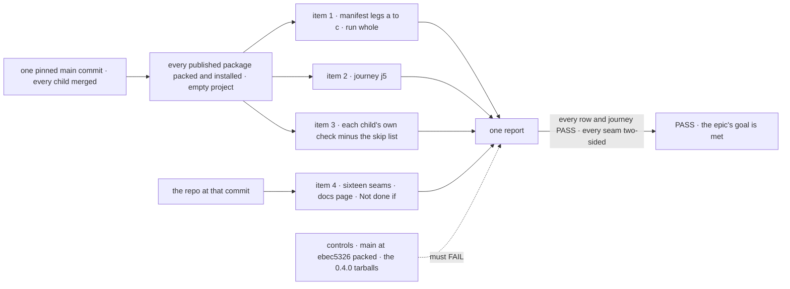
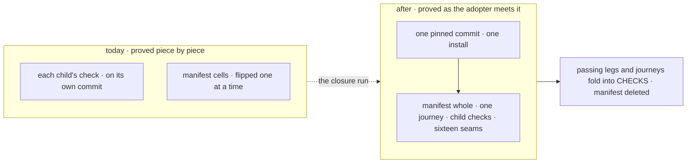

# FIX-2562 · Closure: an adopter's first hour on a clean SDK, checked on installed tarballs

**Spec** · [Decisions](DECISIONS.md)

## Five teams, before and after

| A team that… | Today | After this closes |
|---|---|---|
| **decides whether the epic is done** | Each child green on its own commit; the manifest's cells flipped one at a time | One report on one pinned `main` commit: every manifest row PASS beside its control's FAIL, one journey, every child's own check, and a sweep of the sixteen seams |
| **installs from npm and copies an example out** | The quick start throws at `fsdev run`; an example copied out of the repo doesn't run | Leg a runs the quick start; the `first-hour.example.*` cells run every example from a directory outside the repo, on the tarballs |
| **autocompletes a root in an editor** | Harness and PR vocabulary on core's root; tracker ids in hovers | The *Surface* cells hold each owned root to its documented names, and the *Leakage* cells scan every installed `.d.ts` for ids. An `/internal` path may still be offered; [epic D2](../../epics/FIX-2447/DECISIONS.md#d2-completions) holds it by the import census and the path name |
| **reads an action's output, or unit-tests an approval step** | Lists requests and searches the pages; `testFlow` can't suspend | `onepath.output-read`: one `sent.result()` call returns the output, read by request id. The testing package's own goal check, re-run in item 3, answers a `ctx.suspendForUser` stop in a `testFlow` test |
| **upgrades a 0.4.0 project** | Old code that passes `human_approval` compiles and loses its Inbox item | Journey j5 walks every moved name: the changelog names its new home. No alias, refusal or old-shape reader is left to check ([epic D4](../../epics/FIX-2447/DECISIONS.md#d4)); `human_approval` still runs as a custom reason, D4's price |

## The goal, and how we'll know it's met

**On one pinned `main` commit with every other child merged, an adopter who installs FSD from
the packed tarballs follows the quick start, autocompletes each root, answers a stop, reads an
output, tests an approval step and upgrades a 0.4.0 project, and each step runs as written and
shows only app-author surface. Every manifest row passes and every control fails. Every root the
set owns is clean, and every other published root sits at or below its ratchet baseline.**

| Is it the right goal? | |
|---|---|
| **The real need** | [The epic's goal](../../epics/FIX-2447/SPEC.md#the-goal-and-how-well-know-its-met), proved on the assembled set: the gaps *between* children ([closure rule](../../../docs/contributing/orchestration.md#the-closure-issue-every-epic-ends-in-qa)) |
| **Smaller, and rejected** | "FIX-2564's manifest is all `expect: pass` on `main`." Each child flipped its rows on its own commit, so a later merge that breaks an earlier row passes until someone reads the job. The export check and the tracker-id lint also read workspace source, and an adopter's editor reads the installed `.d.ts` |
| **Bigger, and not this issue's** | The review's unfiled items, a 1.0 freeze ([epic](../../epics/FIX-2447/SPEC.md#the-goal-and-how-well-know-its-met)), and cleaning the published roots the set doesn't own (workforce's wider root, memory, contracts, harness-manager, fsdev, workspace, tools, bullmq, mcp, scheduled, voice-openai): the ratchet holds them, and [FIX-2568](https://linear.app/fixpoint-labs/issue/FIX-2568) (workforce's wider root and memory, first) and [FIX-2569](https://linear.app/fixpoint-labs/issue/FIX-2569) (the other nine), related issues outside the epic, clean them |
| **Not done if** | The epic's six rows, plus: a root outside the owned set grew past its ratchet baseline · a check ran on another commit · a journey ran against workspace `src` or a repo checkout · a control was skipped or passed · a child's check was skipped without a manifest row naming it · a seam was checked from one side · a check carried forward although its code, docs or surface changed since it passed · a finding was deferred, or dropped with its blocks relation left · a closure finding is open in Linear |



Items 1 to 3 read only what the adopter's project sees. Item 4 reads the repo, because a seam is
two children's code. Each control breaks a named assertion, not just its leg.

| How we verify | |
|---|---|
| **Goal check** | FIX-2564's `scripts/packed-install/run.mjs --goal` and its closure manifest, **run whole, not rebuilt**, plus one journey added to it as a `closure` row. Model `n/a` for the legs and the journey: handlers compute every answer. Run by the closure worker on one pinned `main` commit. The report is the closure PR's body; findings are filed as children blocking this issue |
| **Signal** | Every manifest row PASS, with assertion ids printed. The [journey](#the-journeys) passes. Every row in [the sweep](DECISIONS.md#the-plan-in-full) is two-sided |
| **Input** | The packed tarballs of every published package at the pinned commit, installed into an empty ESM project by the packer `changeset publish` uses. j5 also installs the published 0.4.0 tarballs by integrity hash. A different valid input is another example, another root or another moved name: each must pass |
| **Anti-game** | Assert on the installed project only: no import from the repo, and the packed-install resolution guard stays on. The closure adds rows and changes no assertion or expectation to get green. A journey that duplicates a manifest cell or a child's goal check is that cell or check, not a second one. A README that lists every export in bulk is not documentation: the closure reports it as a *Surface* finding, as the epic's export check refuses a list the same diff writes |
| **Control that must fail** | FIX-2564's goal control, `run.mjs --control=adopter-goal` (`main` at `ebec5326` packed, and the 0.4.0 tarballs): every manifest row FAILs. The journey has nothing to fail on at that control, so it gets a planted one: `j5:moved-name-named` with one moved name's changelog line removed. It must FAIL |

### The journeys

Only what no cell and no child's check already grades. Each team in [the epic's
table](../../epics/FIX-2447/SPEC.md#five-teams-before-and-after) is still walked once:

| The epic's team | Walked by |
|---|---|
| Installs from npm and follows the quick start | Leg a's quick start, and FIX-2461's `first-hour.example.*` cells for an example copied out (item 1) |
| Autocompletes a package root | FIX-2448's *Surface* cells and FIX-2453's *Leakage* cells, lint and tarball scan (item 1). No `/internal` journey: epic D2 lets completions offer it |
| Answers a user's stop from React | Leg c (item 1) |
| Reads an action's output, or unit-tests an approval step | `onepath.output-read` (item 1); FIX-2460's goal check, re-run (item 3) |
| Upgrades across a rename | `shims.never-published` (item 1); journey **j5** for moved and retired names |

| Assertion | Passes when |
|---|---|
| `j5:moved-name-named` | The upgrade fixture, a small app written against 0.4.0 that compiles and runs on the 0.4.0 tarballs first, is reinstalled on the pinned tarballs. Each moved root name in it fails to compile, and the package's changelog line names its new home ([Q1](DECISIONS.md#q1), answered break: no `@deprecated` alias). No single child sees every move, so only the closure can walk them all |

## What changes



Before, every piece passed alone. After, the pieces meet on one install, and the run reads what
the adopter's project sees. Then the scaffolding goes ([D1](DECISIONS.md#d1)).

```diff
  // scripts/packed-install/<the closure manifest>: FIX-2564's rows, unchanged
+ { row: "closure", id: "j5:moved-name-named",    expect: "pass" }
  // the shape is FIX-2564's
```

Once that run is green, the same closure PR moves the passing legs and the journey into
`run.mjs`'s `CHECKS`, where the `packed-install` job gates every PR, and deletes the manifest and
its workflow.

**Docs:** no documentation impact; no page is written or changed. Item 4 follows the quick start
(FIX-2451's) and *what each package root is for* (FIX-2448's) as written. A page that doesn't hold
when followed is a finding against its child.

## What stays as it is

All product code; every child's check as it is on `main`; FIX-2564's assertions and its control.

## What's already here, and the debt

| Already here | What this does with it |
|---|---|
| FIX-2564's legs a to c, the closure manifest, its goal control | **Builds on.** Run whole, last, on one commit ([ER-9](../../epics/FIX-2447/DECISIONS.md#who-owns-what)) |
| `scripts/packed-install/run.mjs`: pack, install, `CHECKS`, the resolution guard, the `packed-install` CI job that gates every PR | **Extends** with one journey, as a manifest row; then `CHECKS` takes the passing legs and journeys |
| Each child's goal check (FIX-2448 to FIX-2463; FIX-2462's runs as FIX-2459's, into which it folded) and the two bugs' regression tests (FIX-2451, FIX-2554) | **Composed.** Re-run in item 3, minus the manifest's cells |
| [FIX-2368](../FIX-2368/SPEC.md), the last closure | **Kept** its shape: tagged assertions, the plan's four rows |
| Anything else grading the set | **None.** Searched `goals/` and `scripts/` for `packed-install`, `language service`, `sent.result`, `suspendForUser` with `testFlow` |

| The debt | |
|---|---|
| **Removes** | FIX-2564's manifest and its workflow, at the wrap ([D1](DECISIONS.md#d1)) |
| **Adds** | One journey, folded into `CHECKS` with the legs and gating every PR. Permanent by design: with the legs they are the first hour's regression check |
| **Leaves** | The review's unfiled items, as the epic does; the roots outside the owned set, held by the ratchet for FIX-2568 and FIX-2569 |

**Net: down, a little.** The epic's scaffolding goes; one journey stays, for a promise that spans
every published package.

## Sign off

**[The goal](#the-goal-and-how-well-know-its-met), at that size:** the manifest whole, one
journey, every child's check and sixteen seams, on one pinned commit, on installed tarballs;
owned roots clean, the rest at or below their ratchet. If wrong: the epic wraps on children that
each passed on their own commit, while the adopter's editor still shows our process.

**[The debt](#whats-already-here-and-the-debt), net down a little:** the manifest and its
workflow go, one journey stays. If wrong: minutes on every PR for checks nobody reads.

1. **[D1](DECISIONS.md#d1) · At the wrap, the passing legs and journeys fold into `CHECKS` and
   gate every PR; the manifest and its workflow are deleted.** If wrong: every PR pays the legs'
   minutes, and a flaky leg blocks merges.

**Open: none.** [Epic Q1](../../epics/FIX-2447/DECISIONS.md#q1) was answered break on Nov 6, so
the run point is after the last child merges ([how](DECISIONS.md#q1)).

Improvement · closure (QA) · `scripts/packed-install/` only · large, repeats per finding · epic
[FIX-2447](../../epics/FIX-2447/SPEC.md), closure · required · runs after every other child merges ·
Linear [FIX-2562](https://linear.app/fixpoint-labs/issue/FIX-2562)
