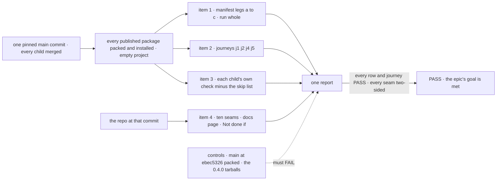
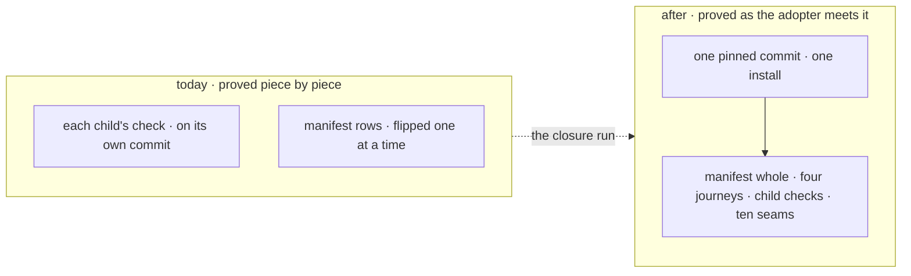

# FIX-2562 · Closure: an adopter's first hour on a clean SDK, checked on installed tarballs

**Spec** · [Decisions](DECISIONS.md)

## Five teams, before and after

| A team that… | Today | After this closes |
|---|---|---|
| **decides whether the epic is done** | Each child green on its own commit; the manifest's rows flipped one at a time | One report on one pinned `main` commit: every manifest row PASS beside its control's FAIL, four journeys, every child's own check, and a sweep of the ten seams |
| **installs from npm and copies an example out** | The quick start throws at `fsdev run`; an example copied out of the repo doesn't run | Leg a runs the quick start; journey j1 runs every example from a directory outside the repo, on the tarballs |
| **autocompletes a root in an editor** | Harness and PR vocabulary on core's root; tracker ids in hovers | Journey j2 asks the TypeScript language service what an editor would offer: every name has a README entry, no hover carries an id, and no `/internal` path is offered |
| **reads an action's output, or unit-tests an approval step** | Lists requests and searches the pages; `testFlow` can't suspend | Journey j4: one `sent.result()` call returns the output, read by request id; a `testFlow` test answers a `ctx.suspendForUser` stop |
| **upgrades a 0.4.0 project** | Old code that passes `human_approval` compiles and loses its Inbox item | Journey j5: every moved name and retired value is named, by a deprecation, a refusal or the changelog. Nothing changes silently |

## The goal, and how we'll know it's met

**On one pinned `main` commit with every other child merged, an adopter who installs FSD from
the packed tarballs follows the quick start, autocompletes each root, answers a stop, reads an
output, tests an approval step and upgrades a 0.4.0 project, and each step runs as written and
shows only app-author surface. Every manifest row passes and every control fails.**

| Is it the right goal? | |
|---|---|
| **The real need** | [The epic's goal](../../epics/FIX-2447/SPEC.md#the-goal-and-how-well-know-its-met), proved on the assembled set: the gaps *between* children ([closure rule](../../../docs/contributing/orchestration.md#the-closure-issue-every-epic-ends-in-qa)) |
| **Smaller, and rejected** | "FIX-2564's manifest is all `expect: pass` on `main`." Each child flipped its rows on its own commit, so a later merge that breaks an earlier row passes until someone reads the job. The export check and the tracker-id lint also read workspace source, and an adopter's editor reads the installed `.d.ts` |
| **Bigger, and not this issue's** | The review's unfiled items and a 1.0 freeze ([epic](../../epics/FIX-2447/SPEC.md#the-goal-and-how-well-know-its-met)) |
| **Not done if** | The epic's six rows, plus: a check ran on another commit · a journey ran against workspace `src` or a repo checkout · a control was skipped or passed · a child's check was skipped without a manifest row naming it · a seam was checked from one side · a check carried forward although its code, docs or surface changed since it passed · the editor check has no recorded evidence · a finding was deferred, or dropped with its blocks relation left · a closure finding is open in Linear |



Items 1 to 3 read only what the adopter's project sees. Item 4 reads the repo, because a seam is
two children's code. Each control breaks a named assertion, not just its leg.

| How we verify | |
|---|---|
| **Goal check** | FIX-2564's `scripts/packed-install/run.mjs` and its closure manifest, **run whole, not rebuilt**, plus four journeys added to it as `closure` rows. Model `n/a` for the legs and j2 to j5: handlers compute every answer. Run by the closure worker on one pinned `main` commit. The report is the closure PR's body; findings are filed as children blocking this issue |
| **Signal** | Every manifest row PASS, with assertion ids printed. Every assertion in [the journeys](#the-journeys) passes. Every row in [the sweep](DECISIONS.md#the-plan-in-full) is two-sided |
| **Input** | The packed tarballs of every published package at the pinned commit, installed into an empty ESM project by the packer `changeset publish` uses. j5 also installs the published 0.4.0 tarballs by integrity hash. A different valid input is another example, another root or another moved name: each must pass |
| **Anti-game** | Assert on the installed project only: no import from the repo, and the packed-install resolution guard stays on. The closure changes no row's assertion or expectation to get green. A journey that duplicates a manifest row is that row, not a second one. A README that lists every export in bulk is not documentation: it is a `j2` finding, as the epic's export check refuses a list the same diff writes. Calls are observed at the client's `fetch`, never through the client's own report |
| **Control that must fail** | FIX-2564's goal control (`main` at `ebec5326` packed, and the 0.4.0 tarballs): every manifest row FAILs. Each journey under the same control fails on a named assertion: **`j1:runs-copied-out`**, **`j2:completions-documented`**, **`j2:no-tracker-in-hover`**, **`j4:output-by-id`**, **`j4:suspension-test`**, **`j5:retired-value-refused`**. Two assertions have nothing to fail on at the control, so each gets a planted one: `j2:no-internal-offered` with one package's `/internal` hiding stripped from its installed manifest, and `j5:moved-name-named` with one moved name's deprecation and changelog line removed. Both must FAIL |

### The journeys

One per team whose *after* item 1 doesn't walk. *Answers a user's stop from React* is leg c, so it
gets none.

| Assertion | Passes when |
|---|---|
| `j1:runs-copied-out` | Each directory under `examples/`, copied outside the repo with its FSD ranges pointed at the tarballs, installs, and its README's run command exits 0 with the output the README shows. An example that needs a model key runs with one; a missing key blocks the run, it never skips the example |
| `j2:completions-documented` | For each published root, every completion TypeScript's language service (`getCompletionsAtPosition`, as an editor calls it) offers on `import { } from "<root>"` has an entry in that package's installed README |
| `j2:no-tracker-in-hover` | No completion's quick info (`getQuickInfoAtPosition`), and no installed `.d.ts`, matches `FIX-\d+` or `LAB-\d+` |
| `j2:no-internal-offered` | Path completions on `"@flow-state-dev/<pkg>/"` offer no `internal` entry ([epic D2](../../epics/FIX-2447/DECISIONS.md#d2)'s spot-check), confirmed once by hand in VS Code, with a screenshot in the report |
| `j4:output-by-id` | A client on the installed packages sends an action to a served app; `await sent.result()` returns its output; the client's `fetch` log shows a read by request id and no call that lists requests |
| `j4:suspension-test` | A `testFlow` test from the installed testing package answers a `ctx.suspendForUser` stop and the flow completes with its output |
| `j5:retired-value-refused` | The upgrade fixture, a small app written against 0.4.0 that compiles and runs on the 0.4.0 tarballs first, reinstalled on the pinned tarballs, passing `human_approval` throws, naming the replacement and a removal version |
| `j5:moved-name-named` | Each moved root name in that project either compiles with a `@deprecated` naming its new path and removal version, or fails and the package's changelog line names its new home ([Q1](DECISIONS.md#q1)) |

## What changes



Before, every piece passed alone. After, the pieces meet on one install, and the run reads what
the adopter's project sees.

```diff
  // scripts/packed-install/<the closure manifest>: FIX-2564's rows, unchanged
+ { row: "closure", id: "j1:runs-copied-out",       expect: "pass" }
+ { row: "closure", id: "j2:completions-documented", expect: "pass" }
+ // …the rest of the journeys; the shape is FIX-2564's
```

**Docs:** no documentation impact; no page is written or changed. Item 4 follows the quick start
(FIX-2451's) and *what each package root is for* (FIX-2448's) as written. A page that doesn't hold
when followed is a finding against its child.

## What stays as it is

All product code; every child's check as it is on `main`; FIX-2564's assertions and its control.

## What's already here, and the debt

| Already here | What this does with it |
|---|---|
| FIX-2564's legs a to c, the closure manifest, its goal control | **Builds on.** Run whole, last, on one commit ([ER-9](../../epics/FIX-2447/DECISIONS.md#who-owns-what)) |
| `scripts/packed-install/run.mjs`: pack, install, `CHECKS`, the resolution guard, the `packed-install` CI job that gates every PR | **Extends** with four journeys, as manifest rows |
| Each child's goal check (FIX-2448 to FIX-2463) and the two bugs' regression tests (FIX-2451, FIX-2554) | **Composed.** Re-run in item 3, minus the manifest's rows |
| [FIX-2368](../FIX-2368/SPEC.md), the last closure | **Kept** its shape: tagged assertions, the plan's four rows |
| Anything else grading the set | **None.** Searched `goals/` and `scripts/` for `packed-install`, `language service`, `sent.result`, `suspendForUser` with `testFlow` |

| The debt | |
|---|---|
| **Removes** | Nothing |
| **Adds** | Four journeys in the manifest, kept and gating after the wrap ([D1](DECISIONS.md#d1)). Permanent by design: they are the first hour's regression check |
| **Leaves** | The review's unfiled items, as the epic does |

**Net: up, a little.** Four journeys, for a promise that spans every published package.

## Sign off

**[The goal](#the-goal-and-how-well-know-its-met), at that size:** the manifest whole, four
journeys, every child's check and ten seams, on one pinned commit, on installed tarballs. If
wrong: the epic wraps on children that each passed on their own commit, while the adopter's
editor still shows our process.

**[The debt](#whats-already-here-and-the-debt), net up a little:** four journeys, nothing
removed. If wrong: minutes on every PR for checks nobody reads.

1. **[D1](DECISIONS.md#d1) · After the wrap, the legs and journeys gate every PR in the
   `packed-install` job.** If wrong: every PR pays the legs' minutes, and a flaky leg blocks
   merges.

**Open: none of its own.** The run point depends on [epic Q1](../../epics/FIX-2447/DECISIONS.md#q1);
the plan holds under each answer ([how](DECISIONS.md#q1)).

Improvement · closure (QA) · `scripts/packed-install/` only · large, repeats per finding · epic
[FIX-2447](../../epics/FIX-2447/SPEC.md), closure · required · runs after every other child merges ·
Linear [FIX-2562](https://linear.app/fixpoint-labs/issue/FIX-2562)
