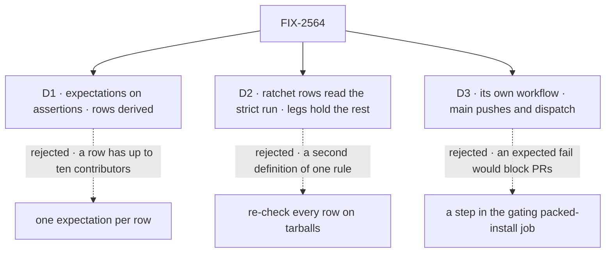

# FIX-2564 · Decisions

[Spec](SPEC.md) · **Decisions**

What was chosen, what lost, and what each locks in for the children who flip cells. Three
decisions are the sign-off.

## The tree

Solid edges are what you're signing. Dashed edges lost, and the label says why.

## D1 · Each assertion carries its own expectation, and a row's outcome is derived from its assertions

| | |
|---|---|
| **Instead of** | One `expect` per row, as the brief words it ("each child flips its rows") |
| **Because** | *Surface* alone spans ten children across the package roots, and *One path*, *First hour* and *Types* two each. With one expectation per row, a row stays failed until its last owner lands, so the others finish with nothing to flip and nothing on `main` shows their work. Per assertion, most children flip a cell of their own the day they land |
| **Locks in** | The manifest's unit is the assertion id. Each cell names every contributor, in this spec, and the last to land flips it; an earlier contributor shows its share in a dispatched run. A root's cell is not split by name, so the ids don't track a moving census. The lead measure still counts rows: a row passes only when every cell under it does. The epic's wording "flip its rows" reads as "flip its cells" |

It comes down to Surface's ten contributors: per-row, nine of them can't show their work land.

**What would change my mind:** each row turning out to have a single owner once the specs settle.
Then per-row is the same thing with fewer ids.

## D2 · Surface and Leakage read the ratchets' strict runs; the legs hold only what the tree can't show

| | |
|---|---|
| **Instead of** | Re-checking every row on the tarballs: a root-export census and a tracker-id scan of the installed `.d.ts` |
| **Because** | The epic consolidates verification: one place per row, and leg b holds only what the workspace ratchets can't see ([ER-9](../../epics/FIX-2447/DECISIONS.md#who-owns-what)). The export check already defines *outside consumer* over the workspace and its apps; a tarball census would define it a second time and could disagree. So a ratchet cell runs that check with its baseline or allow-list set aside, and passes when it finds nothing for its package. Collisions are the same: FIX-2449's workspace collision check, run strict over every published root, is the one `surface.collisions` cell, and leg b keeps no copy. What only a tarball shows stays in a leg: core's built `.d.ts` (`surface.core-installed-dts`) is read against FIX-2448's frozen moved list, not a second definition of *outside consumer* |
| **Locks in** | Until FIX-2448's export check, FIX-2449's collision check and FIX-2453's lint exist, their cells report `pending`, which counts as `fail`. Each owner exposes a strict run that names violations by package, and runs the control when it lands, so the cell is seen to fail before it can pass. Under the control, the ratchet code on `main` reads a checkout of `ebec5326` |

It comes down to one rule, one definition: a tarball census would redefine *outside consumer*.

## D3 · Its own workflow, run on every push to `main` and by manual dispatch on any branch

| | |
|---|---|
| **Instead of** | A step in the gating `packed-install` job, whose comment asks for new checks to go in its `CHECKS` list |
| **Because** | Every row starts as an expected fail, and the epic keeps the legs off child PRs. A step in that job would run on every PR, and a red mismatch would block it. A separate workflow runs the same script after merge, and a child dispatches it on its own branch to show its cell pass before it flips the line. The script stays the one place; only the job is separate, which is what that comment protects |
| **Locks in** | A second install of every tarball on each `main` push, a few minutes of CI, and the only one: a child that reads installed tarballs (FIX-2448's `.d.ts` read) does it as a leg assertion here, not a pack and install of its own. A child's goal verdict links a dispatched run. The workflow and the manifest are scaffolding: the closure folds the passing legs into `CHECKS`, where they gate every PR, and deletes both. Until then the closure is the manifest's last writer: it may add rows, never edit an assertion |

It comes down to the gate: inside the PR job, an expected fail blocks unrelated PRs.

## Decided, not asked

- **From the epic, cited, not restated:** [ER-6](../../epics/FIX-2447/DECISIONS.md#who-owns-what), [ER-9](../../epics/FIX-2447/DECISIONS.md#who-owns-what) · **cells owned** in [FIX-2564's grid](../FIX-2564/SPEC.md#what-changes): every assertion; it flips none.
- **The judge is the convergence point, and it is `runChecks`.** Each assertion is a goal `CHECKS`
  entry with no runner of its own. Every assertion reports `pass`, `fail`, `pending` (its
  check doesn't exist yet) or `error` (it could not run). The job is red when an outcome differs
  from its expectation in either direction, `pending` counting as `fail`, and on any `error`.
- **Admission.** An assertion joins the manifest only if it fails under the control. A rule 0.4.0
  already met can't show progress. That cut a check on `@deprecated` names: both of 0.4.0's
  (`resumedBy`, `dynamic`) were in 0.3.0. *Shims*' never-published scope is FIX-2454's census, 19 names
  no published version accepted (among them `queued`, `suspendedWait`, `questions`, which 0.4.0
  dual-reads), not the three the issue named. FIX-2454's two `human_approval` cells left the grid
  with the owner's no-compat call ([epic D4](../../epics/FIX-2447/DECISIONS.md#d4)): nothing
  refuses that value or reads a stored one now, so there is nothing to assert.
- **Under the control, every row fails.** Probed on the published tarballs: core 0.4.0 carries 272
  tracker ids in its `.d.ts` and orchestration 0.5.0 ships `retired-shapes`. FIX-2457's probe
  shows a handler with state schemas alone already compiles on `main`, so `types.typed-handler`'s
  fixture declares `uses: [cap]` (or declared targets). Its helper is one that stays public after
  FIX-2459 (`getOrCreateTaskCollection` on `./tasks`), not `payBoardDebts`, which moves to
  `orchestration/internal` where an adopter fixture may not reach. If it still compiles under the
  control, it is not admitted.
- **The flags.** `run.mjs --goal` and `run.mjs --control=adopter-goal`. Plain `--control` stays the
  0.1.1 control. The epic's `run.mjs --control` means the second.
- **The control set** is every published package at the version npm served on the day of
  `ebec5326` (core, engine, client, react and fsdev 0.4.0; orchestration 0.5.0), pinned by integrity
  in the manifest, as `CONTROL` pins 0.1.1.
- **Leg a's selection rule is the leg's, never the doc's.** Every titled block is written as its
  file, every shell block runs in order, the install lines map each `@flow-state-dev/*` name to its
  tarball, and `pnpm dev` is skipped. The only thing the leg adds is model access: a placeholder key
  and a local stub endpoint, set through the environment. No marker in the doc steers the leg.
- **A moved import path is the one assertion edit a child may make.** If a child moves a name a
  fixture imports, its PR updates that path in the same diff and says so (BP-034). What a fixture
  asserts never changes outside this issue.
- **Ids carry no tracker ids** (BP-006); ownership lives in this spec's table. Ids are
  `<row>.<what>`; *First hour* uses `first-hour.`, the prefix FIX-2461's cells already carry.

## Considered and dropped

| Alternative | Why not |
|---|---|
| Fold the legs into `goals/` with a `GOAL_CONTROL` | Goals run by hand on the workspace. The lead measure needs CI, on tarballs |
| Run the goal mode on child PRs, non-required | The epic keeps it off child PRs; dispatch covers a child that wants proof first |

## Analysis

Skipped in spec-set member mode: `epic-agent` runs `analysis` and `reuse-review` over the whole set.

## How it got here

- **Draft (Nov 5).** Spec-set member of epic FIX-2447. Moved the expectation to the assertion,
  read the ratchet rows from their strict runs, and gave the goal mode its own workflow.
- **Set review (Nov 5).** *Surface* narrowed to the roots the epic owns; each cell names every
  contributor and the last to land flips it (D1), replacing one owner per id. Collisions became one
  ratchet cell, FIX-2449's check over every root, with FIX-2458 contributing. Admitted FIX-2448's
  installed-`.d.ts` read, FIX-2454's two `human_approval` cells, FIX-2461's
  `first-hour.example.*`; renamed the output read to FIX-2455's `onepath.output-read` with its
  two cases; `types.typed-handler` now declares `uses` and calls a helper that stays public. The
  judge is `runChecks`; the closure is the manifest's last writer.
- **Owner amendment (Nov 6).** [Epic Q1 answered, break](../../epics/FIX-2447/DECISIONS.md#q1),
  and [epic D4, no backward-compat code](../../epics/FIX-2447/DECISIONS.md#d4)
  ([owner's comment](https://github.com/fixpoint-labs/flow-state-dev/pull/4836#issuecomment-6689198303)).
  `shims.human-approval-throws` and `shims.stored-human-approval` are dropped from the grid and
  the figure: FIX-2454 no longer refuses `human_approval` or reads a stored one. *Shims* is now
  `shims.never-published` alone. `types.fresh-session-default` no longer names `refuseRetired`,
  which is not built.
  The merged manifest (`scripts/packed-install/goal-manifest.json`) and its two fixtures
  (`goal-human-approval.mjs`, `goal-stored-approval.mjs`) still carry both cells; removing them
  is a code change, outside this spec amendment, without which *Shims* can never pass.

**Open: none.**
