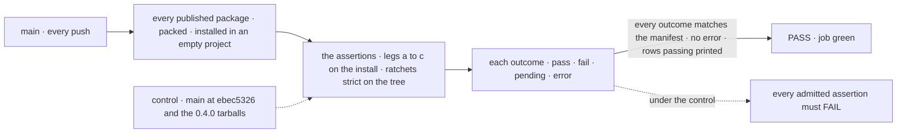
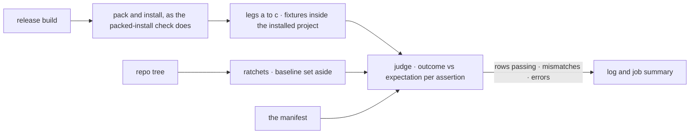

# FIX-2564 · The epic's goal legs on installed tarballs, landed first as expected-fail rows

**Spec** · [Decisions](DECISIONS.md)

## Five people, before and after

| Someone who… | Today | After |
|---|---|---|
| **owns the epic and asks how far along it is** | "0 of 6 rows" is a line in a spec. Nothing on `main` moves when a child lands | Every push to `main` prints how many of the six *Not done if* rows hold on installed tarballs |
| **finishes a child, say the one-call output read** | Proves its own goal check. Nothing ties that to the epic's row | Flips its own assertion from `fail` to `pass` in one manifest line, and shows a branch run where it passes |
| **lands a change that moves someone else's assertion** | Nobody sees it until the closure | `main` goes red, naming the assertion whose outcome no longer matches its expectation |
| **reviews a child PR and suspects a hollow pass** | Has no fixed bar to hold it to | Sees the child's manifest diff touch expectation lines only. The assertions are this issue's and don't move |
| **runs the closure** | Would build all three legs at the end and find the misses then | Runs a manifest that has tracked `main` since the first child merged |

The epic's lead measure, and [epic D1](../../epics/FIX-2447/DECISIONS.md#d1)'s trigger, read off
this from day one.

## The goal, and how we'll know it's met

**From the day this merges, anyone can read off `main` how many of the epic's six *Not done if*
rows hold for an adopter who installs from npm, and each child proves its share by flipping only
its own line.**

| Is it the right goal? | |
|---|---|
| **The real need** | The epic's lead measure, *rows passing in the manifest, read off the `main` job* ([epic](../../epics/FIX-2447/SPEC.md#the-goal-and-how-well-know-its-met)) |
| **Smaller, and rejected** | "The legs exist and run." A leg nobody has seen fail against 0.4.0 can report progress that isn't there |
| **Bigger, and not this issue's** | Proving the epic's goal, on one pinned `main` after every child: the closure FIX-2562. Gating child PRs on rows: the workspace ratchets do that |
| **Not done if** | An admitted assertion passes under the control · the job stays green while an outcome and its expectation disagree, in either direction · a row counts as passing while one of its assertions fails · a leg resolves a `@flow-state-dev/*` import from the workspace · the job runs on a child PR or blocks a release |



Green means outcomes agree with the manifest, not that the epic is done.

| How we verify | |
|---|---|
| **Goal check** | No `goals/` entry: this check lives in CI on purpose ([D3](DECISIONS.md#d3)). Run by the implementer at completion: `run.mjs --goal` on the branch, then `run.mjs --control=adopter-goal`, then the judgment rules' unit tests. Verdict in the implementation PR, with the dispatched workflow run linked |
| **Signal** | `--goal` exits 0 with every assertion `fail` against its `fail` expectation and prints *0 of 6 rows*. The control exits 0 only when every admitted assertion fails by name |
| **Input** | Today's `main`. A different valid input: a branch carrying one child's merged fix must move exactly that child's assertion, and the job must go red until its line flips |
| **Anti-game** | A leg imports only from the installed project, as every packed-install fixture does, and one that runs under vitest uses the suite's resolution guard, which refuses a workspace link. A child's diff changes expectation lines only. A row's outcome is derived, never written. An `error` (a crash, a network failure) is red whatever the expectation, so a broken leg can't pass as an expected fail |
| **Control that must fail** | `run.mjs --control=adopter-goal`: the ratchets as on `main`, run against a checkout of `ebec5326`, and every leg against the published tarballs pinned by integrity. Each admitted assertion must report `fail`. An assertion that can't be made to fail there is not admitted |

## What changes


Read across a row: a row passes only when all its cells do, so expectations sit on cells
([D1](DECISIONS.md#d1)).

| Row | Assertion | Checked in | Flipped by |
|---|---|---|---|
| Surface | `surface.root.<package>`, one per published root that fails under the control: the export check, baseline set aside | ratchet | core FIX-2448 · engine, client FIX-2449 · react FIX-2456 · orchestration, patterns FIX-2459 · testing FIX-2460 · the three harnesses FIX-2458 · workforce FIX-2463 (FIX-2459 if it exits) · both stores FIX-2452 · any other root FIX-2448 |
| Surface | `surface.collisions`: no two installed roots export one name for different declarations | leg b | FIX-2449 |
| One path | `onepath.answer-task-stop`: installed React's approval hook answers a stop raised in a task-board run | leg c | FIX-2450 |
| One path | `onepath.action-output`: the installed client returns an action's output in one call, read by request id, never by listing | leg c | FIX-2455 |
| First hour | `firsthour.quickstart`: the quick start's own blocks, in order, then its `fsdev run` returns an answer | leg a | FIX-2451 |
| Leakage | `leakage.tracker-ids`: the tracker-id lint, any allow-list set aside | ratchet | FIX-2453 |
| Shims | `shims.unpublished-shapes`: the installed task store reads none of the three shapes no published version wrote | leg b | FIX-2454 |
| Types | `types.typed-handler`: a handler with typed state calls an exported board helper and compiles against the installed `.d.ts` with no cast | leg c | FIX-2457 |
| Types | `types.fresh-session-default`: a fresh session reads its state schema's default | leg c | FIX-2554 |

FIX-2461 and FIX-2462 own no cell; the closure runs their goal checks. *A closure bug is open* is a
Linear fact the closure reads, not a cell.

**What a child types to flip its cell:**

```diff
   "expect": {
-    "onepath.action-output": "fail",
+    "onepath.action-output": "pass",
```

**Docs:** no documentation impact: CI tooling with no adopter surface. The script header carries it (BP-007).

## How one run reaches a verdict



Packing and installing are the existing check's code; the judge and the assertions are new.

## What stays as it is

- The gating packed-install job, its `CHECKS`, its two controls and the two-users suite. Goal mode
  runs none of them, so it needs no Redis.
- The workspace ratchets, which gate PRs; FIX-2448 and FIX-2453 build them.
- Each child's own goal check. A cell is the epic's view of it, not a replacement.

## What's already here, and the debt

| Already here | What this does with it |
|---|---|
| `scripts/packed-install/run.mjs`: pack, install, fixtures run inside the consumer project, a pinned control | **Extends.** A goal mode and a second named control, on its packing and install code |
| The suite's resolution guard (`suite.mjs`) | **Builds on**, for any leg that runs under vitest |
| `--control`, already the 0.1.1 control | **Leaves alone.** The new control follows the `--control=<name>` form `workspace-link` set |
| `goals/` goal checks with `GOAL_CONTROL` | **Leaves alone.** Run by hand on the workspace; these legs run in CI on tarballs ([D3](DECISIONS.md#d3)) |
| The export check and the tracker-id lint, to come | **Reads** their strict runs; until each exists its cells report `pending` ([D2](DECISIONS.md#d2)) |
| Anything else that tracks an epic's rows | **None.** Searched `manifest`, `expect`, `closure` in `scripts/` and `.github/` |

| Adds | Existing piece considered | Why it doesn't fit / how composed |
|---|---|---|
| The manifest, one JSON file beside `run.mjs`: rows, assertion ids, expectations, the control's pins | `goal.md`'s verdict log; `CONTROL`'s pin in `run.mjs` | A log records runs; this records expectations a child edits. The pins extend `CONTROL`'s integrity-hash pattern |
| Goal mode and the judge in `run.mjs` | `runChecks` | `runChecks` is pass/fail; the judge compares outcome with expectation and keeps `error` separate |
| A workflow on `main` pushes and manual dispatch | The `packed-install` job | Composed: the same script, its own job, so an expected fail never blocks a PR or a release ([D3](DECISIONS.md#d3)) |

| The debt | |
|---|---|
| **Removes** | Nothing. |
| **Adds** | The manifest, the goal mode and its workflow, and a second CI install of every tarball on each `main` push. Scaffolding, not permanent: the closure folds the passing legs into `CHECKS`, where they gate, and deletes the manifest and the workflow |
| **Leaves** | `run.mjs`'s `CHECKS` comment already says "legs b and c" for the two-users suite; the new ids are named by row so the two don't collide |

**Net: up, until the closure.** One file, one mode and one job are added and nothing goes; the
closure pays it by moving the legs into the gating check.

## Sign off

**[The goal](#the-goal-and-how-well-know-its-met):** the six rows read off `main` from day one,
each cell flipped only by its owner. If wrong: the epic's progress stays a claim until the closure.

**[The debt](#whats-already-here-and-the-debt):** net up until the closure, which folds the legs
into the gating check. If wrong: a second packed-install job nobody removes.

1. [D1](DECISIONS.md#d1) · Expectations sit on assertions; a row's outcome is derived. **The one to
   weigh.** If wrong: a child's flip can't show until its last row-mate lands.
2. [D2](DECISIONS.md#d2) · Surface and Leakage read the ratchets' strict runs; the legs hold only
   what the tree can't show. If wrong: two cells read `pending` until FIX-2448 and FIX-2453 land.
3. [D3](DECISIONS.md#d3) · Its own workflow, on `main` pushes and manual dispatch. If wrong: a
   second job's minutes on every push.

**Open: none.**

Improvement · `scripts/packed-install` and CI · medium · epic FIX-2447 · builds first, blocks FIX-2562
