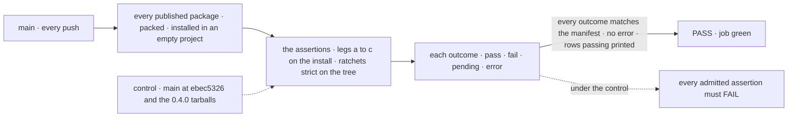
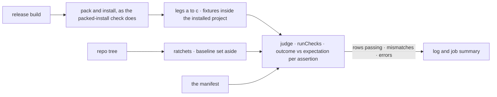

# FIX-2564 · The epic's goal legs on installed tarballs, landed first as expected-fail rows

**Spec** · [Decisions](DECISIONS.md)

## Five people, before and after

| Someone who… | Today | After |
|---|---|---|
| **owns the epic and asks how far along it is** | "0 of 6 rows" is a line in a spec. Nothing on `main` moves when a child lands | Every push to `main` prints how many of the six *Not done if* rows hold on installed tarballs |
| **finishes a child, say the one-call output read** | Proves its own goal check. Nothing ties that to the epic's row | Flips its own assertion from `fail` to `pass` in one manifest line, and shows a branch run where it passes. Where a cell has several contributors, the last to land flips it |
| **lands a change that moves someone else's assertion** | Nobody sees it until the closure | `main` goes red, naming the assertion whose outcome no longer matches its expectation |
| **reviews a child PR and suspects a hollow pass** | Has no fixed bar to hold it to | Sees the child's manifest diff touch expectation lines only. The assertions are this issue's and don't move |
| **runs the closure** | Would build all three legs at the end and find the misses then | Runs a manifest that has tracked `main` since the first child merged, then folds the passing legs into the gating check and deletes the manifest |

The epic's lead measure, and [epic D1](../../epics/FIX-2447/DECISIONS.md#d1)'s trigger, read off
this from day one.

## The goal, and how we'll know it's met

**From the day this merges, anyone can read off `main` how many of the epic's six *Not done if*
rows hold for an adopter who installs from npm, and each child proves its share by flipping only
its own line.**

| Is it the right goal? | |
|---|---|
| **The real need** | The epic's lead measure, *rows passing in the manifest, read off the `main` job* ([epic](../../epics/FIX-2447/SPEC.md#the-goal-and-how-well-know-its-met)) |
| **Smaller, and rejected** | "The legs exist and run." A leg nobody has seen fail against 0.4.0 can report progress that isn't there |
| **Bigger, and not this issue's** | Proving the epic's goal, on one pinned `main` after every child: the closure FIX-2562. Gating child PRs on rows: the workspace ratchets do that |
| **Not done if** | An admitted assertion passes under the control · the job stays green while an outcome and its expectation disagree, in either direction · a row counts as passing while one of its assertions fails · a leg resolves a `@flow-state-dev/*` import from the workspace · the job runs on a child PR or blocks a release |



Green means outcomes agree with the manifest, not that the epic is done.

| How we verify | |
|---|---|
| **Goal check** | No `goals/` entry: this check lives in CI on purpose ([D3](DECISIONS.md#d3)). Run by the implementer at completion: `run.mjs --goal` on the branch, then `run.mjs --control=adopter-goal`, then the judgment rules' unit tests. Verdict in the implementation PR, with the dispatched workflow run linked |
| **Signal** | `--goal` exits 0 with every assertion `fail` against its `fail` expectation and prints *0 of 6 rows*. The control exits 0 only when every admitted assertion fails by name |
| **Input** | Today's `main`. A different valid input: a branch carrying one child's merged fix must move exactly that child's assertion, and the job must go red until its line flips |
| **Anti-game** | A leg imports only from the installed project, as every packed-install fixture does, and one that runs under vitest uses the suite's resolution guard, which refuses a workspace link. A child's diff changes expectation lines only. A row's outcome is derived, never written. An `error` (a crash, a network failure) is red whatever the expectation, so a broken leg can't pass as an expected fail |
| **Control that must fail** | `run.mjs --control=adopter-goal`: the ratchets as on `main`, run against a checkout of `ebec5326`, and every leg against the published tarballs pinned by integrity. Each admitted assertion must report `fail`. An assertion that can't be made to fail there is not admitted |

## What changes

![The manifest as a grid: six rows down the side, where each is checked across the top (a workspace ratchet, leg a, leg b, leg c). Surface is the export check per owned root and the collision check over every root, both ratchets, plus core's installed declarations in leg b. One path is two leg c assertions. First hour is the quick start and each example in leg a. Leakage is the tracker-id lint. Shims is one leg b assertion. Types is two leg c assertions. Every cell starts at expect fail, names every contributor, and the last of them to land flips it](figures/manifest.svg)

Read across a row: a row passes only when all its cells do, so expectations sit on cells
([D1](DECISIONS.md#d1)). A cell names every child that contributes to it, and the last of them to
land flips it.

This grid is the epic's one statement of each row's assertions, checks and flippers; the epic
and the children cite it rather than restating it.

*Surface*, pending the owner and in the recommended reading, covers the roots the epic owns: core,
engine, client, react, testing, orchestration, patterns, the three harnesses, both stores, and
workforce's `*_ENTRY` names. Every other published root (workforce's wider root, memory, contracts,
harness-manager, fsdev, workspace, tools, bullmq, mcp, scheduled, voice-openai) is held by the
export check's ratchet, so it can't grow, and goes to [FIX-2568](https://linear.app/fixpoint-labs/issue/FIX-2568) (workforce's wider root and memory, first) and [FIX-2569](https://linear.app/fixpoint-labs/issue/FIX-2569) (the other nine), related issues outside the epic. It has no cell.

| Row | Assertion | Checked in | Flipped by (the last to land) |
|---|---|---|---|
| Surface | `surface.root.<package>`, one per owned root: the export check, baseline set aside, finds nothing on that root | ratchet | core FIX-2448, FIX-2460 (its benchmark types) · engine FIX-2449, FIX-2452 (store constructors) · client FIX-2449 · react FIX-2449, FIX-2450, FIX-2455, FIX-2456 · orchestration FIX-2459 · patterns FIX-2459, FIX-2460 · testing FIX-2460 · claude-code, codex, cursor FIX-2458 · store-sqlite, store-postgres FIX-2452 |
| Surface | `surface.root.workforce`: the five `*_ENTRY` names only, not workforce's wider root | ratchet | FIX-2463 |
| Surface | `surface.collisions`: the workspace collision check, run strict over every published root, finds no two roots exporting one name for different declarations | ratchet | FIX-2449 (foundation renames), FIX-2458 (harness renames), FIX-2452 (`initializeSchema` across the store roots), FIX-2459 (orchestration's `camelToKebab` beside contracts') |
| Surface | `surface.core-installed-dts`: on the installed core tarball, read through the TypeScript compiler from its `.d.ts`, no moved name is on the root or `core/types`, each sits on the entry its move names, and `BlockContext` has no `requestHost` | leg b | FIX-2448 |
| One path | `onepath.answer-task-stop`: installed React's approval hook answers a stop raised in a task-board run | leg c | FIX-2450 |
| One path | `onepath.output-read`: the installed client's `request(firstId).result()`, with 101 newer requests in the session, returns the output the action computed; a failing action resolves `failed` with its `error.code`. Read by request id, never by listing | leg c | FIX-2455 |
| First hour | `first-hour.quickstart`: the quick start's own blocks, in order, then its `fsdev run` returns an answer | leg a | FIX-2451 |
| First hour | `first-hour.example.<name>.<step>`: each example under `examples/`, copied to an empty folder and run by the recipe in `examples/README.md`. Only the steps that fail under the control are admitted | leg a | FIX-2461 |
| Leakage | `leakage.tracker-ids`: the tracker-id lint, any allow-list set aside | ratchet | FIX-2453 |
| Shims | `shims.never-published`: the installed packages read or refuse none of the names no published version accepted, as listed by FIX-2454's census (19) | leg b | FIX-2454 |
| Types | `types.typed-handler`: a handler that declares `uses: [cap]` (or declared targets) calls `getOrCreateTaskCollection` from orchestration's `./tasks`, a helper that stays on a public entry, and compiles against the installed `.d.ts` with no cast | leg c | FIX-2457 |
| Types | `types.fresh-session-default`: a fresh session reads its state schema's default, both the flow's and one declared only by a block or capability the flow uses; a flow in which two blocks or capabilities declare one field with a different type or default is refused at flow definition, and the error names the field and both declaring blocks; identical declarations merge silently. A type-only conflict fails the cell. One merge, the one the type-level `extendSchema` describes, with no second runtime mechanism; the conflict error carries no tracker id | leg c | FIX-2554 (the flow `stateSchema` fill, merged), FIX-2576 (block- and capability-declared defaults, the conflict refusal) |

FIX-2562's journeys reuse these cells (`first-hour.example.*` for copying an example out) rather
than restating them. FIX-2460's stop answer and FIX-2453's tarball scan get no cell: they stay those
children's own goal checks, which the closure re-runs. *A closure bug is open* is a Linear fact the
closure reads, not a cell.

**What a child types to flip its cell:**

```diff
   "expect": {
-    "onepath.output-read": "fail",
+    "onepath.output-read": "pass",
```

**Docs:** no documentation impact: CI tooling with no adopter surface. The script header carries it (BP-007).

## How one run reaches a verdict



Packing and installing are the existing check's code (`packAll`, `npmInstall`), and the judge is its
`runChecks` over a goal `CHECKS` list. The assertions and the manifest are new.

## What stays as it is

- The gating packed-install job, its `CHECKS`, its two controls and the two-users suite. Goal mode
  runs `runChecks` over its own list and none of those checks, so it needs no Redis.
- The workspace ratchets, which gate PRs; FIX-2448 and FIX-2453 build them.
- Each child's own goal check. A cell is the epic's view of it, not a replacement.

## What's already here, and the debt

| Already here | What this does with it |
|---|---|
| `scripts/packed-install/run.mjs`: pack, install, fixtures run inside the consumer project, `runChecks` over `CHECKS`, a pinned control | **Extends.** A goal mode, a goal `CHECKS` list and a second named control, on its `packAll`, `npmInstall` and `runChecks` |
| The suite's resolution guard (`suite.mjs`) | **Builds on**, for any leg that runs under vitest |
| `--control`, already the 0.1.1 control | **Leaves alone.** The new control follows the `--control=<name>` form `workspace-link` set |
| `goals/` goal checks with `GOAL_CONTROL` | **Leaves alone.** Run by hand on the workspace; these legs run in CI on tarballs ([D3](DECISIONS.md#d3)) |
| The export check, the workspace collision check and the tracker-id lint, to come | **Reads** their strict runs; until each exists its cells report `pending` ([D2](DECISIONS.md#d2)). Leg b keeps no collision copy of its own |
| Anything else that tracks an epic's rows | **None.** Searched `manifest`, `expect`, `closure` in `scripts/` and `.github/` |

| Adds | Existing piece considered | Why it doesn't fit / how composed |
|---|---|---|
| The manifest, one JSON file beside `run.mjs`: rows, assertion ids, expectations, the control's pins | `goal.md`'s verdict log; `CONTROL`'s pin in `run.mjs` | A log records runs; this records expectations a child edits. The pins extend `CONTROL`'s integrity-hash pattern |
| Goal mode and the judge in `run.mjs` | `runChecks`/`CHECKS` | **Extends**, with no runner of its own: each goal check is a `CHECKS` entry, and the judge compares the outcome `runChecks` reports with the manifest's expectation, keeping `error` separate |
| A workflow on `main` pushes and manual dispatch | The `packed-install` job | Composed: the same script, its own job, so an expected fail never blocks a PR or a release ([D3](DECISIONS.md#d3)) |

| The debt | |
|---|---|
| **Removes** | Nothing. |
| **Adds** | The manifest, the goal mode and its workflow, and a second CI install of every tarball on each `main` push. Scaffolding, not permanent: the closure folds the passing legs into `CHECKS`, where they gate, and deletes the manifest and the workflow. Until then the closure is the manifest's last writer: it may add rows, never edit an assertion |
| **Leaves** | `run.mjs`'s `CHECKS` comment already says "legs b and c" for the two-users suite; the new ids are named by row so the two don't collide |

**Net: up, until the closure.** One file, one mode and one job are added and nothing goes; the
closure pays it by moving the legs into the gating check.

## Sign off

**[The goal](#the-goal-and-how-well-know-its-met):** the six rows read off `main` from day one,
each cell flipped only by its owner. If wrong: the epic's progress stays a claim until the closure.

**[The debt](#whats-already-here-and-the-debt):** net up until the closure, which folds the legs
into the gating check. If wrong: a second packed-install job nobody removes.

1. [D1](DECISIONS.md#d1) · Expectations sit on assertions; a row's outcome is derived; a cell
   with several contributors is flipped by the last to land. **The one to weigh.** If wrong: a
   child's flip can't show until its last row-mate lands.
2. [D2](DECISIONS.md#d2) · Surface and Leakage read the ratchets' strict runs; the legs hold only
   what the tree can't show. If wrong: the ratchet cells read `pending` until FIX-2448's export
   check, FIX-2449's collision check and FIX-2453's lint land.
3. [D3](DECISIONS.md#d3) · Its own workflow, on `main` pushes and manual dispatch. If wrong: a
   second job's minutes on every push.

**Open: none.**

Improvement · `scripts/packed-install` and CI · medium · epic FIX-2447 · builds first, blocks FIX-2562
