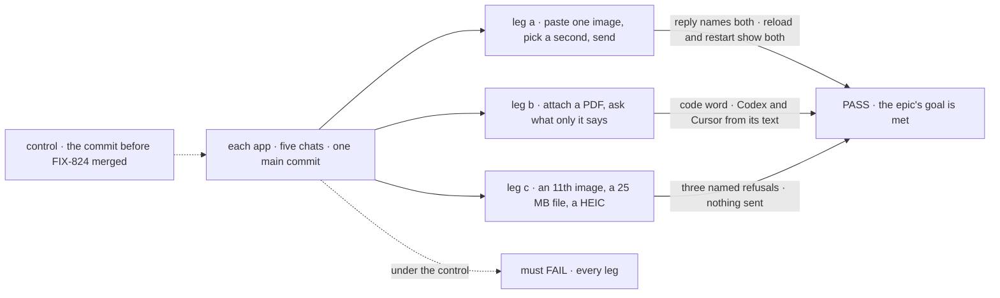

# FIX-2565 · Closure: every chat takes images and documents

**Spec** · [Decisions](DECISIONS.md)

## The epic's five teams, and the journey each one walks

| A team that… | The journey the closure walks, on one `main` commit |
|---|---|
| **chats in Kitchen Sink, Shift Manager or a lab** | The three legs below, in each of the five chats |
| **runs a coding worker on Claude Code, Codex or Cursor** | Leg a on each Kitchen Sink harness page and in the Claude Code-style lab; the harness's reply names both images |
| **files a task in Shift Manager with a screenshot** | Files it, lets the worker run, re-runs it: both runs name the image; deletes it: the file's read is 404 |
| **builds a flow on FSD** | A fresh flow with `userMessage`, sent two images through `@flow-state-dev/client` on the default local store; reply names both, and again after a restart |
| **builds its own composer** | `fsdev ui add attachments` into a fresh Next.js app; paste, refuse an 11th image, send references |

This issue builds nothing. It proves the assembled set does what the epic set out to do, and
files what it finds.

## The goal, and how we'll know it's met

**In every chat in our apps, a person can attach images and documents by paste, + or drop, see
and remove them before sending, and the reply shows the model or harness saw them, or says
plainly why it can't.** The epic's goal, unchanged.

| Is it the right goal? | |
|---|---|
| **The real need** | [FIX-2516's goal](../../epics/FIX-2516/SPEC.md#the-goal-and-how-well-know-its-met), proved on the assembled set |
| **Smaller, and rejected** | "Every child's own goal check passed." Each ran on its own branch; a seam between two of them is in neither |
| **Bigger, and not this issue's** | A hosted deploy with a hosted adapter; none is built |
| **Not done if** | A leg passes on a stubbed model · one app is skipped as "same as another" · a finding is open |

The check reads what a person sees in the browser, after a real restart, against real models
and real harnesses.

| How we verify | |
|---|---|
| **Goal check** | `goals/attachments/closure/` · real models and every signed-in harness · persistent local stores · real browser, the closure's runner first, `fsd-qa` over the mailbox for what it can't drive · verdict in the closure PR |
| **Signal** | Each cell of the figure below. Plus, once per app: the session read after leg a carries references and no base64 run over 1 KB. Once in all: a second user's read of a file is 404 |
| **Input** | Images and a PDF with a random code word, drawn per run (the epic's input) |
| **Anti-game** | Assert on what a person sees: the reply, the reloaded line, the composer's message. Never on a stubbed model or a hook's state |
| **Control that must fail** | The commit before FIX-824 merged: every leg. `GOAL_CONTROL=strip-file-parts` on the final commit: legs a and b, on *reply names both* and *code word* |

## What it runs

Read a row as one app's pass. Leg b on Codex and Cursor reads the PDF's text, extracted on our
side (FIX-2520 [D1](../FIX-2520/DECISIONS.md#d1)); a scanned page is a stated limit, not a cell.

**Then three sweeps, each a list of findings:**

- **FIX-824's kill line and the model-free package checks, re-run** on the same commit:
  FIX-824 and FIX-2518. The app and model checks are the legs above. The kill line's dependency
  check allows FIX-2520's one PDF text library.
- **The rules, checked across the repo:** ER-1, nothing but the helper and the resolver matches
  `fsd-blob:` or decodes `data`; ER-2, no base64 in any session read or `localStorage` after the
  legs; ER-6, no `clipboardData`, `dataTransfer` or `onDrop` handler in `apps/`, `labs/` or
  `packages/shift-manager`; a host whose disk doesn't last refuses an upload by name.
- **The coordination seams**, each walked once: a task filed from a message keeps its files after
  the session is deleted, and deleting one task leaves a sibling's files; a steer with a file
  becomes the next turn.

**Docs:** no documentation impact of its own. The sweep reads the shared story against what
shipped and files a gap as a finding.

## What stays as it is

Everything. A finding is filed as an issue against the child that owns it, under the epic, and
fixed there.

## What's already here, and the debt

| Already here | What this does with it |
|---|---|
| `goals/closure-smarter-agents/`, the last closure's runner (`closure.mts`, a folder per app) | **Builds on** its layout and its per-app runners |
| FIX-824's and FIX-2518's goal checks | **Re-runs** them, unchanged but for the one accepted dependency |

| Adds | Existing piece considered | Why it doesn't fit / how composed |
|---|---|---|
| `goals/attachments/closure/` | `goals/closure-smarter-agents/` | Composed: the same shape, new asks |

| The debt | |
|---|---|
| **Removes** | Nothing |
| **Adds** | A goal check, kept as the epic's regression check |
| **Leaves** | No hosted adapter, so no hosted run (the epic's debt) |

**Net: flat.**

## Sign off

**[The goal](#the-goal-and-how-well-know-its-met), at that size:** six surfaces, three legs, a
restart, five journeys and three sweeps. If wrong: the epic closes with a seam no child owned.

**[The debt](#whats-already-here-and-the-debt), net flat.** If wrong: nothing.

**No decisions of its own.** What passes is the epic's goal; leg b on Codex and Cursor reads the
PDF's text (FIX-2520's D1).

**Open: none.**

Improvement · `goals/` · medium · epic FIX-2516 closure
