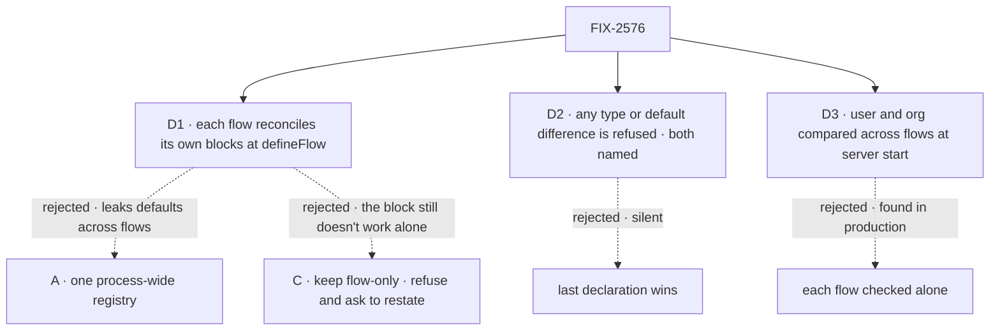

# FIX-2576 · Decisions

[Spec](SPEC.md) · **Decisions**

What was considered, what was chosen, and what each choice locks in. The three cards record the
owner's answer on the POC, [#4788](https://github.com/fixpoint-labs/flow-state-dev/pull/4788)
(option B, Nov 5). They are not re-derived here; the POC's measurements are the evidence.

## The tree

## D1 · Each flow reconciles its own blocks' scope schemas when it is defined, with no registry

| | |
|---|---|
| **Instead of** | A, a schema registry in core that blocks join when built and flows when defined; or C, the flow-only fill with a general "restate the field" refusal |
| **Because** | The POC ran all three on the six kitchen-sink flows. A's process global leaked another flow's defaults into a session (a chat-agent session filled 34 fields, most of them the coordinator's), refused two unrelated flows that share a block, held a stale entry under HMR, failed every flow on the first conflict, and needed new names on core's root, which this epic shrinks ([tenet 2](../../../docs/philosophy.md)). C leaves the block not working on its own. B did none of that, at about 0.25 to 0.4 ms per `defineFlow` and about 1 µs more per load of a stored record |
| **Locks in** | The merged schema is internal to the flow instance. Nothing is added to core's root export. A schema that belongs to no block is declared on the flow or a capability |

It comes down to the leak: a registry has no idea which flow a session belongs to.

## D2 · Two declarations of one field that differ in type or default are refused, naming both

| | |
|---|---|
| **Instead of** | The last declaration wins, as `extendSchema` does at the type level; or a narrower declaration wins when it is assignable to the wider one |
| **Because** | A silent winner is picked by import order, so the value a block reads depends on code it never sees. `mergeTargetsInto` already refuses a different schema under one name. The one real conflict the POC found, `thinkingStyle` in chat-agent, is a block declaring a looser read view of the flow's enum, and the fix is one line. "Narrower wins" is more code and harder to explain for a case seen once |
| **Locks in** | Identical declarations merge quietly; new fields union at any depth; a default on one side and none on the other is not a conflict; `.nullable()` is part of the type. A flow that defines today can throw after the upgrade, and the changeset says so (ER-7). The error is not a retired value: no `refuseRetired`, no tracker id ([ER-5](../../epics/FIX-2447/DECISIONS.md#who-owns-what)) |

It comes down to import order: a silent winner makes a block's state depend on code it can't see.

## D3 · Two flows that type a shared user or org field differently are refused when the server admits them

| | |
|---|---|
| **Instead of** | No cross-flow check: each flow is reconciled alone |
| **Because** | A user or org record is one blob shared by every flow on the server, so two flows that disagree on a field write values the other can't read. A per-flow walk can't see that by itself; the server is the first place that holds every flow. A session belongs to one flow, so its fields are never compared |
| **Locks in** | A server that starts today can refuse to start after the upgrade, naming the field and both flows. The check covers what the walk merged (flow and block declarations), user and org only |

It comes down to the shared record: only the server sees every flow that writes it.

## Decided, not asked

- **From the epic, cited, not restated:** [ER-5](../../epics/FIX-2447/DECISIONS.md#who-owns-what),
  ER-7, and the FIX-2457 × FIX-2554 *Scope-state defaults* seam row, which this issue now carries
  for the runtime half (in the spec set's review head, [#4772](https://github.com/fixpoint-labs/flow-state-dev/pull/4772)).
  **Cell contributed:** `types.fresh-session-default` in FIX-2564's manifest.
- **The convergence point is one accessor for a flow's merged schema per scope**, and every read
  of stored scope state goes through it: the three load closures in `createExecutionContext`
  (which also serve `createScopePersist` and `createScopeReread`), the three reads in
  `state-routes.ts`, and the session list in `client-session.ts`. The [census](poc/read-sites/census.mjs)
  with `--after` is the check: no read passes `flow.<scope>.stateSchema` straight to the fill.
- **What the walk reads.** The same reachable closure `collectRequiredFlowConfig` and
  `collectBlockResources` read, tool edge included. Each block's own `session/user/orgStateSchema`,
  and each capability's, per capability, from what `resolveCapabilities` keeps
  (`__resolvedCapabilities`), so a conflict names the capability, not the block that used it.
  Preset-contributed schemas and dynamic `uses` contribute none, as today.
- **Within one block, two capabilities that disagree are refused too.** Today `extendSchema` lets
  the last one win and nothing reads the result. Same rule as D2, same error.
- **`extendSchema` stays** as it is: the type-level statement of the merge. For non-conflicting
  declarations the walk's merge is the same shape; where they would differ, the walk refuses. That
  is how this meets the seam row's "matches", with one applied runtime merge.
- **The hire refusal goes once its fields are covered.** `roleStateProblem` is removed after each
  session field it checks is declared, with its default, by a board block that reads it. A field
  that no block declares moves onto the block that reads it in the same PR.
- **The admission check runs where the engine admits a flow** (the flow registry `createFlowState`
  builds), over the merged user and org schemas, by the D2 rule.
- **`client.expose` and `client.derived` stay checked against the flow's own schema.** Naming a
  block-only field there is a separate change.
- **Verification is engine tests plus the census**, not `fsdev run`: the change is the schema the
  fill reads, and the engine's test harness reaches every read site.

## Considered and dropped

| Option | Why it lost |
|---|---|
| A · a registry in core | D1. The POC's table, rows 2b, 2c, 5b and 7 |
| C · flow-only fill and a general refusal | Meets the smaller goal; every adopter still copies fields |
| A server-owned registry fed by the walk | Solves a need nobody has yet: reading schemas with no flow loaded. #4788 names it as the move if that need appears |
| Narrower declaration wins when assignable | D2. More code, subtler rule, one case seen |

## Open / settled

**Settled · the shape (option B).** Per-flow walk, strict rules, server check for user and org.
Evidence: [#4788](https://github.com/fixpoint-labs/flow-state-dev/pull/4788),
`specs/issues/FIX-2554/poc/scope-schema-registry/` on its branch, at `ad2e5b5c`. Owner's answer,
Nov 5. Run it with
`cd apps/kitchen-sink && ../../node_modules/.bin/tsx ../../specs/issues/FIX-2554/poc/scope-schema-registry/run.mts`
on that branch.

**Settled · the read sites.** Seven calls of the fill in `packages/*/src`, all in the engine, all
passing the flow's own schema. Evidence: [`poc/read-sites/census.mjs`](poc/read-sites/census.mjs)
on `3dad421f0`; its count control and totality control both run and failed as they must.

**Settled · `extendSchema`'s runtime result is unread.** One write site
(`capability/merge.ts:510`), no reader in `packages/core/src`. Checked by search on `3dad421f0`.

**Open: none.**

## Analysis

**2026-11-05 · watermark 2026-11-05 · right approach.** Run by the authoring worker, which has no
sub-agent tool in this dispatch; the owner's POC answer had already settled the direction.
*Reuse:* the walk, the fill and the refusal precedent are all existing; no Adds item has an
existing piece that does its job. *Other frameworks:* not re-surveyed; #4788 compared the three
shapes that apply. *Other shapes:* A, B, C, and a server-owned registry, all on the tree.
*Should it exist:* yes; the type already promises the default. *Major concern:* the hire
refusal's fields may not all be declared by board blocks today; covered by the rule above.

## How it got here

- **Draft** — framed as finishing FIX-2554's promise for blocks and capabilities; built as the
  owner's option B from #4788 on the existing `walkBlockGraph` and the unchanged fill.
