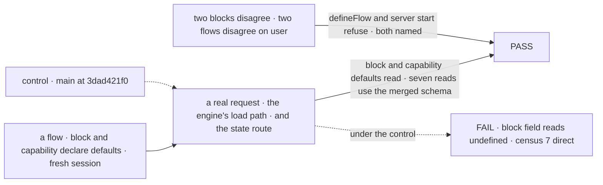

# FIX-2576 · A block's or capability's scope-state defaults apply at runtime, not only the flow's

**Spec** · [Decisions](DECISIONS.md)

## Six people, before and after

| Someone who… | Today | After |
|---|---|---|
| **writes a block with `sessionStateSchema: z.object({ count: z.number().default(0) })` and reads `ctx.session.state.count` on a new session** | `undefined`, though the type says `number` | `0` |
| **uses a capability that defaults a session field, such as the skills capability's `activeSkills`** | `undefined` until something writes it, unless the flow restates the field | The capability's default |
| **puts two blocks in one flow that default the same field differently** | One wins silently at the type level, and nothing applies at runtime | `defineFlow` throws, naming the field and both blocks |
| **runs two flows on one server that type a shared `user.state` field as a string and a number** | Not detected; one flow reads a value the other wrote | The server refuses to start, naming the field and both flows |
| **hires a manager or coordinator worker on their own flow** | `hireWorkforce` refuses until the flow spreads the board's session shape into its schema | No refusal; the board's blocks bring their own defaults |
| **reads the kitchen-sink chat-agent flow** | `thinkingStyle` is an enum on the flow and `z.string().optional()` on the assistant generator | One enum, so the flow defines under the strict rule |

The fourth and sixth rows are the price: a flow or server that starts today can refuse after the
upgrade, and only when two declarations really disagree.

## The goal, and how we'll know it's met

**A field that a block or capability a flow uses declares with a default reads as that default on
every scope-state read, with no restating on the flow; declarations that disagree are refused
before anything runs.**

| Is it the right goal? | |
|---|---|
| **The real need** | The issue: "A block's declared state works on its own, and a flow no longer has to copy fields from the blocks it uses." The epic's leg c cell `types.fresh-session-default` asks for a fresh session that reads "one declared only by a block or capability the flow uses" ([FIX-2564](https://github.com/fixpoint-labs/flow-state-dev/pull/4772)) |
| **Smaller, and rejected** | #4788's variant C: keep the flow-only fill and make `hireWorkforce`'s refusal general ("restate the block's field"). The refusal is honest, but the block still does not work on its own, and every adopter copies fields |
| **Bigger, and not this issue's** | Request scope; schemas a preset contributes; `client.expose` and `client.derived` naming a field only a block declares; a process-wide registry ([D1](DECISIONS.md#d1)) |
| **Not done if** | One of the seven reads still fills from the flow's own schema (a `/state` or session-list read that drops the block default) · only `sessionStateSchema` is covered, not the user and org ones · a capability-declared field is not filled · a conflict is refused without both declarers named · two flows sharing a block are refused · the chat-agent conflict is passed by loosening the rule instead of fixing the line |



The test reads state the way a run does, not the merge function alone; on today's `main` the
block's field is `undefined` and every read passes the flow's own schema.

| How we verify | |
|---|---|
| **Goal check** | `packages/engine/test/scope-state-defaults.test.ts` gains flow-level cases run through `createFlowState` and a real action on in-memory stores: a block's session default, a capability's session default, a block's user and org default, on a fresh record and on a stored one that lacks the field, read in the handler and from `GET /sessions/:id/state`. Beside it, refusal cases: two blocks with different defaults, two with different types, identical declarations (no refusal), the same blocks in two flows (no refusal), two flows on one server typing `user.state.theme` differently. The [census](poc/read-sites/census.mjs) run with `--after`. The epic's leg c cell `types.fresh-session-default`. Every kitchen-sink flow defines, and the coordinator's `activeSkills` reads its default on a fresh session |
| **Signal** | The engine tests pass; the census exits 0 with 0 direct passes; `defineFlow` errors name the field path and both declarers |
| **Anti-game** | The fill is reached through the engine, not called directly. A capability case is required: a capability's schema is merged and then dropped on the built block today, so a walk over `block.config` alone passes a block-only test. The route read is required, or a fix in one closure passes |
| **Control that must fail** | `main` at `3dad421f0`: the block and capability cases read `undefined`, and the census reports 7 calls, 7 direct. The census's own controls are run: `--control` plants a direct call and it is counted; `--control-totality` plants a mention it can't parse and the run exits 2 |

## What changes


The fill does not change; what it is handed does. Two new refusals stand in front of it.

**What an author writes:**

```diff
 const counter = handler({
   name: "counter",
   sessionStateSchema: z.object({ count: z.number().default(0) }),
   execute: async (_input, ctx) => ctx.session.state.count, // today undefined on a new session; after 0
 });

 defineFlow({
   kind: "my-app",
-  session: { stateSchema: z.object({ count: z.number().default(0) }) }, // restated only so the default applies
   actions: { tick: { block: counter } },
 });

 // apps/kitchen-sink/flows/chat-agent/run/assistant/assistant.ts
-  sessionStateSchema: z.object({ mode: modeSchema.default("ask"), thinkingStyle: z.string().optional() }),
+  sessionStateSchema: z.object({ mode: modeSchema.default("ask"), thinkingStyle: thinkingStyleSchema.optional() }),
```

**A disagreement, as an author sees it:**

```text
Flow "my-app": session.state.mode is declared twice with different defaults:
block "planner" defaults it to "plan" and block "asker" to "ask". Declare one default, or
declare the field once on the flow.
```

**Docs:** update `apps/docs/docs/fundamentals/state-and-scopes.md` → *Schema bubbling* (block
declarations now fill defaults; the "only the flow's own `stateSchema`" paragraph and the
restate advice go; add the two refusals) and → *Creating sessions* (defaults from every
declaration the flow reaches); a line in `fundamentals/capabilities.md` beside the
`sessionStateSchema` row; `docs/architecture/state-and-scopes.md`'s defaults paragraph; the workforce README (the
`sessionStateShape` lines) and `workforce/delegating-work.md`, where a manager flow is told to
spread it. No new page.

## What stays as it is

- The fill itself, `applyScopeStateDefaults`: what it fills, what it keeps, how it walks a schema.
- Validation on write: a write still parses against the schema it parses against today.
- `client.expose` and `client.derived` check keys against the flow's own schema.
- The request scope.
- Core's root export: nothing is added ([D1](DECISIONS.md#d1)).

## What's already here, and the debt

| Already here | What this does with it |
|---|---|
| The fill, `applyScopeStateDefaults`, and its seven reads in the engine (three load closures, three in the state route, one in the session list) — [census](poc/read-sites/census.mjs) | **Builds on.** The job is "fill a scope record's defaults"; there is one way, and this changes only its schema argument. This is not a second way |
| `walkBlockGraph`, read by `collectRequiredFlowConfig` and `collectBlockResources` in `defineFlow` | **Builds on.** The same reachable closure, tool edge included, a third reader |
| `mergeTargetsInto` in `core/src/capability/merge.ts`: same name, different schema → error | **The precedent** for refusing instead of merging silently |
| `extendSchema` in the same file: a block's capability schemas, last-wins, shallow | **Beside it.** Its runtime result is never read (one write site, no reader), so the walk's merge becomes the one applied merge. The FIX-2457 × FIX-2554 seam row asks the runtime merge to match it; for non-conflicting fields it does, and where they differ the walk refuses ([D2](DECISIONS.md#d2)) |
| `workerFlowProblems` → `roleStateProblem` in `workforce/src/worker-flow-contract.ts`: refuses a hire whose flow doesn't default a role's session fields | **Retired.** The board's blocks bring the defaults |
| Mechanism rows | **`flow`, `scope`.** Searched `mechanisms.yaml` for state, schema, default and merge; no row does this job, so none is added |
| FIX-2554 ([#4770](https://github.com/fixpoint-labs/flow-state-dev/pull/4770), merged; direct route, no retained spec) | **Amended.** Its fill stays; its "only the flow's own `stateSchema` counts" rule and its hire refusal go |
| #4788, the POC (draft, not for merge) | **Owner's answer, option B.** Its merge rules and measurements are this spec's evidence |

| Adds | Existing piece considered | Why it doesn't fit / how composed |
|---|---|---|
| A per-flow merged schema per scope, internal on the flow instance | The flow's own `stateSchema`; `extendSchema` | The flow's schema has no block fields; `extendSchema` is last-wins and shallow. Composed: the walk unions declarations under the strict rule and keeps the result beside the flow's own schema |
| A refusal at `defineFlow` | `mergeTargetsInto`'s error; `FlowConfigRefusalError` | Same rule as `mergeTargetsInto`, for scope state. Not a retired value, so not `refuseRetired`, and no tracker id ([ER-5](../../epics/FIX-2447/DECISIONS.md#who-owns-what)) |
| A refusal when a server admits its flows, user and org only | The flow registry's own admission checks | One more check at the same seam ([D3](DECISIONS.md#d3)) |

| The debt | |
|---|---|
| **Removes** | The rule that a flow restates its blocks' fields; `roleStateProblem` and the spread it demands from manager flows; the docs paragraph that says block defaults don't apply; the kitchen-sink `thinkingStyle` mismatch |
| **Adds** | A merge with its own rules beside `extendSchema`'s unread one. Permanent by design: it is the applied one, and `extendSchema` stays the type-level statement. Two refusals, both new failure modes on upgrade, named in the changeset (ER-7) |
| **Leaves** | `extendSchema`'s runtime output, written and never read; `board.sessionStateShape` stays exported; once the board's blocks declare their own fields,
spreading it only restates them. Removing a published name follows the epic's Q1; the coordinator files it or not |

**Net: down.** A rule every flow author obeyed, a refusal and a doc caveat go; one internal merge
and two refusals arrive.

## Sign off

**[The goal](#the-goal-and-how-well-know-its-met):** a block's or capability's default reads on
every scope read, with no restating, and disagreements are refused first. If wrong: adopters keep
copying fields into flows, and the leg c cell stays red.

**[The debt](#whats-already-here-and-the-debt), net down:** the restating rule and the hire
refusal go; an internal merge and two refusals arrive. If wrong: a second merge someone keeps in
step with `extendSchema`.

1. [D1](DECISIONS.md#d1) · Each flow reconciles its own blocks at `defineFlow`; no registry
   (owner, option B). If wrong: a later need for schemas with no flow loaded costs a server-owned
   registry fed by this walk.
2. [D2](DECISIONS.md#d2) · Any type or default difference is refused, naming both. If wrong: an
   upgrade refuses flows whose blocks declare wider read views on purpose.
3. [D3](DECISIONS.md#d3) · Cross-flow user and org disagreements are refused at server start;
   session fields are not compared. If wrong: a server refuses to start over two flows it ran
   before.

**Open: none.** All three are the owner's answer on #4788, recorded. D2 is the one to weigh.

Improvement · `core` (`defineFlow`), `engine` (seven reads, the admission check), `workforce`
(refusal retired), kitchen-sink (one line) · medium · epic FIX-2447, joined after its spec set
