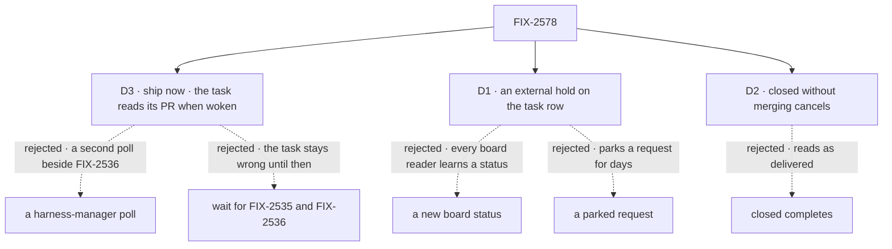

# FIX-2578 · Decisions

[Spec](SPEC.md) · **Decisions**

Inputs, not reopened: FIX-2268's PR record and its writers; FIX-2380's review hold; FIX-2543's
Accept → Open a PR (Jake's decision comment on that issue); FIX-2471's ER-7 as amended and
FIX-2535's D2 (a coding session follows its PR from the moment it is recorded).

## The tree

Dashed edges lost, for the reason on the label.

## D3 · Ship now: the task reads its PR when woken, and until FIX-2535/2536 only your line wakes it

| | |
|---|---|
| **Instead of** | Waiting for FIX-2535 (webhook) and FIX-2536 (poll), both in spec review · a poll of `gh` inside harness-manager |
| **Because** | The truth is GitHub's, so every wake reads the PR through the host's `gh` before anything runs, and a wake only has to arrive. Today a person's line is a wake; FIX-2535's reviews and closing event, and FIX-2536's polled ones, become wakes through the message route with no change here. A harness-manager poll would be a second poll beside FIX-2536's, against FIX-2471's one ingestion path (its D4) and its *"polls under 5 minutes"* rule |
| **Locks in** | Until those land, a merged PR shows *PR open* until someone types in the thread or cancels. The thread says so: *"Merged? Say so here and I'll check."* After they land, a merge wakes the task only if the subscription delivers the closing event to the session; FIX-2535's subscribe-on-record must hear every kind, the close included (a review note for its implementer) |

**What would change my mind:** FIX-2535 and FIX-2536 not reaching main this month; then a
hold `due` (the board's deadline steer) every 30 minutes is the cheap stopgap, filed as its own
issue.

It comes down to today: waiting leaves every PR task wrongly done until FIX-2471's feeds land.

## D1 · The wait is a hold on the task row, not a new status or a parked request

| | |
|---|---|
| **Instead of** | A board status (`awaiting_merge`) · the run's request parked on `suspendForUser` or `parkOnWait` until the PR closes |
| **Because** | A row hold is how a running task already waits with no lease (a midway question, FIX-2133): the claim skips it, a steer that answers it owes the same attempt a turn, a cancel closes it. A status would be a seventh member that the state machine, the claim orders and every board reader must learn. The hold costs three readers that today take any open hold as "waiting on a user" (`waitsOnUser`, board-meta, the goal-seek loop), which learn `actor`. A parked request holds a request open for days, and a user suspension shows in the Inbox as something to answer |
| **Locks in** | Row holds gain `ask.kind: "external"` with `actor: "system"`, persisted. `ask.kind` is a closed enum, so a package older than this one refuses such a row: orchestration and its readers ship together (one repo, one release). A screen reads *PR open* as `in_progress` with an open `external` hold, through `pullRequestWait` |

The kind is `external`, not `wait`: `Task.wait` is already a request waiting on a row, and
`"wait"` is the name FIX-2317 retired from `keptOpenBy`.

It comes down to the readers: a status changes every board reader, a hold kind changes three.

## D2 · A PR closed without merging cancels the task

| | |
|---|---|
| **Instead of** | Completing it (the issue's other option) · failing it (`errored`) |
| **Because** | `completed` tells the filer, the board and the task notice that the work was delivered, and it wasn't. `errored` says the run broke. Closing a PR is a person's choice to drop the work, which is what a cancel records, with the reason *its pull request was closed without merging*. The manager ends a claim-board refusal as `errored` today because "a cancel there reaches nobody" (`manager.ts` ~1222); this cancel is not a refusal of the run, it reports a person's act, and the task notice carries it to the filer. The claim holder cancels through `board.cancel(id, reason, { claim })`. A cancel also ends the task's subscriptions (`task_cancelled`) |
| **Locks in** | A task whose PRs all closed without merging is `cancelled`, with that reason; if any of them merged, some work landed and the task completes, with the closed ones noted (Gitar, round 2). Reopening the PR does not reopen the task; the person files the work again |

It comes down to the filer: *completed* would tell them the work landed.

## Decided, not asked

- **Off by default, on in every app here.** `awaitPullRequests` is an option like
  `reviewChanges`: a host with no way to wake a waiting task would leave it open. The lab,
  Teammates and Shift Manager turn it on; Jake's rule holds in every app that ships.
- **One hold per wait, listing its PRs.** Rows of the session's PR record stamped with one of
  this task's requests (`requestId`), in any state: the settle decides over all of them as a wake does, so a PR closed before the run ended still cancels (Codex, round 1). One `external` hold carries one
  `{ by: "event", event: "pull-request", key }` per PR, so one line wakes it. A PR found on the
  branch from before the run never counts (`openedSince`, FIX-2268).
- **The read on a wake** runs inside the network-call bound the drain budget already reserves
  (`NETWORK_CALL_TIMEOUT_MS`). Unreadable (`gh` signed out, a timeout) never settles the task.
  A fork's PR is read, not refused as `pullRequestHead` refuses it to start a run.
- **Convergence point.** The one write that opens an `external` hold is the hold write's `ask`
  op, through a new constructor (never `midway`), reached only from the manager's settle. The one
  place that reads the PR and settles is the owed turn's first step. Both ways into a PR (the
  run's own `gh pr create`, FIX-2543's landing) end in that settle.
- **A steer's sender.** A typed line stays `from: "user"`. A delivered message answers as
  `"service"`, a new value on the steer and answer sources, and its words reach the run quoted
  with the sender's handle, never as the person's: a PR comment is outside text, screened by
  FIX-2471 for who may send it. The lab's brief frames an `external` answer as *"News on your
  pull request: …"*, not *"You asked … The answer"*.
- **The review hold first.** With `reviewChanges` on, a run with commits waits for review; the
  wait starts only after Accept, when the review's suspension mirror is already closed (the `ask`
  op refuses while one is open).
- **Two PRs, packages then apps**, after FIX-2543's #4783 merges, since its Accept path is one
  of the two ways in. The goal folder holds the stub `gh`.

## Considered and dropped

- **Just change the lab's wording.** The smaller goal in `SPEC.md`: the board and the filer
  would still read the task as done.
- **Read the PR's state from the delivered event**, not from GitHub. The event shape is
  FIX-2535's, and a person's line carries no state at all; one read on every wake works for both.
- **Keep the run's request open with the harness session live** until the merge. A coding
  process held for days, and lost on any restart.
- **One hold per PR.** A line answers one hold, and the turn is owed only once none is open, so
  a task with two PRs would ignore the line.

## Analysis

2026-11-05, on the first draft. **Right approach, one fold.** The row-hold base and D2 hold up.
Folded: the draft said a new hold kind changes no reader; three readers take any open hold as
"waiting on a user", and workforce's `queueBehindUser` would park every delivered message until
the hold closed. They now read `actor`, and the message route answers before the queue. Also
folded: `steerFromLine` answers only questions today (extended), the PR record's write fills only
nulls (extended), the answer source can't be `"board"` (now `"service"`), the kind was renamed
from `wait`, the BP-030 claim corrected, and one hold per wait instead of one per PR. Goal check
widened from the blind goal read: the moved review-routing line is stated, the card and link are
graded, and legs for an unreadable PR, a delivered message, a restart, and a second control.

## Notes from review

Round 1 (2026-11-05): Codex, one finding, folded inline as a correction: the first settle reads every PR the task owns, closed ones included, so D2 holds when a PR closes before the run ends.

Round 2 (2026-11-05): Gitar, one finding, folded inline as a correction: a task with one PR merged and one closed unmerged completes, with the closed one noted; only all closed unmerged cancels (D2, SPEC → What changes).

Round 1, Cursor (simplify, approved), recorded for the implementer:

- *"Extract shared `holdIfOpenPrs` / `settleFromPrStates` helpers mirroring review's 'complete without another harness run when terminal' pattern, so the manager doesn't grow a third copy of the same state machine."*
- *"Consider a single exported predicate (extend `waitsOnUser` or add `holdsUser(row)`) and switching board-meta, goal-seek, and `queueBehindUser` to it."* Note: an actor-aware `queueBehindUser` alone is not enough, since a message to an open task's session is otherwise a talk turn that refuses an open task; the answer route stays.
- *"For the first implementation PR, it may be enough to prove typed steers + gh read + hold persistence (legs a, c, d, e, f) and add the `service` steer source + delivery answer in the same PR that lands FIX-2535 wiring."* The PR split is the implementer's.
- *"Share one read helper and avoid duplicate listing on every steer cycle."*

## Open

None.

## How it got here

- **Draft** — framed as the "task stays open" half of FIX-2471's ER-7 gap; the wait is a row
  hold of a new kind, read against GitHub on each wake, built on the midway question's path,
  FIX-2268's PR record and FIX-2535's deliveries.
