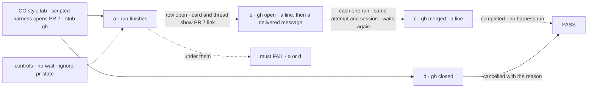
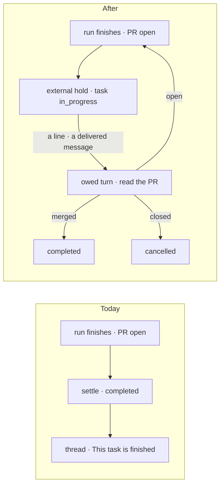

# FIX-2578 · A coding task that opened a PR stays open until the PR merges or closes

**Spec** · [Decisions](DECISIONS.md)

Child of epic [FIX-2369](../../epics/FIX-2369/SPEC.md). It is the "task stays open" half of a
gap the webhook epic [FIX-2471](../../epics/FIX-2471/SPEC.md) names in its
[ER-7](../../epics/FIX-2471/DECISIONS.md#er7): *"a coding task ends just after opening its PR"*.
That epic's FIX-2535 (webhook) and FIX-2536 (poll) carry the PR's reviews to the task's
session. This issue makes the task still be open, and able to act, when they arrive.

## Who feels it, before and after

| Someone who… | Today | After |
|---|---|---|
| **has a coding task whose run opened a PR** (the Claude Code-style lab, #4798) | The run says it finished, the task completes, the thread says *This task is finished.* and the composer goes | The task stays open. Its card on the board and its thread say **PR open · #4798**, with the link, and the composer stays |
| **types in that thread while the PR is open** ("fix the lint", a reviewer's point pasted in) | The line is talk: a harness turn outside the task, which never reopens it | The line is a steer: one more run on the same attempt and coding session, then the task waits on the PR again |
| **merges the PR, then types or a GitHub event arrives** | Nothing changes; the task was already done | The task reads the PR as merged and completes, with no harness run |
| **closes the PR without merging** | Nothing changes | On the next wake the task is cancelled: *its pull request was closed without merging* ([D2](DECISIONS.md#d2)) |
| **accepts a review with Open a PR** (Teammates, Shift Manager, FIX-2543) | The task completes once the PR is open | The task waits on that PR the same way |
| **gets a review on the PR** | It reaches a finished task's session as talk, once FIX-2535 lands | **Not until FIX-2535 or FIX-2536 is on main.** Then the review wakes the task the way a typed line does, and the run takes its words. Before that, you paste it in ([D3](DECISIONS.md#d3)) |

## The goal, and how we'll know it's met

**A coding task whose work is a pull request counts as done only when that pull request merges:
until then it stays open, shows the PR on its card and in its thread, and takes more work on the
same coding session.**

- **The real need**, in Jake's words on the issue: *"Once the PR opens there might be feedback.
  Until the PR is merged, the task is never truly resolved/done."*
- **Smaller, and rejected:** only change the thread's wording ("PR open") while the task still
  completes. The board, the task notice and the filer would all read it as done, and a typed
  line would still be talk outside the task.
- **Moved, and still owed after this ships:** the issue's acceptance line *"a review comment or
  request-changes on that PR appears in (or wakes) that task's thread"*. GitHub's events reach a
  session through FIX-2535 (webhook) and FIX-2536 (poll); this issue routes what they deliver into
  the waiting task, and its goal check proves that route with a delivered message, not with
  GitHub. Until one of them is on main, nothing wakes a task on its own: a merged PR shows
  *PR open* until someone types ([D3](DECISIONS.md#d3)).
- **Bigger, and not this issue's:** review rounds from a review policy (FIX-1809); removing the
  worktree after merge (FIX-1768).
- **Not done if:** a task whose PR is still open reads `completed`, to the board, the notice or
  the filer; its card or thread shows no PR, no link, or no composer; a run that opened no PR
  stops completing; a line typed while the PR is open runs outside the task's attempt; a wake
  while the PR is open settles the task; a merged PR leaves the task open after a wake, or starts
  a harness run; a closed one completes it; an unreadable PR (`gh` signed out) settles it either
  way; a delivered message to a waiting task is parked instead of waking it; the wait is lost
  after a host restart; a cancel while waiting leaves anything open.



The check reads the task row, the session's items and the stub's call log, never the manager's calls.

**How we verify.**

- **Reproduce first, unit, `packages/harness-manager`:** a scripted run that records an open PR
  through FIX-2268's record and stops `finished`. Assert the row is not `completed` and holds one
  open `external` hold naming the PR. It fails on today's settle.
- **Goal, `goals/claude-code-style-lab/a-pr-task-waits-for-its-merge/`**, run with
  `pnpm tsx goals/claude-code-style-lab/a-pr-task-waits-for-its-merge/run.mts`, model-free: the
  lab's host through `runFsdev`, a scripted harness whose run writes PR 7 to the record, and a
  stub `gh` first on `PATH` that answers `repos/…/pulls/7` from a state file each leg sets, and
  logs each call. Legs:
  - **a:** the row is `in_progress` with an open `external` hold; the session's PR row and the
    card's line carry the stub's URL; the thread's composer is drawn.
  - **b:** stub says open. A line typed through the session door, then a message delivered to
    the session (as FIX-2535 will deliver one): each makes exactly one harness run, read from the
    run record, on the same `attempts` and the same coding `sessionId`, and the row waits again.
  - **c:** stub says merged; a line. The row is `completed` with the PR on its output; the run
    record counts no new run.
  - **d:** stub says closed; a line. The row is `cancelled` with the reason.
  - **e:** stub exits non-zero. A line runs one run and the row waits again; it never settles.
  - **f:** the host is crashed (`crashAndRestart`) while waiting; the hold and its PR survive, and
    leg c then passes.
- **Controls:** `GOAL_CONTROL=no-wait` builds the lab's manager without `awaitPullRequests`:
  `a:open` FAILS (the row is `completed`). `GOAL_CONTROL=ignore-pr-state` settles every wake as
  merged: `b:waits-again` and `d:cancelled` FAIL.
- **Teammates and Shift Manager, one leg each on FIX-2543's Open a PR path**, with the same stub:
  after Accept the row waits on the PR; with the stub merged and a line, it completes. Control
  `no-wait` fails the first.

## What changes



The settle no longer ends the task while its PR is open; every wake reads the PR before anything runs.

The calling code, in each coding host:

```diff
 harnessManager({
   name: `harness-thread-${name}`,
   …
   reviewChanges,
   judge: goalJudge({ … }),
+  awaitPullRequests: true,
 })
```

- **Orchestration: a third row-hold kind, `external`** ([D1](DECISIONS.md#d1)): `actor:
  "system"`, opened by the turn holding the claim, closed by `{ by: "event", event, key }`
  entries (one per thing it waits on) or by any steer that answers it. Like a midway question the
  row stays `in_progress` with no lease, the claim skips it, and its release owes the same attempt
  a turn. It is never `midway`, so the filer is not told of it as a question. Nothing in
  orchestration names a pull request. What has to learn it:
  - **The readers that treat any open hold as "waiting on a user"** read `actor`:
    `waitsOnUser` (`task-board/shared.ts`), board-meta's `waiting-on-a-user` reason, the
    goal-seek loop's `WAITING_ON_A_USER`. The Inbox already does.
  - **`steerFromLine`** answers an open `external` hold with the line, as it answers the oldest
    question today (`tasks/steers.ts`).
  - **The steer and answer sources** gain `"service"`, for words from outside the app.
- **harness-manager: `awaitPullRequests`**, off by default. At the settle, after the judge and
  the review, the manager takes every PR in the record stamped with one of this task's requests,
  whatever state it was seen in, and decides as on a wake (below). Any still open holds the task
  on one `external` hold listing those PRs, instead of completing; all already closed unmerged
  cancels it here. On the turn the hold's release owes, the manager reads each PR
  first ([D3](DECISIONS.md#d3)): **all merged**
  completes the task with its PRs on the output, with no harness run; **none open, some merged**
  completes it the same way, with the closed ones noted on the output; **all closed unmerged**
  cancels it ([D2](DECISIONS.md#d2)); **any open** runs the steer on the same coding
  session, and the run's end comes back to the same check; **unreadable** runs the steer and
  holds again, with a status note. FIX-2543's Accept → Open a PR enters the same wait.
- **workspace: the PR read** is `pullRequestHead`'s fetch of `repos/{owner}/{repo}/pulls/<n>`,
  returning `state` and `merged` too, through a call that does not refuse a fork's PR.
- **core: the PR record's write keeps `state` current**: a read's state replaces the stored one
  (`writePullRequests` fills only null fields today), so a screen shows *merged* after it.
- **workforce: a delivered message to a task session whose task holds an open `external` hold
  answers it** with the message's words, as `"service"`, checked before `queueBehindUser`, which
  would otherwise park it until the hold closes.
- **harness-manager's `./browser` entry: `pullRequestWait(row)`**, the open hold's PRs (number,
  link, title) read with the session's PR record, so a screen draws one line.
- **Apps:** the Claude Code-style lab, Teammates and Shift Manager turn the option on. The lab's
  card and thread show **PR open · #N** with the link, a waiting icon (not *resolved*) and the
  composer, with *"Merged? Say so here and I'll check."* while no feed is on main. Teammates'
  popup and Shift Manager's task line show the same line.
- **Docs:** harness-manager's README on settling gains *Waiting on a pull request*;
  `docs/architecture` on task holds names the `external` kind. Changesets for orchestration
  (a hold kind, a steer source), harness-manager (an option, a reader), workspace and core (two
  fields, a write rule). Every app here is private.

## What stays as it is

A run that opened no PR settles as today. The review hold (FIX-2380) comes first and is
unchanged; the wait starts after Accept, and a revise round goes back to review. The PR record's
writers and FIX-2535's subscribe-on-record. Talk on a finished task. The task's cancel, which
closes every hold. FIX-2471's subscription end rules.

## What's already here, and the debt

**The job is "hold a running task until something outside it happens".** The mechanism list
has `suspension`, `wait-gate` and `task` (holds). This would be the **fourth way to hold a
task's turn**, written as an existing one: a row hold, the midway question's path, with one more
kind. Searches for `wait`, `park`, `hold`, `pull request`, `merged` across `packages/` found no
other task-level wait on an outside event.

| Piece | What this does with it |
|---|---|
| Row holds, the `ask` op, `released` → `turnOwed` (`orchestration/tasks/collection/holds.ts`) | **Extended**: an `external` kind with its own constructor (`newRowHolds` writes `actor: "user"`) |
| `{ by: "event", event, key }` releaser (`tasks/schema/hold.ts:32`), stored, never written | **Used** for the first time |
| `waitsOnUser`, board-meta, the goal-seek loop | **Extended** to read `actor` |
| `steerFromLine` (`tasks/steers.ts`) | **Extended** to answer an `external` hold |
| `askStep` / `HeldOnQuestion` (`harness-manager/src/ask-step.ts`) | **Reused** shape: the wait ends the turn as a question does |
| The PR record and `writePullRequests` (FIX-2268) | **Read** at the settle; the write rule **extended** so `state` stays current |
| `pullRequestHead` (`workspace/src/branch-pull-requests.ts:245`) | **Extended** to return `state` and `merged`, forks readable |
| `messageReceivedEntry` and `queueBehindUser` (workforce) | **Extended**: an answer route ahead of the queue |
| FIX-2380's review hold and FIX-2543's Open a PR | **Composed**: the wait follows them |
| FIX-2471's subscriptions (FIX-2534) and FIX-2535 D2 | **Composed**: their deliveries become the wait's wake |
| `suspendForUser`, `parkOnWait` | **Not used**: both park a request, for days here ([D1](DECISIONS.md#d1)) |

**Prior designs.** FIX-2268's [*Bigger, and not this issue's*](../FIX-2268/SPEC.md) left the
PR's later state out ("nothing keeps it current after the session"): **amended in part**, a wake
writes the live state back. FIX-2369's [goal](../../epics/FIX-2369/SPEC.md) stopped at a reviewed
branch: kept; this child goes one step past it. FIX-2471's
[ER-7](../../epics/FIX-2471/DECISIONS.md#er7) (amended by #4675) let a finished task's session
hear its PR: kept; with the wait, the task is still open when it does.

**Removes:** the *finished* state for a task whose PR is open. **Adds:** one hold kind and the
three readers that learn `actor`, one steer source, one manager option, two fields and a write
rule on existing PR code, one browser reader, one message route. **Accepted debt:** until
FIX-2535 or FIX-2536 lands, only a person's line wakes a waiting task ([D3](DECISIONS.md#d3));
paid by those issues, already filed. **Net: slightly up**, spread over existing pieces; no new
mechanism.

## Sign off

**Approve by merging.**

- **Goal:** a task whose work is a PR is done when the PR merges, and stays open and workable
  until then. Review routing from GitHub stays with FIX-2535/2536. *If wrong:* tasks wait on PRs
  nobody merges; a cancel ends them.
- **Debt:** slightly up: a hold kind and the readers that learn it, a steer source, an option,
  no new mechanism. *If wrong:* a later task wait (CI, a deploy) adds its own kind instead of
  reusing `external`.
- [D3](DECISIONS.md#d3) · **Ship now; the task reads its PR when woken, and until FIX-2535/2536
  only your typed line wakes it.** *If wrong:* a merged PR shows *PR open* until you type.
- [D1](DECISIONS.md#d1) · The wait is a hold on the task row, not a new status or a parked
  request. *If wrong:* boards that filter by status can't tell a PR wait from a running task.
- [D2](DECISIONS.md#d2) · A PR closed without merging cancels the task. *If wrong:* abandoned
  work reads as cancelled where you wanted it done.

Feature · orchestration, harness-manager, workforce, workspace, core, three apps · medium · two
PRs (packages, then apps), after FIX-2543's #4783 · child of
[FIX-2369](https://linear.app/fixpoint-labs/issue/FIX-2369)
