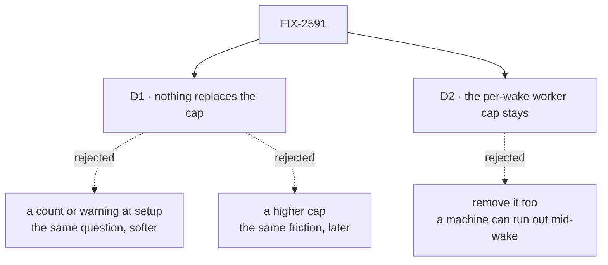

# FIX-2591 · Decisions

[Spec](SPEC.md) · **Decisions**

What was considered, what was chosen, why, and what each choice locks in. Two decisions are
the sign-off surface. Everything else here is context for them.

## The tree

Solid edges are what you're signing. Dashed edges lost, and the label says why.

## D1 · Nothing replaces the cap: no count and no warning at setup

| | |
|---|---|
| **Instead of** | A line at setup that names how many epics are active ("3 active: A, B, C") without asking · or a higher cap |
| **Because** | The owner already decides what runs and sees every epic on the Linear board. A count at setup is a nudge toward the question this issue removes. A higher number is the same rule, and the same question arrives one epic later |
| **Locks in** | Nothing in the process notices overcommitment. If gates queue and epics stall, the owner sees it on the board or at a wrap, not when they ask. Adding a count later is a one-line setup change, so this is cheap to reverse |

It comes down to the ask: a count at setup is the removed question, worded softer.

**What would change my mind:** the owner saying they want to see how many epics are active
when they start one. Then the count goes in as one line, and never as a question.

## D2 · The per-wake worker cap stays exactly as is

Jake asked to remove "the cap rule". **Our reading: the rule on how many epics are active,
and only that.** Correct this if you meant both.

| | |
|---|---|
| **Instead of** | Removing the worker cap too: the `cap` argument of the `epic-wake` workflow, and `epic-lifecycle` → "Sizing to the VM" |
| **Because** | The worker cap limits how many git worktrees and sub-agents run at once on one machine. Without it, a wake with many ready rows can run out of disk or memory part way through. It is a different axis from how many epics exist, and the removed section already said so |
| **Locks in** | The word "cap" stays in the epic docs, now meaning only worker concurrency. If both were meant, a second change touches the workflow and its verification harness |

It comes down to the machine: without the worker cap, a busy wake can exhaust it.

**What would change my mind:** Jake saying "the cap rule" meant the worker cap as well.

## Decided, not asked

- **Retained specs and dated records stay as written**: `specs/`,
  `docs/internal/4dx-process-review.md`, the cycle ledger, the archive, changelogs. They are
  design history (BP-037). `docs/internal/4dx-process.md` maps live rules to owners, so it is
  living and changes. The sweep classifies both kinds.
- **No alias for the removed section.** Its two inbound links go in the same change (BP-034).
- **"Two epics under one project" keeps its heading and anchor.** Only its first sentence
  stops citing the cap.
- **No convergence point to move.** The setup step was the cap's only writer: `epic-wake.js`
  counts no epics (searched `activeEpics`, `epicCount`, `maxEpics`, `epic cap`).
- **No workflow script changes**, so `verify.mjs` is not required. Touch one, run it.

## Considered and dropped

| Alternative | Why not |
|---|---|
| Delete only the setup step | The orchestration doc stays canonical for the rule, and the skill links to it |
| Keep the question, default the answer to "start" | Still a question on every request. The issue asks for none |
| Rewrite retained specs to drop the cap | They record why past calls were made. Rewriting them loses that |

## Settled

- **The inventory is complete** — **CONFIRMED** by `poc/cap-sweep/check.mjs` on `origin/main`
  at this spec's base: 6,965 tracked text files, 20 cap lines in 6 files, 21 other-axis lines,
  14 history lines. `--control` plants a cap line beside an allowlisted one, and it is reported.

## Analysis

2026-11-06 · watermark 2026-11-06 (issue filed) · **Right approach.** Run inline by the spec
author, not by a separate agent: this worker had no sub-agent dispatch.

1. **Reuse** — nothing is added, so there is nothing to reuse. *Builds on / Adds* is empty.
2. **Prior art** — the cap came from 4DX's "focus on one or two goals". The 4DX map already
   dropped that premise for work items, since agents in isolated worktrees cost each other
   nothing, and kept it for epics because the owner's attention splits. This issue says the
   owner manages their own attention, so the last use of the premise goes.
3. **Other shapes** — a count at setup, a higher cap, an advisory question. D1 and *Considered
   and dropped*.
4. **New factors** — none since the watermark.
5. **Necessity** — earns its place: it removes a step from every new epic request.
6. **Ergonomics** — less to learn: one fewer rule, one fewer setup step.
7. **Concerns** — the "cap rule" reading. Raised as D2 for Jake. Recorded, nothing folded.

## How it got here

- **Draft** — framed as a removal of one process rule; the whole-tree sweep set the edit list;
  the worker cap kept as a separate axis.

**Open: none.**
