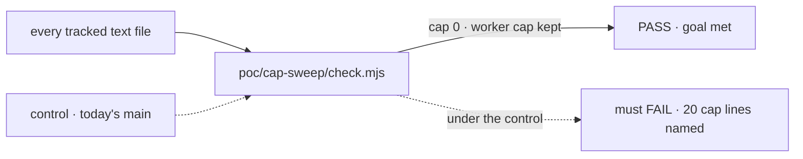

# FIX-2591 · Remove the cap on how many epics run at once

**Spec** · [Decisions](DECISIONS.md)

## Five people, before and after

| Someone who… | Today | After |
|---|---|---|
| **asks to run a new epic while two are active** | Gets a question first: hold this outcome, or wrap another? Nothing starts until they answer | The epic starts. Setup discovers, then creates |
| **asks for an epic that already exists** | Discovery finds it and resumes it; the cap is skipped for a reuse | The same: discovery finds it and resumes it |
| **runs one epic with eight issues ready at once** | Workers are bounded by the per-wake cap sized to the machine | The same. That cap is not this one ([D2](DECISIONS.md#d2)) |
| **reads the orchestration doc or `plan-day` to learn the rules** | Reads that at most two epics run, and why | Finds no limit on epics. `plan-day`'s ceiling of 8 is still explained |
| **reads a retained spec that mentions the cap** | Reads it as the history of a decision | The same. Retained specs are not rewritten |

The product owner decides what runs and how many epics they can give attention to. A rule
that asks permission to do what they just asked for is friction with no decision behind it.

## The goal, and how we'll know it's met

**When the product owner asks for an epic, it starts, and no contributor doc or skill tells
an agent to limit how many epics are active.**

| Is it the right goal? | |
|---|---|
| **The real need** | *"Asking for an epic starts that epic. Setup never asks hold-or-wrap."* ([FIX-2591](https://linear.app/fixpoint-labs/issue/FIX-2591), Jake) |
| **Smaller, and rejected** | "Delete the Cap step from `epic-lifecycle`." The orchestration doc would still state the rule, and the skill sends coordinators there for it, so a coordinator could still ask |
| **Bigger, and not this issue's** | "Remove the per-wake worker cap too." A different axis: how many worktrees run on one machine. Kept ([D2](DECISIONS.md#d2)) |
| **Not done if** | Setup still has a step that counts epics · any living doc still states a number of epics · the sweep passes because a cap line was allowlisted as "something else" · the worker cap went too |



The sweep reads every tracked file, not a list of the sites we already know. The dashed path
is today's `main`, which must fail with every cap line named.

**No goal check under `goals/` applies:** this changes contributor docs and skills, and no
runtime behaviour. The sweep is what proves the goal instead.

| How we verify | |
|---|---|
| **Check** | `node specs/issues/FIX-2591/poc/cap-sweep/check.mjs`, run by the implementer at completion, output in the implementation PR |
| **Signal** | `cap: 0`, `worker cap kept: yes`, exit 0 |
| **Input** | The whole tracked tree. An unclassified hit counts as a cap hit, so a new mention anywhere is caught |
| **Anti-game** | No passing by new allowlist entries or narrower patterns. Any new `OTHER_AXIS` entry is named in the implementation PR body, with its reason |
| **Control that must fail** | Today's `main`: FAIL with `cap: 20 lines in 5 files`. And `--control`, which plants a cap line in a file that has an allowlisted line: it must be reported as cap |

## What changes


Read the middle step. It goes, and the question with it. The worker cap at the bottom is the
same in both columns.

**Epic setup, as a coordinator reads it in `epic-lifecycle`:**

```diff
- **Discover → cap → create/resume, in that order.** Reasoning and cost:
- [`orchestration.md`] → "How many epics run at once".
+ **Discover → create/resume, in that order.**
  - **1 — Discover only.** …unchanged…
- - **2 — Cap (skip for a reuse).** At most two active epics, … At the cap,
-   ask whether to hold this outcome or wrap another, … name held work at the next wrap.
- - **3 — Resume or create — never the wrong one.**
+ - **2 — Resume or create — never the wrong one.**
```

The rule's section in `orchestration.md` goes, and every place that restates it is listed
under [what's already here](#whats-already-here-and-the-debt).

**Docs:** no user documentation impact. Contributor docs and skills only, changed in the same
PR. No changeset: no published package changes.

## What stays as it is

- **The per-wake worker cap**: the `cap` argument of `epic-wake`, "Sizing to the VM", and
  the concurrency cap on admitting issues. No workflow script changes.
- Discovery (resume versus create), the project-objective line, and the project-spec refresh.

## What's already here, and the debt

| Already here | What this does with it |
|---|---|
| `orchestration.md` → "How many epics run at once" | **Removes** the section |
| `epic-lifecycle` → Epic setup, step 2 "Cap" and the discover → cap → create order | **Removes** the step; the steps renumber |
| `orchestration.md` → "Two epics under one project", first sentence | **Amends**: no longer cites the cap. The heading and its anchor stay |
| `epic-lifecycle` project-spec step, "with the cap at two epics" | **Amends** the clause |
| `plan-day` → the ceiling of 8 | **Amends** the reason: how many objectives run is the owner's choice, not a cap |
| `docs/internal/4dx-process.md` → the rule row and design call 1 | **Removes** the row; call 1 is rewritten or dropped |
| `epic-spec-template` worked example, "an epic slot" (three lines) | **Amends**: a slot presumes a fixed number of epics |
| The per-wake worker cap | **Leaves alone** ([D2](DECISIONS.md#d2)) |
| [`4dx-process-review.md` → R1](../../../docs/internal/4dx-process-review.md#r1--give-docsobjectivesmd-a-finish-line-and-cap-concurrent-epics-at-two), which proposed the cap | **Superseded in part**: the cap half. Its objectives-finish-line half is kept. The review stays as written |
| Retained specs that cite the cap (FIX-2367, FIX-2369, FIX-2447) | **Leaves alone**: design history ([decided, not asked](DECISIONS.md#decided-not-asked)) |

**Builds on / Adds: none.** The change only removes and rewords. No package is touched.

| The debt | |
|---|---|
| **Removes** | One process rule, its setup step, a question on every new epic request, and its rationale in three places |
| **Adds** | Nothing |
| **Leaves** | `verify.mjs` calls the worker cap "the epic cap" in one check's title. Cosmetic; the workflow scripts are outside this change |

**Net: down.** A rule and a step go; nothing is added.

## Sign off

**[The goal](#the-goal-and-how-well-know-its-met), at that size:** the epic starts, and no
living doc states a limit, proved by a sweep of the whole tree. If wrong: a coordinator still
reads a limit somewhere and asks the question this issue removes.

**[The debt](#whats-already-here-and-the-debt), net down:** a rule and its step go; nothing
is added. If wrong: nothing we can see; a removal has no shim.

1. **[D1](DECISIONS.md#d1) · Nothing replaces the cap: no count and no warning at setup.**
   If wrong: overcommitment shows up late, on the board or at a wrap, instead of at the ask.
2. **[D2](DECISIONS.md#d2) · The per-wake worker cap stays exactly as is.** This is our
   reading of "the cap rule". If wrong: a second change to the workflow and its harness.

**Open: none.** Number 2 is the one to weigh: correct it if "the cap rule" meant both.

Improvement · contributor docs and skills, no package · small: 5 files, 20 lines removed or reworded · no epic
