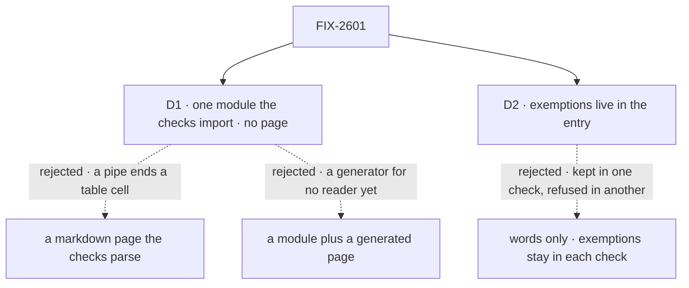

# FIX-2601 · Decisions

[Spec](SPEC.md) · **Decisions**

Two decisions shape what the glossary is. The epic decided where it lives
([D2](../../epics/FIX-2600/DECISIONS.md#d2)) and that it merges first
([D3](../../epics/FIX-2600/DECISIONS.md#d3)); this issue doesn't reopen either.

## The tree

Solid edges are what you're signing. Dashed edges lost, and the label says why.

## D1 · The glossary is one module the checks import; no page is generated from it

| | |
|---|---|
| **Instead of** | A markdown page the checks parse · or a module with a page generated from it |
| **Because** | A rule is a pattern, a list of paths and a reason. A module holds that as written. A markdown table can't hold a pattern with a `\|` in it, and a parser over prose is one more thing to drift. A generated page holds it too, but adds a generator and a staleness check for a reader who hasn't asked. `docs/mechanisms/mechanisms.yaml` already works this way: the data file is the doc |
| **Locks in** | A word is coined or retired by editing `docs/contributing/glossary.mjs`. Its terms come first, each with a sentence of meaning, and the exemptions follow, so the top reads as a glossary |

It comes down to holding a real rule: a markdown cell can't hold a pattern with a pipe in it.

**What would change my mind:** people asking to read the glossary as a page. The generator is
added then, and no rule moves.

## D2 · A word's exemptions live in its glossary entry, not in each check

| | |
|---|---|
| **Instead of** | The words in the glossary, and each check keeping its own exemptions (`KEEP`, `EXCEPTIONS`, `PERSON_PINS`, `EXEMPT_FILES`) |
| **Because** | An exemption is half of a rule: *ask* is kept for a person's question, *hand-off* for work already under way. With exemptions in each check, a word can be kept in one check and refused in another, which is the drift the epic exists to stop. The epic's ER-1 names exemptions as part of the rule |
| **Locks in** | About 60 terms and 70 exemptions in one module. Classifying a hit is a glossary edit, and it is reviewed as one |

It comes down to one word having one answer: split exemptions let two checks disagree.

**What would change my mind:** an exemption that is about how one check matches, not about
the word (a parse it can't do). That stays in its check, named as such.

## Decided, not asked

- **The glossary owns the words, how far each reaches, and what is exempt. A check owns how it
  finds them.** The sweep keeps its walk, totality check and marker. The guard keeps its areas,
  ground and added-lines scan. The side-chain check keeps its four encodings. Each glossary word
  names the check that matches it when one check owns the encoding (the side-chain names); the
  default is the sweep's and the guard's whole-word name match. A new retirement with no
  matcher named is refused by both text checks.
- **Each entry says how far it reaches: a *name* or a *meaning*.** A name (an identifier, a term)
  is read in every tree the checks read. A meaning (an English word refused only in one sense,
  such as *the ask* or *hand it off*) is read in code and published pages only. A new retirement
  is a name unless it says otherwise. FIX-2354 sets the contributor trees' reach on this field
  ([FIX-2354 D1](../FIX-2354/DECISIONS.md#d1)).
- **The tree map moves too.** The sweep's `ROOTS` and `EXCLUDE` and the guard's `AREAS` become
  one map in the glossary module, which both text checks read. Per-check differences that the
  map can't express stay as each rule's own file scope. Nothing they read changes here (the
  parity leg proves it); FIX-2354 widens the map in one place.
- **The three checks stay three** (ER-4 allows a merge). The guard's added-lines mode and the
  side-chain check's syntax tree are different jobs; merging rewrites two working CI gates to
  save one duplicated file walk.
- **The resource entry is the owner's 2026-11-06 table, as written** (ER-5). At added-lines scope
  it refuses a new *declaration* of a `…Row` or `…CollectionItem…` name for a resource, not a
  use: a PR calling today's `listCollectionItems` before FIX-2479 renames it is not refused.
  FIX-2479 turns it to the whole tree (ER-6).
- **`published: true` on an entry replaces `GLOSSARY_TERMS`.** The guard counts the published
  page's rows against the flagged entries, as today.
- **The glossary itself is excluded from every check by a named rule.** It names every retired
  word on purpose, as `goals/vocabulary/one-word-per-thing/` is today.
- **`goals/vocabulary/one-word-per-thing/` keeps its path.** Its `goal.md` stays FIX-1876's goal
  check; its *Collection item* section becomes one line pointing to the glossary.

## Considered and dropped

| Alternative | Why not |
|---|---|
| The published `apps/docs/docs/glossary.md` as the source | The epic's D2: a normal PR can't edit it |
| Merge the sweep and the guard into one check | A rewrite of two working gates for one shared walk. Left for a later look |
| Keep `rules.mjs` where it is and import it from the other checks | Leaves the rules in a goal folder no contributor looks in when naming |

## Analysis

2026-11-07 · watermark 2026-11-07 (epic analysis) · **Right approach, with one change.**

1. **Reuse** — `reuse-review` verdict on the one *Adds* row: **extend** `rules.mjs` (move and
   widen), read like `mechanisms.yaml`. See [Builds on / Adds](SPEC.md#whats-already-here-and-the-debt).
2. **Prior art** — Vale vocabularies and the Kubernetes glossary both put the data first. D1
   takes the data and drops the page until a reader asks for it.
3. **Other shapes** — a parsed markdown page; a generated page. Both in D1.
4. **New factors** — none since the epic's analysis, the same day.
5. **Necessity** — earns its place: it is the epic's substance.
6. **Ergonomics** — one file to edit. Its length is D2's price.
7. **Concerns** — the epic's ER-2 promised that CI fails a PR that coins a public term without
   an entry. No check can tell a new term from a new name. **Folded** as an epic amendment: CI
   refuses retired words and a published term with no entry; the skills and review own coining.

## How it got here

- **Drafted in the spec set (2026-11-07)** — data module, exemptions in the entry. The set
  review moved the tree map into the glossary, added the name-or-meaning field FIX-2354 needs,
  and narrowed the resource entry to declarations so today's API calls aren't refused.

**Open: none.**
