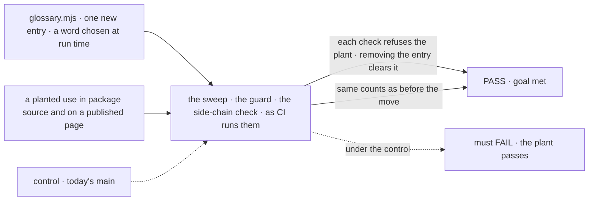

# FIX-2601 · One glossary for framework vocabulary, read by every vocabulary check

**Spec** · [Decisions](DECISIONS.md)

## Five people, before and after

| Someone who… | Today | After |
|---|---|---|
| **names a new thing** (a contributor or an agent) | Has nowhere to look. Six places hold rules, and none says it is current | Opens `docs/contributing/glossary.mjs`: each term, what it means, the words it retires, what is exempt, and the decision behind it. The naming skills send them there |
| **retires a word** (the owner) | Edits `rules.mjs`, the guard's term list or the side-chain check's name sets, and `goal.md`, and hopes they agree | Adds the word to one entry. The sweep, the Workforce guard and the side-chain check all refuse it on their next run |
| **keeps a word on purpose** (a legacy reader, a person's question) | Adds a keep-list entry in whichever check flagged it; the other checks don't know | Adds one exemption to the term's entry, with its reason. Every check reads it ([D2](DECISIONS.md#d2)) |
| **adds a line declaring an exported name built on a retired word** | Caught only for the words the check that reads that file happens to know | Refused by every check, from the glossary's words |
| **writes the published glossary at release** | `GLOSSARY_TERMS` in the guard lists the terms the page must define | The same list, read from entries flagged `published` |

The 2026-11-06 "resource" call reversed a 2026-11-02 "item" call that CI still enforced, and
the reversal turned up only by searching Linear. A rule that lives in one file can't do that
unseen: the reversal is an edit to that file, in a diff someone reviews.

## The goal, and how we'll know it's met

**A word is retired, exempted or un-retired by editing one glossary entry, and every
vocabulary check enforces that edit on its next run, with no rule lost on the way in.**

| Is it the right goal? | |
|---|---|
| **The real need** | [FIX-2600](../../epics/FIX-2600/SPEC.md#the-goal-and-how-well-know-its-met) ER-1: a rule is written only in the glossary, and every check reads it |
| **Smaller, and rejected** | "The checks import one shared word list." The exemptions stay in each check, so a word can still be kept in one and refused in another ([D2](DECISIONS.md#d2)) |
| **Bigger, and not this issue's** | Reading `docs/contributing/` and `.agents/` (FIX-2354). Renaming the code to the resource convention (FIX-2479) |
| **Not done if** | A check still holds a retired word, a pattern or an exemption in its own file · the move changed any check's counts on the same commit · `goal.md` still states a rule · one of the four settled areas (resource and status, dispatch and wait and ask and hand-off, Workforce's words, dispatcher and flow runner and claim order) has no entry · `COLLECTION_ITEM` still says "collection item" · a skill restates a rule instead of pointing to the glossary |



The check edits only the glossary and reads the checks' own CI output. On today's `main`, no
check reads the glossary, so the same edit changes nothing and the run must fail.

| How we verify | |
|---|---|
| **Goal check** | `goals/vocabulary/one-glossary/retire-a-word-in-one-place/` · model-free · run by the implementer at completion · verdict in the implementation PR |
| **Signal** | Lever leg: the sweep and the guard each report the plant under the new entry; a second entry that names the side-chain check's matcher is reported by that check in a planted `.ts` file; all three pass once the entries are removed. Parity leg: on the same commit, every count each check prints (hits, kept, marked, open; counted and stripped per term; findings per encoding) and every `--control` verdict match the run before the move |
| **Input** | A word generated at run time, so no rule can already match it. A plant in `packages/core/src/` and one in `apps/docs/docs/`. A different word, or a plant in another package, must pass too |
| **Anti-game** | The lever leg's working-copy diff touches only `glossary.mjs` and the plants. Don't assert on a check's fixture tests: they pass while CI reads another list |
| **Control that must fail** | Today's `main`: the lever leg FAILs on *the plant is refused*. The parity leg is named, not hidden: the resource entry's new message is the one intended difference |

## What changes


Read the right column. Each check keeps only *how* it finds a word: its file walk, its
encodings, its report. *Which* words, *where* they reach and *what* is exempt come from one file.

**A retirement, as the owner types it** (field names are the implementer's):

```diff
  {
    term: "Flow runner",
    means: "What decides where a flow action runs.",
+   retires: [{ name: "isInProcessDispatcher" }],
    decision: "FIX-2245",
  },
```

**Docs:** contributor docs only. `CLAUDE.md` and `AGENTS.md` name the glossary among the
documents to read before naming a thing. `issue-spec`, `epic-agent`, `create-block`, `add-flow`
and the coherence lens of `review` each check new public names against it, and say a change
that coins a public term adds its entry. `goal.md`'s *Collection item* section becomes a
pointer. No user-docs impact: the published glossary is unchanged
([epic D2](../../epics/FIX-2600/DECISIONS.md#d2)). No changeset: the checks are private tooling.

## What stays as it is

- **The three checks and their CI steps.** No check is added or merged
  ([decided](DECISIONS.md#decided-not-asked)).
- **Which trees each check reads.** Moving the tree map into the glossary changes nothing it
  reads. FIX-2354 widens it.
- **The `retired-name-refusal` marker** and the guard's added-lines mode.
- **Code names.** FIX-2479 renames them.

## What's already here, and the debt

| Already here | What this does with it |
|---|---|
| `rules.mjs` (FIX-1876): `ROOTS`, `RETIRED`, `KEEP`, `EXCLUDE`, `COLLECTION_ITEM` | **Extends, by moving.** It becomes the glossary, widened to every check's rules |
| `check-retired-terms.mjs`: `TERMS`, `EXCEPTIONS`, `PERSON_PINS`, `AREAS`, `GLOSSARY_TERMS` | **Builds on.** Its lists move to the glossary; its areas, ground and added-lines scan stay |
| `validate-side-chain-vocabulary.mjs` (FIX-766): its name sets and `EXEMPT_FILES` | **Builds on.** Its words move; its four encodings and syntax-tree matching stay |
| `docs/mechanisms/mechanisms.yaml`: a data file that is the contributor doc, read by checks | **Precedent** for [D1](DECISIONS.md#d1) in one respect only: no page is generated from it. It holds no patterns, so its format is no precedent |
| The published glossary page | **Leaves alone** ([epic D2](../../epics/FIX-2600/DECISIONS.md#d2)); entries flagged `published` replace `GLOSSARY_TERMS` |
| FIX-2071 ER-3: a rename adds its identifiers to `RETIRED` | **Amended**: it adds them to the glossary entry |
| The 2026-11-02 `COLLECTION_ITEM` rule | **Superseded** by the owner's 2026-11-06 resource entry, at added-lines scope, for declarations ([decided](DECISIONS.md#decided-not-asked)) |
| Anything else that holds vocabulary | **None.** Searched `RETIRED`, `TERMS`, `retired`, `say:` across `scripts/`, `goals/`, `.agents/`, `packages/*/test/` |

| Adds | Existing piece considered | Why it doesn't fit / how composed |
|---|---|---|
| `docs/contributing/glossary.mjs` | `rules.mjs`; the published page; `mechanisms.yaml` | Composed: `rules.mjs` moved and widened, and, like `mechanisms.yaml`, the file the checks read is the doc. The published page can't change per PR |

| The debt | |
|---|---|
| **Removes** | Five rule homes in files and the prose rules in `goal.md`; three copies of "which words, where" |
| **Adds** | One glossary module, permanent by design. About 60 terms and 70 exemptions, so it is long ([D2](DECISIONS.md#d2)) |
| **Leaves** | Two text checks with two file walks ([decided](DECISIONS.md#decided-not-asked)). Contributor trees unread until FIX-2354 |

**Net: down.** Six rule homes become one, and nothing is added beside the checks.

## Sign off

**[The goal](#the-goal-and-how-well-know-its-met), at that size:** one edit, every check, nothing
lost. If wrong: the glossary drifts like `goal.md` did, or a rule quietly drops in the move.

**[The debt](#whats-already-here-and-the-debt), net down:** six homes become one long module.
If wrong: a module too long to read, which people stop reading.

1. **[D1](DECISIONS.md#d1) · The glossary is one module the checks import; no page is
   generated from it.** If wrong: contributors who want a page read a JavaScript file.
2. **[D2](DECISIONS.md#d2) · A word's exemptions live in its glossary entry, not in each
   check.** If wrong: a large glossary for exemptions only one check ever needed.

**Open: none.** D2 is the one to weigh.

Improvement · tooling, `docs/contributing`, five skills · medium · epic FIX-2600
