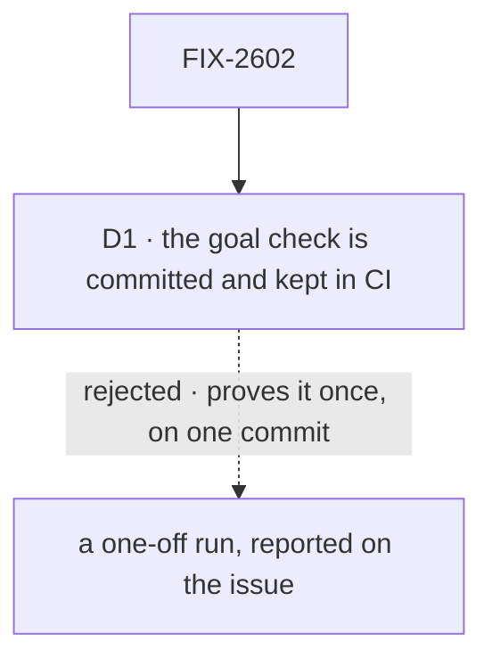

# FIX-2602 · Decisions

[Spec](SPEC.md) · **Decisions**

The plan's shape is the closure rule's ([`orchestration.md`](../../../docs/contributing/orchestration.md#the-closure-issue-every-epic-ends-in-qa)).
One decision is this epic's: what happens to the goal check once the epic wraps.

## The tree

Solid edges are what you're signing. Dashed edges lost, and the label says why.

## D1 · The closure's goal check is committed and runs in CI's process guards after the wrap

| | |
|---|---|
| **Instead of** | A one-off run whose report is a comment on the closure issue |
| **Because** | The epic's goal is that the glossary *stays* the one lever. A later PR that makes a check stop reading it, or narrows where it reads, passes every other check: each check's own `--control` plants a word the check already knows. Only leg a, which retires a word nobody knows yet, fails that PR |
| **Locks in** | One more CI step on every PR, which runs the three checks with a planted word, and one more goal folder to keep |

It comes down to a check that stops reading the glossary: a one-off run never sees it.

**What would change my mind:** the step getting slow enough to matter on every PR. Then it
runs nightly, and is not removed.

## Decided, not asked

- **One pinned commit, finished on that commit.** Another epic's merge doesn't re-pin the run;
  a check it makes stale is updated and re-graded in the same run, as the closure rule says.
- **Journey B uses a fixture app under the goal folder**, written against the old names, not a
  real app: a real app is updated by FIX-2479 itself, so it can't show the upgrade path.
- **The side-chain check gets its own entry and a `.ts` plant.** It matches only entries that
  name it (FIX-2601's matcher rule), and it reads no prose, by design.
- **A browser is not needed.** Every check is a CLI run.

## Considered and dropped

| Alternative | Why not |
|---|---|
| Fold leg a into FIX-1876's `--control` | Its plants are words the checks already know, so it can't show the glossary is the lever |
| One leg only | Leg b is the only proof the code follows the resource entry |

## Notes from review

Recorded for the implementer, not folded into the design.

- *(PR #4886, second-look pass)* "FIX-2602 is a closure issue that re-runs the children's checks plus a seam sweep. The one thing that is not in the other three is the committed CI goal check (its D1), and that is a small piece. I haven't read it closely. Consider whether this is an epic-wrap step with that one committed check, rather than a fifth issue with its own spec and PR. Not above the line: it follows the epic's own structure."

## Analysis

2026-11-07 · watermark 2026-11-07 · **Right approach.**

1. **Reuse** — the one *Adds* row composes the three existing checks; it reads no word itself.
2. **Prior art** — none beyond the repository's own closure rule.
3. **Other shapes** — a one-off run (D1).
4. **New factors** — the set review added the name-or-meaning field (FIX-2354 D1); leg a's word
   is a name, so it reaches every tree.
5. **Necessity** — required by the closure rule.
6. **Ergonomics** — none; no user surface.
7. **Concerns** — none.

## How it got here

- **Drafted in the spec set (2026-11-07)** — the epic's two legs, two journeys, the gap sweep.
  The set review made leg a plant the side-chain check in a `.ts` file, and named the five seams.
- **Amended with FIX-2479 (2026-11-07)** — leg c added: after the `/release-docs` pass, zero
  open with FIX-2479 D4's quote exemption gone, and the renamed values (2 wire values, 81
  messages) are what a client sees (the owner's "Rename all 4", FIX-2479 D3).

**Open: none.**
