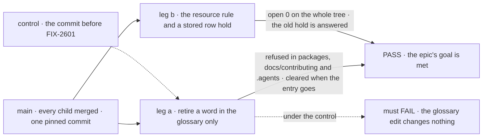

# FIX-2602 · Closure: one word per thing, enforced from one glossary

**Spec** · [Decisions](DECISIONS.md)

## Four teams, and what the closure walks for each

| A team that… | After the epic, they… | Walked by |
|---|---|---|
| **decides a word** (the owner) | Retire a word by editing one glossary entry, and every check refuses it in source, contributor docs and skills | Item 1, leg a |
| **reads contributor docs and skills** | Meet no retired name there, because a check reads those trees | Item 1, leg a (plants under `docs/contributing/` and `.agents/`) |
| **builds on the packages** | Upgrade an app to the resource names, guided by the changeset, and a hold stored before the upgrade still answers | Item 1, leg b, and journey B |
| **names a new thing** (a contributor or an agent) | Are sent to the glossary by the skill they run, and refused by CI if the name uses a retired word | Journey A |

Each child proves its own piece on its own commit. This issue runs the assembled set on one
`main` commit, after every other child has merged, the way those four teams meet it.

## The goal, and how we'll know it's met

**The epic's goal, on one `main` commit: each framework concept has one word, written in one
glossary, and CI refuses a retired word wherever a contributor reads it.**

| Is it the right goal? | |
|---|---|
| **The real need** | [FIX-2600](../../epics/FIX-2600/SPEC.md#the-goal-and-how-well-know-its-met), the epic's goal, unchanged |
| **Smaller, and rejected** | "Every child's own check passed." Each ran on a different commit, and none edits the glossary and watches all three checks respond |
| **Bigger, and not this issue's** | Renaming words that collide but aren't retired; the published glossary page, which `/release-docs` writes |
| **Not done if** | Any of the epic's *not done if* states is present · a check passed on a commit other than the pinned one · a finding was closed without a fix or the owner's reason |

Leg a is the one that proves the glossary is the lever: under the control, the same edit must
change nothing. Leg b proves the code follows the glossary's resource entry.

| How we verify | |
|---|---|
| **Goal check** | `goals/vocabulary/glossary-is-the-one-lever/` with two legs · model-free · run by the closure worker on the pinned commit · committed by the closure PR and kept in CI ([D1](DECISIONS.md#d1)) |
| **Signal** | Leg a: the sweep and the guard each report the planted word, by the new entry, in `packages/core/src/`, `docs/contributing/` and `.agents/skills/`; a second new entry handed to the side-chain check's matcher is reported in a planted `.ts` file; with the entries removed all three PASS. Leg b: the resource entry at whole-tree scope reports OPEN 0, and a task stored with a `kind: "row"` hold is listed and answered |
| **Input** | A word generated at run time that no check knows. A different word, or a plant in another file under the same trees, must give the same verdict |
| **Anti-game** | Leg a's working-copy diff is the glossary file and the plants only. It runs the checks as CI runs them, and reads their output, not their fixture tests. The side-chain check only matches entries that name it, in `.ts` files, since prose is its stated gap |
| **Control that must fail** | Leg a on the commit before FIX-2601 merged: *each check reports the plant* FAILs. Leg a on the commit before FIX-2354 merged: FAILs on its `docs/contributing/` and `.agents/` plants, while the `packages/core/src/` plant is still refused |

## What changes

Read the right column top to bottom: that is the run, in order, on one commit.

**The plan, in order** (each check's verdict and evidence in the report on the closure issue):

1. **The epic's goal check**, legs a and b above, with both controls shown failing.
2. **Journey A · a contributor names a new thing.** Run `issue-spec`'s naming step on a draft
   that coins a term: it points to the glossary. Then open a branch that declares an exported
   name built on a retired word: the PR's CI fails, naming the glossary entry.
3. **Journey B · an app upgrades.** A fixture app written against the old names is updated by
   following only the changeset: it typechecks, and the hold it stored before the upgrade is
   answered after it.
4. **Every child's goal check, again**, skipping what item 1 walks: FIX-2601's parity leg,
   FIX-2354's `--control` plants, FIX-2479's integration leg for a `confirm` hold.
5. **The gap sweep.** Each of the epic's five coordination seams, from both sides: `rules.mjs`
   is gone and nothing imports it; the guard's `process` area no longer holds contributor trees;
   the resource entry is whole-tree; `architecture-reference.md` carries both renames; the
   published term list is read from flagged entries. Then each *not done if* state, checked absent.

A finding is filed as a child of the epic, blocking this issue, and the next run re-grades it
on the commit its fix lands at ([`orchestration.md`](../../../docs/contributing/orchestration.md#the-closure-issue-every-epic-ends-in-qa)).

**Docs:** no documentation impact. The goal folder's `goal.md` is the record.

## What stays as it is

- **The children's own checks.** Re-run, not replaced.
- **The published glossary page.** Written at release.

## What's already here, and the debt

| Already here | What this does with it |
|---|---|
| `goals/vocabulary/one-word-per-thing/` (FIX-1876, widened by FIX-2354) | **Builds on.** Leg a's plants go through the same checks |
| Each child's goal check | **Re-runs** them on the pinned commit |
| CI's process guards | **Extends** with one step: leg a and leg b |

| Adds | Existing piece considered | Why it doesn't fit / how composed |
|---|---|---|
| `goals/vocabulary/glossary-is-the-one-lever/` | The children's checks; FIX-1876's `--control` | Composed: it edits the glossary and runs the three existing checks. No check of its own reads a word |

| The debt | |
|---|---|
| **Removes** | Nothing |
| **Adds** | One goal folder and one CI step, permanent by design ([D1](DECISIONS.md#d1)) |
| **Leaves** | Whatever the run files, as children of the epic |

**Net: flat.** One CI step, which keeps the epic's goal true after the wrap.

## Sign off

**[The goal](#the-goal-and-how-well-know-its-met), at that size:** the epic's goal, on one
commit, with both controls. If wrong: the epic wraps on checks that each passed somewhere else.

**[The debt](#whats-already-here-and-the-debt), net flat:** one CI step. If wrong: a step that
runs every PR to guard a goal nobody revisits.

1. **[D1](DECISIONS.md#d1) · The closure's goal check is committed and runs in CI after the
   wrap.** If wrong: one more step on every PR, for a lever that never moves.

**Open: none.**

Improvement · `goals/`, CI · medium · epic FIX-2600 · closure
