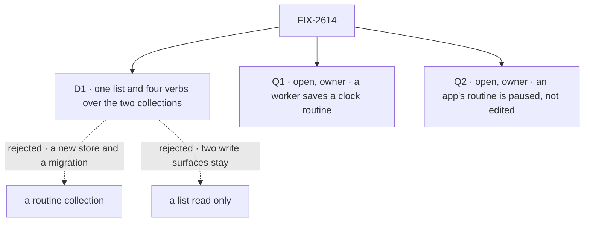

# FIX-2614 · Decisions

[Spec](SPEC.md) · **Decisions**

One decision and two owner forks are the sign-off. The owner's 2026-11-08 direction is an input.

## The tree

Solid edges are what you sign; dashed edges lost, for the reason on the label.

## D1 · One list and four verbs over the two collections; an event routine writes only through `subscribe` and `unsubscribe`

| | |
|---|---|
| **Instead of** | A routine collection that both triggers move into · a merged list read, with today's verbs kept |
| **Because** | Epic ER-5 makes `subscribe` and `unsubscribe` a subscription's only writers; FIX-2536 hangs its poll row on them. So pause is `unsubscribe` with reason `paused` (out of the index, poll row ended), and resume is `subscribe` again from the row, re-checking read access as the user (ER-4). A clock routine pauses on its `enabled`. A schedule's key is in its dispatch id (`schedules/keys.ts`): a new store migrates live fires |
| **Locks in** | Four public verbs and a `trigger: { clock } \| { event }` input. A routine id names its trigger (`clock:<key>`, `event:<subscription id>`). A third trigger is a third collection under the same verbs |

It comes down to ER-5's writers: a new store adds a third, and migrates every live fire.

**What would change my mind:** a third trigger that fits neither collection, with a fourth on the way.

## Open

### Q1 · Can a worker save a clock routine on its own, when you ask it to in a conversation?

- **In plain terms:** a worker can follow a PR for you, but only the app can set up recurring
  work. One tool set lets a worker do it when you say "every Monday".
- **The trade-off:** a routine from one sentence, against a model starting work that runs as
  you until someone stops it.
- **My recommendation: yes.** The same `saveRoutine`; the list names the worker as its maker;
  its tools change only routines that act through it.
- **What would change my mind:** an app whose users can't see the list.
- **If wrong:** a worker files a task every minute for someone who never opens Shift Manager.

It comes down to the conversation: "person only" sends the user to another screen.

### Q2 · Can a person edit or delete a routine the app declared?

- **In plain terms:** every user gets the app's routines. A deleted one, the next seed puts
  back; an edited one, the app's next change overwrites.
- **The trade-off:** one predictable rule, against changing what the app chose.
- **My recommendation: pause only.** The config owns the settings, so the app's fixes reach
  everyone and a pause survives them; save and delete refuse, naming why.
- **What would change my mind:** an app author asking for per-user overrides.
- **If wrong:** people stuck with a routine they can only pause.

It comes down to an app's fix: an edited copy never gets it.

<b>Decided, not asked</b> — engineering calls

## Decided, not asked

- **Names (EM call, 2026-11-08).** `listRoutines`, `saveRoutine`, `pauseRoutine` (one `paused`
  flag: resume differs only by it), `deleteRoutine`; `routineTools`; `LIST_ROUTINES_ACTION`,
  `listedRoutineSchema`. The implementation PR adds a *Routine* glossary entry retiring the old
  names and *recurring work* / *scheduled work*. *Schedule* stays the clock's word,
  *subscription* the event's.
- **No aliases (BP-034, as FIX-2479).** Stored keys, ids and fields stay (BP-030). Tested: a
  session whose history calls `subscribe` still takes a turn.
- **The list lives on the roster flow,** which keeps schedules and now declares
  `subscriptionResources`. Paused routines list; ended ones don't; FIX-2536's poll rows never do.
  A roster client must not read the org-scoped thread index, which holds other users'
  entries, through the collection routes: a test.
- **Reach.** Roster actions: all the user's routines. A worker's tools: its own (`not_yours`).
- **A person's event routine** names `worker`; the user's conversation with it hears, derived on
  the server, never from input (BP-031).
- **Endings read paused as live:** no resume for a failed task or closed thread.
- **One config surface (EM call, 2026-11-08):** `routines.declared`, owned here. An entry with
  an `owner` is seeded at startup for that owner (FIX-2536 D3 owns the mechanics); one without
  is seeded for each user when their roster session opens, so no roster, no seed. One key for
  both: FIX-2536's `cfg_<hash of flow kind and entry id>`, written only when missing or changed.
  Both write through `saveRoutine`'s writers (ER-5); an entry removed from config is ended at
  its next fire.
- **Cadence (FIX-2536 D3):** `everyMinutes` (5, 10, 15, 20, 30, 60, checked in code) on an
  event `saveRoutine`, passed to `subscribe`, and on config entries.
- **`madeBy`** on new rows, optional. **Shift Manager:** *Routines*, with pause and delete.

## Considered and dropped

| Alternative | Why not |
|---|---|
| A trigger × an action | FIX-2538 owns event-to-task |
| Static `schedules` for config routines | They run as the system, not as a user |

## Settled

None; read in the code. Retiring, by `grep -rn` over `packages/`, `apps/`, `goals/`:
`subscriptionTools`, `saveSchedule`, `listSchedules`, `deleteSchedule`, `LIST_SCHEDULES_ACTION`,
with `listedScheduleSchema` and `ListedSchedule`.

## Analysis

2026-11-08 · watermark FIX-2536 at 4d3d4ed · **Right approach, two forks raised.** Run by the
authoring worker (no sub-agent tool). Reuse: every Adds row composes. Prior art: GitHub
Actions' `on:`, Zapier. Other shapes: a routine store ([D1](#d1)), trigger × action. Necessity:
nothing lists subscriptions. Concern: a model starting recurring work ([Q1](#q1)).

## Notes from review

None yet.

## How it got here

- **Draft:** one name and four verbs over the two collections, event verbs through `subscribe`
  and `unsubscribe`, on the owner's 2026-11-08 direction.
- **Aligned with FIX-2536 D3 (EM calls, 2026-11-08):** one config surface, its `cfg_` key, cadence.
