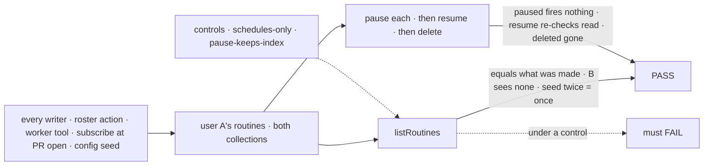
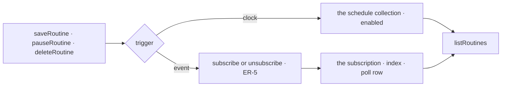

# FIX-2614 · Routines: one name, list and tools for work that fires on its own

**Spec** · [Decisions](DECISIONS.md)

## Six people, before and after

| Someone who… | Today | After |
|---|---|---|
| **wants to see what runs for them** | Shift Manager's *Scheduled work* lists clock work; subscriptions are listed nowhere | One *Routines* list, clock and event, each with who made it |
| **wants to stop one** | Clock: `deleteSchedule`. Event: only the conversation that subscribed | Pause, resume or delete any of theirs there; a resume re-checks read access |
| **asks a worker "every Monday, refresh the numbers"** | The worker can't | The worker saves a clock routine, listed as its own ([Q1](DECISIONS.md#q1)) |
| **declares routines in the app's config** | Static schedules run as the system, not a user | `routines.declared` seeds a named owner's at startup, or each user's on their roster session ([Q2](DECISIONS.md#q2)) |
| **builds on the packages** | `subscriptionTools`; `saveSchedule`, `listSchedules`, `deleteSchedule` | `routineTools`; `listRoutines`, `saveRoutine`, `pauseRoutine`, `deleteRoutine`. No aliases; stored data unchanged |
| **has a coding task following its PR** | A subscription, from FIX-2535's PR-open subscribe | The same, now a routine's event trigger |

The epic ([FIX-2471](../../epics/FIX-2471/SPEC.md)) gives this issue D5, D10 and ER-5;
FIX-2534 ([spec](../FIX-2534/SPEC.md)) the subscription it renames around.

## The goal, and how we'll know it's met

**A person sees every standing instruction that fires on its own as them, on a clock or on an
event, in one list, and creates, pauses, resumes and deletes any of them through the same four
verbs a worker uses, over the storage that exists today, with no old name left.**

| Is it the right goal? | |
|---|---|
| **The real need** | The issue's *"no one place to see or stop what is running for you"* (owner, 2026-11-08) |
| **Smaller, and rejected** | "A merged list read": two write surfaces stay, and an event routine still can't be paused |
| **Bigger, and not this issue's** | A trigger × action matrix · several triggers per routine · a create form · the poll and its startup seed (FIX-2536) |
| **Not done if** | A routine made by any writer is missing from the list · a paused one fires · a resume skips the read check · user B lists A's · a seed run twice makes two · a stored row from `main` stops listing or firing · an old name survives |



| How we verify | |
|---|---|
| **Goal check** | `goals/routines/one-list-for-what-runs-for-you/` · no model · fake clock and a stub GitHub provider · verdict on the implementation PR |
| **Signal** | (a) A's list equals the routines made through all four writers. (b) Paused: a due clock fire dispatches nothing; a routed event delivers nothing, and the thread index has no entry. (c) Resumed: both fire again; with read access revoked while paused, the resume is refused. (d) Deleted: not listed, nothing fires. (e) B lists none of A's. (f) Seeded twice: one routine; a config cron change reaches the row and keeps its pause. (g) A schedule and a subscription saved by `main`'s code list and fire |
| **Anti-game** | Assert on stored routines, dispatches and delivered messages, not on calls to the verbs |
| **Control that must fail** | `schedules-only` (the list reads one collection): (a). `pause-keeps-index`: (b). Today's `main`: no `listRoutines`, (a) |

## What changes


The verbs and the list are new; below the fence nothing moves ([D1](DECISIONS.md#d1)).

```diff
 // the app
-const { subscribe, unsubscribe } = subscriptionTools({ providers: [github] });
+const routines = routineTools({ providers: [github] });   // list, save, pause, delete
 hireWorkforce(installation, {
-  schedules: { index },
+  routines: { index, providers: [github], declared: [weeklyAdoption] },
 });

 // a person, through the roster flow, or a worker's turn, through its tools
-saveSchedule({ key: "adoption", cron: "0 9 * * 1", input: { filer: "launch", goal } })
+saveRoutine({ name: "adoption", trigger: { clock: { cron: "0 9 * * 1" } }, task: { filer: "launch", goal } })
-subscribe({ provider: "github", thread: "github:acme/api#412", kinds: ["review"], interest })
+saveRoutine({ trigger: { event: { provider: "github", thread: "github:acme/api#412", kinds: ["review"], interest } } })
+pauseRoutine({ id: "event:sub_…", paused: true })
```

`trigger.event` is today's `subscribe` input whole, so a field FIX-2537 or FIX-2538 adds lands
there unchanged. Shapes past the four names and `trigger` are illustrations.

**Docs.** In the change: `glossary.mjs` (a *Routine* entry), `mechanisms.yaml` (a routines
row; the subscriptions anchor). At release (`/release-docs`, from the changeset's `Docs:`
pointers): new `workforce/routines.md` after `messaging-workers`; *Recurring work* and the
subscribe section shrink to links; `shift-manager/overview.md`; both READMEs.

## How a verb reaches storage



**Stays:** both collections and keys, dispatch ids, the thread index, delivery, the screens,
and *subscription* as the event trigger's name.

## What's already here, and the debt

| Already here | What this does with it |
|---|---|
| **The job, "see and stop what runs as you".** Searched `mechanisms.yaml` (`schedule`, `subscriptions`), `packages/` for list, pause, enabled: `listSchedules` closest, clock only | **Replaced** by `listRoutines`, the one way |
| `saveSchedule`, `deleteSchedule` (`scheduled-work.ts` ~220–273) | **Renamed** into `saveRoutine`, `deleteRoutine`; checks unchanged |
| `subscriptionTools`, `subscribe`, `unsubscribe` (`subscribe.ts`) | **Tools renamed**; the two functions stay the writers |
| Static `schedules` (`core/src/types/schedules.ts`) | **Not used** for config: they run as a system principal |

| Adds | Composed from |
|---|---|
| `listRoutines` | `listSchedules`, plus the subscription collection the roster flow now declares |
| `pauseRoutine` | `enabled` on a schedule; `unsubscribe` and `subscribe` on an event |
| A person's event routine | `subscribe`, with the hearing session derived as a fire's is (`deriveWorkerSessionId`) |
| The config seed | `saveRoutine`'s writers, keyed `cfg_` as FIX-2536 D3 |
| The *Routines* screen | The *Scheduled work* screen, widened |

| The debt | |
|---|---|
| **Removes** | Five public names; a second way to write a standing instruction; a list that misses half |
| **Adds** | `paused` as an end reason a resume can undo. A `madeBy` field, optional (BP-030) |
| **Leaves** | Static `schedules` beside declared routines, permanent by design: one runs as the system, the other as a user |

**Net: down, a little.** Two write surfaces become one, and a second list never gets built.

## Sign off

**[The goal](#the-goal-and-how-well-know-its-met):** one list and four verbs over both
triggers. If wrong: a list people trust that misses what runs.

**[The debt](#whats-already-here-and-the-debt): down a little.** If wrong: the rename breaks
open branches for little gain.

1. **[D1](DECISIONS.md#d1) · One list and four verbs over the two collections; an event
   routine still writes only through `subscribe` and `unsubscribe`.** The one to weigh. If
   wrong: a routine store we then migrate into.

**Open, owner:** [Q1](DECISIONS.md#q1) · a worker may save a clock routine (recommended: yes) ·
[Q2](DECISIONS.md#q2) · an app's routine can be paused, not edited or deleted (recommended).

Feature · workforce, shift-manager · medium: four verbs, one screen, one seed, five names retired · epic FIX-2471
