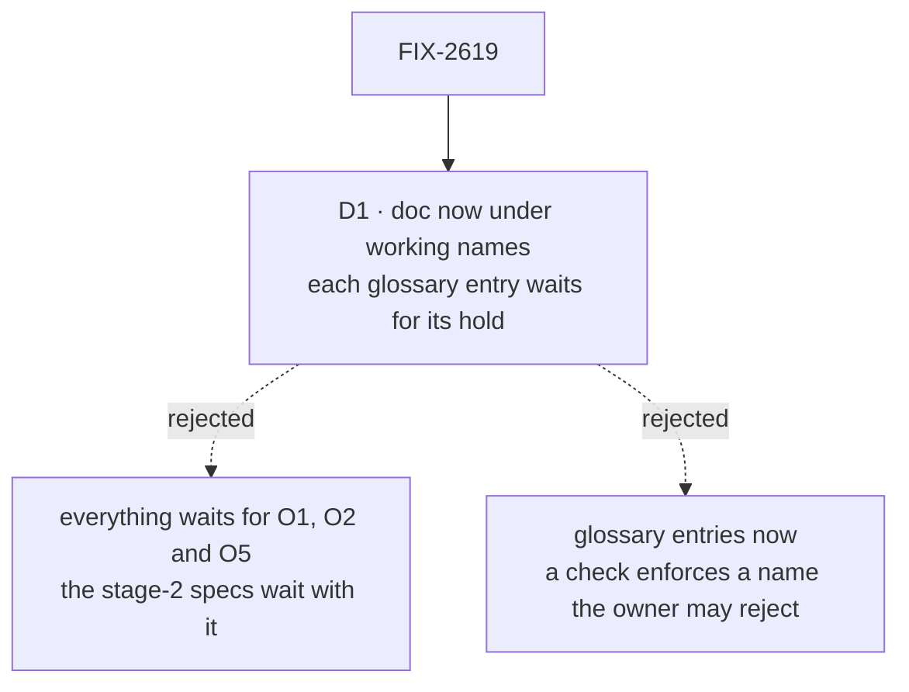

# FIX-2619 · Decisions

[Spec](SPEC.md) · **Decisions**

One decision is the sign-off surface: what lands now and what waits for the owner. The names
themselves are the epic's holds ([O1](../../epics/FIX-2618/DECISIONS.md#o1),
[O2](../../epics/FIX-2618/DECISIONS.md#o2), [O5](../../epics/FIX-2618/DECISIONS.md#o5)); this
issue carries them and decides none.

## The tree

Solid edges are what you're signing. Dashed edges lost, and the label says why.

## D1 · The concept doc and the architecture docs land now under the working names; each glossary entry and the objectives line wait for the hold that fixes them

| | |
|---|---|
| **Instead of** | Holding the whole issue until O1, O2 and O5 are answered · or adding every entry now, under the working names |
| **Because** | The stage-2 specs need the model, not the final words: a doc that says "kit (working name, O5)" serves them as well as one that says the answer. A glossary entry is different, because the checks enforce it: an entry for a name the owner then rejects is a rule CI applies to every PR until someone reverts it |
| **Locks in** | The concept doc may be renamed once after the owner answers, by the same child that edits the entry. The order the entries land in: "view" when O2 is answered; the unit's name and the narrowed FIX-2246 retire when O5 is; "slot" and the objectives line when O1 is. If O1 is "no kits", the unit and slot entries are never added and the objectives line stays as it is |

It comes down to the stage-2 specs: waiting on the owner holds them, not just the words.

**What would change my mind:** the owner answering O1, O2 and O5 before the doc is drafted.
Then it all lands in one PR and the split is moot.

## Decided, not asked

- **The concept doc lives in `docs/internal/design/`**, as `concept-doc` places it, and links
  the architecture docs rather than repeating them. The architecture docs describe today; the
  concept doc describes the target and the gap.
- **The "read" retire lands with the code that removes `reads`.** [ER-9](../../epics/FIX-2618/DECISIONS.md#who-owns-what)
  says "read" retires as the hook's name. Retiring it here would make the checks refuse
  `reads` on `main` before FIX-2623 removes it. So the "view" entry says that "read" retires,
  and FIX-2623 adds the matcher in the PR that deletes `reads` (the glossary's own rule: a
  change that retires a term edits its entry in the same PR). See the set's
  [epic amendments](../../epics/FIX-2618/DECISIONS.md#who-owns-what).
- **"Slot" keeps its block sense.** `ToolsSlot`, `UsesSlot` and the context slot are a typed
  place a block's author fills; a kit's slot is a typed place one kit publishes and another
  fills. Same idea, one level up. The entry says so and retires nothing.
- **"View" is retired in the hook's sense only.** `readTaskView`, "derived views" in prose and
  FIX-2092's loose use stay: a view is an English word, and a `reach: "meaning"` retire of it
  would refuse ordinary prose.
- **The narrowed FIX-2246 retire keeps refusing the session-factory sense** ("filing kit",
  "session kit", "task-filing kit", "manager kit") and drops the bare `the kit` and `kit.x`,
  which are the new unit's ordinary spelling.
- **Each stage-2 child that changes a part of the model edits that part of the concept doc in
  its own PR**, as it edits its own glossary entry ([seams](../../epics/FIX-2618/DECISIONS.md#coordination-seams)).

## Considered and dropped

| Alternative | Why not |
|---|---|
| Write the model into `docs/architecture/` directly | The architecture docs describe what the code does. A target model there reads as shipped, which is the outsider rule's failure inside the contributor tree |
| A Claude Docs living doc instead of a file | Stage-2 specs must link a path on `main`; a living doc is outside the repository's review |
| Retire "view" in every sense, so the hook owns the word | Refuses the ordinary word in code comments and pages for no gain |

## Analysis

2026-11-09 · watermark 2026-11-08 (the epic's analysis) · **Right approach.** Run over the
whole set by the spec-set author; see the set PR.

1. **Reuse** — extends the glossary and the existing architecture docs; the concept doc is the
   one new file, and nothing else explains the model ([Builds on / Adds](SPEC.md#whats-already-here-and-the-debt)).
2. **Prior art** — `concept-doc`'s own exemplar sets the bar; nothing outside the repo applies.
3. **Other shapes** — wait for the owner; add entries now. Both in *Considered* above and D1.
4. **New factors** — FIX-2600's glossary is live and its checks read every entry, which is
   what makes adding entries early costly (D1).
5. **Necessity** — earns its place: four stage-2 specs read it.
6. **Ergonomics** — nothing for an app author; one doc for a spec author.
7. **Concerns** — the "slot" collision, recorded in *Decided, not asked*.

## How it got here

- **Draft (2026-11-09)** — written in the stage-1 spec set, against the merged epic spec.
- **Set review** — the "read" retire moved to FIX-2623's PR, with an epic amendment to ER-9's
  wording; "slot" found to collide with the block config sense, kept and defined.

**Open: none of this issue's own.**
