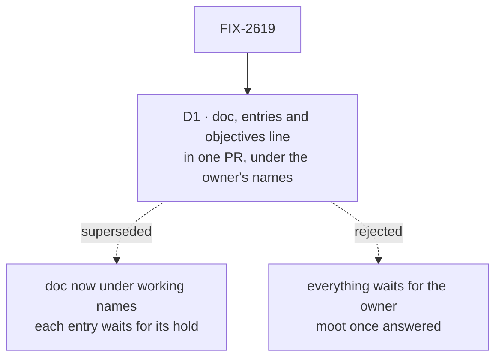

# FIX-2619 · Decisions

[Spec](SPEC.md) · **Decisions**

One decision is the sign-off surface: when the doc and the names land. The names themselves
were the epic's holds ([O1](../../epics/FIX-2618/DECISIONS.md#o1),
[O2](../../epics/FIX-2618/DECISIONS.md#o2), [O5](../../epics/FIX-2618/DECISIONS.md#o5)), all
decided by the owner on 2026-11-10; this issue writes them down and decides none.

## The tree

Solid edges are what you're signing. Dashed edges lost, and the label says why.

## D1 · The concept doc, the architecture docs, the glossary entries and the objectives line land in one PR, under the owner's names

| | |
|---|---|
| **Instead of** | The stage-1 call: the doc now under the working names, each glossary entry and the objectives line waiting for the hold that fixes it · or holding the whole issue for the owner |
| **Because** | The owner answered O1, O2 and O5 before the doc was drafted, which was the stage-1 call's own flip condition. A split now would only rename the doc once for answers already given. CI still enforces only answered names |
| **Locks in** | "view", "kit" and "slot" land with the concept doc, with the narrowed FIX-2246 retire (it keeps the session-factory names and drops `the kit`, `const kit` / `this kit` and `kit.x`) and the objectives non-goal line. The check that refuses "read" as the hook's name stays with FIX-2623 ([ER-9](../../epics/FIX-2618/DECISIONS.md#who-owns-what)) |

It comes down to renames: with every answer in, a split buys nothing but one.

**What would change my mind:** the owner reopening O1, O2 or O5 before this merges. Then that
entry waits for the new answer, as the stage-1 call had it.

## Decided, not asked

- **The concept doc lives in `docs/internal/design/`**, as `concept-doc` places it, and links
  the architecture docs rather than repeating them. The architecture docs describe today; the
  concept doc describes the target and the gap.
- **The "read" retire lands with the code that removes `reads`.** [ER-9](../../epics/FIX-2618/DECISIONS.md#who-owns-what)
  says "read" retires as the hook's name. Retiring it here would make the checks refuse
  `reads` on `main` before FIX-2623 removes it. So the "view" entry says that "read" retires,
  and FIX-2623 adds the matcher in the PR that deletes `reads` (the glossary's own rule: a
  change that retires a term edits its entry in the same PR). See the set's
  [epic amendments](../../epics/FIX-2618/DECISIONS.md#who-owns-what).
- **"Slot" keeps its block sense.** `ToolsSlot`, `UsesSlot` and the context slot are a typed
  place a block's author fills; a kit's slot is a typed place only its owning kit declares, with
  a schema and a merge policy, and other kits fill. Same idea, one level up. The entry says so
  and retires nothing.
- **"View" is retired in the hook's sense only.** `readTaskView`, "derived views" in prose and
  FIX-2092's loose use stay: a view is an English word, and a `reach: "meaning"` retire of it
  would refuse ordinary prose.
- **The narrowed FIX-2246 retire keeps refusing the session-factory sense** ("filing kit",
  "session kit", "task-filing kit", "manager kit") and drops the other three alternatives of
  today's pattern (`glossary.mjs`, the `session-factory` retire): `the kit`, `const kit` /
  `this kit`, and `kit.x`, which are the new unit's ordinary spelling.
- **Each stage-2 child that changes a part of the model edits that part of the concept doc in
  its own PR**, as it edits its own glossary entry ([seams](../../epics/FIX-2618/DECISIONS.md#coordination-seams)).

## Considered and dropped

| Alternative | Why not |
|---|---|
| Write the model into `docs/architecture/` directly | The architecture docs describe what the code does. A target model there reads as shipped, which is the outsider rule's failure inside the contributor tree |
| A Claude Docs living doc instead of a file | Stage-2 specs must link a path on `main`; a living doc is outside the repository's review |
| Retire "view" in every sense, so the hook owns the word | Refuses the ordinary word in code comments and pages for no gain |

## Analysis

2026-11-09 · watermark 2026-11-08 (the epic's analysis) · **Right approach.** Run over the
whole set by the spec-set author; see the set PR.

1. **Reuse** — extends the glossary and the existing architecture docs; the concept doc is the
   one new file, and nothing else explains the model ([Builds on / Adds](SPEC.md#whats-already-here-and-the-debt)).
2. **Prior art** — `concept-doc`'s own exemplar sets the bar; nothing outside the repo applies.
3. **Other shapes** — wait for the owner; add entries now. Both in *Considered* above and D1.
4. **New factors** — FIX-2600's glossary is live and its checks read every entry, which is
   what makes adding entries early costly (D1).
5. **Necessity** — earns its place: four stage-2 specs read it.
6. **Ergonomics** — nothing for an app author; one doc for a spec author.
7. **Concerns** — the "slot" collision, recorded in *Decided, not asked*.

## How it got here

- **Draft (2026-11-09)** — written in the stage-1 spec set, against the merged epic spec.
- **Set review** — the "read" retire moved to FIX-2623's PR, with an epic amendment to ER-9's
  wording; "slot" found to collide with the block config sense, kept and defined.
- **Owner decisions (2026-11-10)** — amended in the epic's follow-up PR from `main` (this spec
  merged in #4986). The owner answered O1, O2 and O5, so D1 flips to one PR; the doc's kit part
  now describes the kit system, workforce's schema on top, slots, React components and placement.

**Open: none.**
