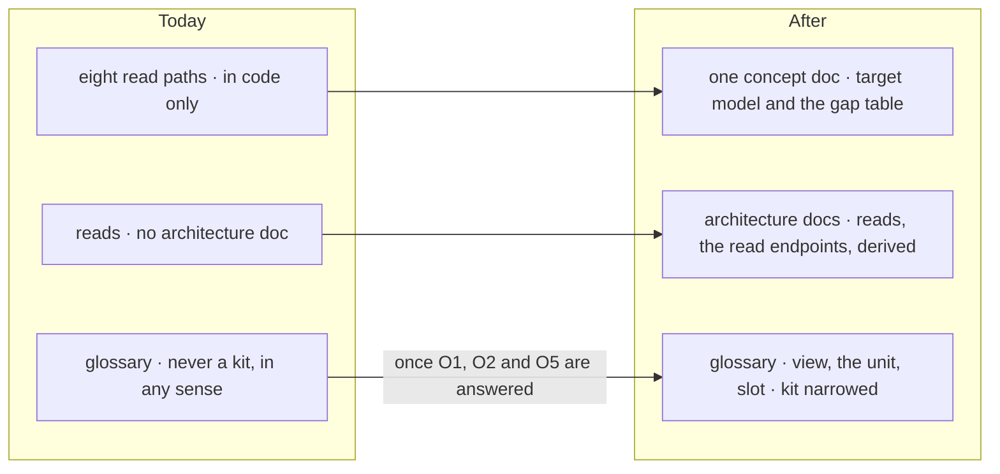

# FIX-2619 · One concept doc for reading, writing and installing a feature, with the glossary entries it needs

**Spec** · [Decisions](DECISIONS.md)

## Five people, before and after

| Someone who… | Today | After |
|---|---|---|
| **writes a stage-2 spec** in [FIX-2618](../../epics/FIX-2618/SPEC.md) (views, resources by scope, kits) | Reads eight read paths in code and four specs to learn how a client reads and writes today, and guesses at the target | Reads one concept doc: the target model, built up one part at a time, with a table of where today's code differs |
| **wants to know how a flow `read` works** | Finds no architecture section for it, and the endpoint table omits its route | Finds both in `docs/architecture/`, matching the code on `main` |
| **reads `resources-and-client-data.md`** | Is told scope `derived` is *the* way to show server data, with no word about `reads` | Reads what is true today, with the two hooks side by side and a pointer to the concept doc |
| **names a new public thing** in the epic | Finds no entry for view or slot, and the FIX-2246 entry refuses `the kit` and `kit.x` everywhere | Finds entries for view, the unit and slot once the owner has answered the holds that fix them ([D1](DECISIONS.md#d1)) |
| **reads the objectives' non-goals** | Reads "Plugin/extension ecosystem" and concludes any installable unit is out | Reads that a third-party ecosystem is out and FSD's own unit is in, once [O1](../../epics/FIX-2618/DECISIONS.md#o1) is answered |

Stage-2 specs written against four private readings of an unwritten model drift apart.

## The goal, and how we'll know it's met

**Someone who has never read the code can explain, from one doc, how an app on FSD reads,
writes, stays current and installs a feature, and the words they use are the glossary's.**

| Is it the right goal? | |
|---|---|
| **The real need** | [FIX-2618](../../epics/FIX-2618/SPEC.md#whats-in-the-box): "the concept doc first, and the architecture docs it names", and [ER-9](../../epics/FIX-2618/DECISIONS.md#who-owns-what): names land before code |
| **Smaller, and rejected** | "Add the glossary entries." The names land, but nobody can say how views, resources by scope, notices and kits fit together, which is what the stage-2 specs need |
| **Bigger, and not this issue's** | User docs for any of it. They are written at release by `/release-docs`, from what shipped ([FIX-2626](https://linear.app/fixpoint-labs/issue/FIX-2626)'s changeset carries the story) |
| **Not done if** | The cold reader gets a scenario wrong, or guesses at a term · a glossary entry fixes a name whose hold is still open · the architecture docs still describe `derived` as the one way to show server data · the narrowed FIX-2246 entry stops refusing "session kit" |

**No goal check:** contributor docs, and `goals/` checks running behaviour. The proof is the
[`concept-doc`](../../../.agents/skills/concept-doc/SKILL.md) cold read: a fresh sub-agent
with only the doc lists the parts in order and answers six scenario questions, two of them
edge cases (an org resource two users write; a view whose dependency changes while its screen
is closed). The control is the vocabulary sweep: once the FIX-2246 entry is narrowed, a planted
"session kit" in a published page must still fail it, and a planted `kit.slots` must pass.

## What changes

The first two rows land as soon as they are written; the third waits for the owner, entry by
entry ([D1](DECISIONS.md#d1)).

**The doc's parts**, in the order the doc builds them: a view (a read with a scope, its
dependencies and keyed rows) · a resource read by scope, with no session · a write through
the resource's flow (`runBy`, the default write flow) · a notice and what it may carry · a
kit, its two halves and its slots · what the app writes itself. One cast throughout: Alice
and Bob, a "pins" resource, a "board" view, and the workforce kit.

**Docs:** create `docs/internal/design/reading-writing-installing.md` (the concept doc).
Update `docs/architecture/flows-and-actions.md` (a `reads` section),
`docs/architecture/server-and-client.md` (the read route, which its endpoint table omits) and
`docs/architecture/resources-and-client-data.md` (the stale client-data lines). Edit
`docs/contributing/glossary.mjs` and `docs/objectives.md` as [D1](DECISIONS.md#d1) times
them. No user docs.

## What stays as it is

- Every published page and README. The concept doc is design history until the code ships.
- The glossary's checks and their walk. This adds and narrows entries; it changes no matcher.
- The epic's decisions. The doc describes them; it decides nothing ([ER-9](../../epics/FIX-2618/DECISIONS.md#who-owns-what)).

## What's already here, and the debt

| Already here | What this does with it |
|---|---|
| [FIX-2286 D1](../FIX-2286/DECISIONS.md#d1): flow `reads`, "the one hook for watching a computed view" | **Builds on.** Documented as it is today, and as the view the epic proposes ([O2](../../epics/FIX-2618/DECISIONS.md#o2)) |
| The glossary entry "Session factory… Never a kit" ([FIX-2246](https://linear.app/fixpoint-labs/issue/FIX-2246)) | **Amended**, once [O5](../../epics/FIX-2618/DECISIONS.md#o5) answers "kit": the retire keeps "filing / session / task-filing / manager kit" and drops `the kit` and `kit.x` |
| The objectives non-goal "Plugin/extension ecosystem" | **Amended**, once [O1](../../epics/FIX-2618/DECISIONS.md#o1) is answered: the third-party ecosystem stays out |
| The word "slot" already names a block's config field (`ToolsSlot`, `UsesSlot`, the context slot, BP-017) | **Leaves alone.** The new entry defines a kit's slot and names the block sense as the same idea one level down ([decided](DECISIONS.md#decided-not-asked)) |
| `docs/internal/design/harness-shared-kit.md` uses "kit" for a shared harness floor | **Leaves alone.** An internal design note; the narrowed entry reads code and published pages only |
| Anything else that explains the client read and write model | **None.** Searched `docs/architecture/`, `docs/internal/design/` and `docs/atlas/` for `reads`, `clientData`, `derived`, `subscribe`: each covers one path |

| Adds | Existing piece considered | Why it doesn't fit / how composed |
|---|---|---|
| One concept doc | `resources-and-client-data.md`, `state-and-scopes.md` | Each covers one path, and both describe today, not the target. The concept doc links them rather than copying |
| Glossary entries: view, the unit, slot | The existing entries | **Extends** the glossary in its own format; no new mechanism |

| The debt | |
|---|---|
| **Removes** | The stale lines that call `derived` the way to expose server data; the missing `reads` section and endpoint table |
| **Adds** | A concept doc that goes stale if stage 2 changes the model without editing it. Each stage-2 child that changes a part edits its section in its own PR (the [glossary seam](../../epics/FIX-2618/DECISIONS.md#coordination-seams) rule, applied to the doc) |
| **Leaves** | The loose "view" in [FIX-2092](https://linear.app/fixpoint-labs/issue/FIX-2092) and `readTaskView`. Not retired here: a view is an English word, and the entry fixes the hook's sense only |

**Net: down.** Three stale or missing architecture sections are fixed; one design doc is added.

## Sign off

**[The goal](#the-goal-and-how-well-know-its-met), at that size:** a cold reader explains the
whole model from one doc, in the glossary's words. If wrong: the stage-2 specs drift, or
this holds them while it chases a polish nobody needs.

**[The debt](#whats-already-here-and-the-debt), net down:** three architecture sections fixed,
one design doc added. If wrong: a concept doc nobody updates when stage 2 moves.

1. **[D1](DECISIONS.md#d1) · The concept doc and architecture docs land now under the working
   names; each glossary entry and the objectives line wait for the hold that fixes them.**
   If wrong: the specs read a doc whose names change under them, or wait weeks for words.

**Open: none of this issue's own.** It carries the epic's [O1](../../epics/FIX-2618/DECISIONS.md#o1),
[O2](../../epics/FIX-2618/DECISIONS.md#o2) and [O5](../../epics/FIX-2618/DECISIONS.md#o5) and decides none of them.

Improvement · docs · contributor docs only · medium · epic [FIX-2618](../../epics/FIX-2618/SPEC.md) stage 1
